# BÁO CÁO PHÂN TÍCH GIAO DIỆN WEB & ĐẶC TẢ CÁC CHỨC NĂNG CHÍNH (QUÉT TRỰC TIẾP `http://localhost:8088`)

**Môi trường quét thực tế:** `http://localhost:8088` (Docker/Nginx Web Frontend kết nối Backend & CSDL thật)  
**Tài khoản kiểm chứng thực tế:**
- **Admin chính:** `0901000000` (`ACCOUNT.id = 1` — *Quản Trị Viên Hệ Thống*)
- **Teacher chính:** `0902000001` (`TeacherProfile.id = 1` — *Thầy Giáo Test Toàn Năng*)

**Nguyên tắc lập báo cáo:**
- 100% ảnh giao diện là **ảnh chụp màn hình thật (`.png`)** trực tiếp từ trình duyệt trên `http://localhost:8088` (29 ảnh gồm cả màn hình chính, bộ lọc và modal).
- 100% danh sách thành phần điều khiển, giá trị mặc định, trạng thái `disabled` và số liệu ghi nhận đều lấy đúng từ DOM hiển thị thực tế kết hợp đối chiếu mã nguồn `Web_Frontend/src/` và `Backend/ToanTuDuy/`.
- Mọi bảng đều kèm theo **khối CSV copy trực tiếp** và được xuất thành 3 tệp `.csv` chuẩn RFC-4180 (UTF-8 BOM) tại thư mục `./csv/`.
- Toàn bộ sơ đồ xử lý là **Sơ đồ hoạt động (UML Activity Diagram)**.

## Khung giao diện dùng chung (Layout Shell ghi nhận thực tế)
- **Sidebar trái:** Cổng Admin (`EduAdmin · Quản Trị Hệ Thống`) và Cổng Teacher (`EduTeacher · Cổng Giáo Viên`) gồm các nhóm menu accordion và nút `Đăng xuất`.
  - *Lỗi hiển thị ghi nhận thực tế:* Khi truy cập trực tiếp bằng URL hoặc chuyển sang các route con, mục `Tổng quan` vẫn giữ nền cam active và các nhóm accordion khác không tự mở rộng theo route hiện tại.
- **Header trên:** Nút `Thu gọn / Mở rộng sidebar`, Tiêu đề trang (`<h1>`), Đồng hồ thời gian thực, Nút chuông `Thông báo`, Thẻ thông tin tài khoản và nút `Mở menu tài khoản`.

## Mục lục 22 chức năng chính đã quét thực tế

| Mã CN | Tên chức năng | Cổng | URL thực tế | Ảnh chụp thực tế |
| :--- | :--- | :--- | :--- | :--- |
| **CN01** | Đăng nhập hệ thống | Công khai | `/login` | `01-login.png` |
| **CN02** | Tổng quan hệ thống (Dashboard Quản trị) | Admin | `/` | `02-dashboard.png` |
| **CN03** | Quản lý Phụ huynh & Học sinh | Admin | `/users/students` | `03-users-students.png` |
| **CN04** | Quản lý Giáo viên | Admin | `/users/teachers` | `04-users-teachers.png` |
| **CN05** | Quản lý Tài khoản & Bảo mật | Admin | `/users/roles` | `05-users-roles.png` |
| **CN06** | Quản lý Danh mục Khóa học | Admin | `/training/courses` | `06`, `06b`, `06c` |
| **CN07** | Quản lý Lớp học & Chi tiết Lớp học | Admin | `/training/classes`, `/training/classes/6` | `07`, `07b` |
| **CN08** | Quản lý Lịch học & Thời khóa biểu | Admin | `/training/schedule` | `08-training-schedule.png` |
| **CN09** | Quản lý Hóa đơn & Biên lai học phí | Admin | `/finance/invoices` | `09`, `09b` |
| **CN10** | Quản lý Bảng lương Giáo viên | Admin | `/finance/payroll` | `10-finance-payroll.png` |
| **CN11** | Quản lý & Gửi Thông báo hệ thống | Admin | `/communication/notifications` | `11`, `11b` |
| **CN12** | Báo cáo Doanh thu | Admin | `/reports/revenue` | `12-reports-revenue.png` |
| **CN13** | Tổng quan Giáo viên (Dashboard Teacher) | Teacher | `/teacher` | `13-teacher-dashboard.png` |
| **CN14** | Thời khóa biểu cá nhân | Teacher | `/teacher/schedule` | `14-teacher-schedule.png` |
| **CN15** | Lớp học đang phụ trách | Teacher | `/teacher/classes` | `15-teacher-classes.png` |
| **CN16** | Danh sách học sinh theo lớp | Teacher | `/teacher/students` | `16-teacher-students.png` |
| **CN17** | Điểm danh học viên & Duyệt đơn xin nghỉ | Teacher | `/teacher/attendance` | `17-teacher-attendance.png` |
| **CN18** | Quản lý Ngân hàng câu hỏi & AI Import | Teacher | `/teacher/questions` | `18`, `18b` |
| **CN19** | Tạo & Giao bài tập về nhà | Teacher | `/teacher/assignments` | `19`, `19b` |
| **CN20** | Chấm điểm & Nhập nhận xét | Teacher | `/teacher/grading` | `20-teacher-grading.png` |
| **CN21** | Chat trực tuyến với Phụ huynh | Teacher | `/teacher/communication/chat` | `21-teacher-chat.png` |
| **CN22** | Phiếu lương cá nhân | Teacher | `/teacher/payslip` | `22-teacher-payslip.png` |

---

## Chức năng 01: Đăng nhập hệ thống

### Mục đích
Xác thực người dùng nội bộ (`Admin`, `Teacher`) truy cập cổng Web bằng Số điện thoại + Mật khẩu (hoặc Google OAuth khi đã cấu hình `VITE_GOOGLE_CLIENT_ID`), lưu JWT token và thông tin phiên vào `sessionStorage`, rồi điều hướng đến phân hệ tương ứng.

### Giao diện
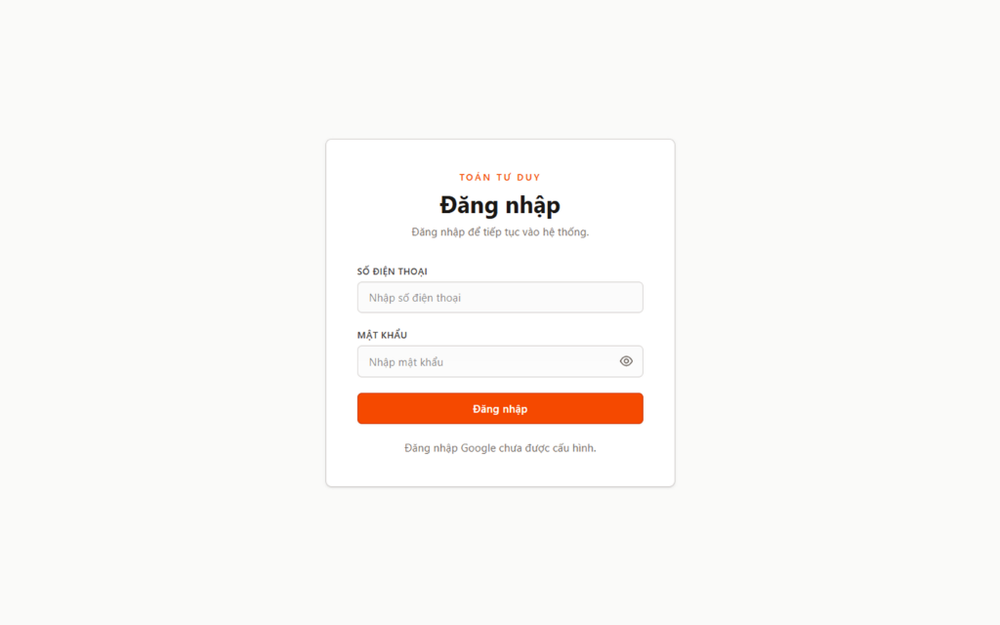

### Các thành phần trong giao diện

| STT | Loại điều khiển | Giá trị mặc định | Lưu ý |
| :--- | :--- | :--- | :--- |
| 1 | Textbox (`input type="tel"`, `#phone`) | Rỗng (`""`) | Nhãn `SỐ ĐIỆN THOẠI`, placeholder `Nhập số điện thoại`, `required`, `maxlength="12"`, khớp regex `(\+84\|0)[0-9]{9}`, tự trim khoảng trắng. |
| 2 | Textbox (`input type="password"`, `#password`) | Rỗng (`""`) | Nhãn `MẬT KHẨU`, placeholder `Nhập mật khẩu`, `required`, `maxlength="128"`. |
| 3 | Icon Button (`button`, `aria-label="Hiện mật khẩu"`) | Đang ẩn mật khẩu | Bấm để đảo giữa `type="password"` và `type="text"`, cập nhật `aria-pressed`. |
| 4 | Primary Button (`button type="submit"`) | `"Đăng nhập"` | Khóa (`disabled`) và đổi thành `"Đang đăng nhập..."` khi đang gửi yêu cầu đăng nhập. |
| 5 | Label / Google Sign-In Area | `"Đăng nhập Google chưa được cấu hình."` | Quét thực tế tại `:8088` chưa cấu hình `VITE_GOOGLE_CLIENT_ID` nên chỉ hiện text thông báo thay vì nút Google OAuth; không có liên kết "Quên mật khẩu". |

**Copy CSV (Thành phần giao diện CN01):**
```csv
STT,Loại điều khiển,Giá trị mặc định,Lưu ý
1,"Textbox (input type=tel, #phone)","(Rỗng)","Nhãn SỐ ĐIỆN THOẠI, placeholder Nhập số điện thoại, required, maxlength=12, regex (\+84|0)[0-9]{9}."
2,"Textbox (input type=password, #password)","(Rỗng)","Nhãn MẬT KHẨU, placeholder Nhập mật khẩu, required, maxlength=128."
3,"Icon Button (Hiện/Ẩn mật khẩu)","Ẩn mật khẩu","Chuyển đổi type password/text, cập nhật aria-label và aria-pressed."
4,"Primary Button (submit)","Đăng nhập","Khóa (disabled) và đổi chữ thành Đang đăng nhập... trong lúc gọi API."
5,"Google Sign-In / Thông báo trạng thái","Đăng nhập Google chưa được cấu hình.","Thực tế trên :8088 chưa cấu hình VITE_GOOGLE_CLIENT_ID; chưa có tính năng Quên mật khẩu."
```

### Dữ liệu được sử dụng

| STT | Tên bảng / Cấu trúc dữ liệu | Thêm | Sửa | Xóa | Truy vấn |
| :--- | :--- | :---: | :---: | :---: | :---: |
| 1 | `ACCOUNT` (`ApplicationUser`) | | X | | X |
| 2 | `ADMIN_PROFILE` (`AdminProfile`) | | | | X |
| 3 | `TEACHER_PROFILE` (`TeacherProfile`) | | | | X |
| 4 | `sessionStorage` (`toanTuDuy.accessToken`, `role`, `profileId`) | X | X | X | X |

**Copy CSV (Dữ liệu sử dụng CN01):**
```csv
STT,Tên bảng / Cấu trúc dữ liệu,Thêm,Sửa,Xóa,Truy vấn
1,ACCOUNT (ApplicationUser),,X,,X
2,ADMIN_PROFILE (AdminProfile),,,,X
3,TEACHER_PROFILE (TeacherProfile),,,,X
4,"sessionStorage (accessToken, role, profileId)",X,X,X,X
```

### Cách xử lý
1. Người dùng mở `http://localhost:8088/login`, nhập Số điện thoại và Mật khẩu rồi nhấn **Đăng nhập**.
2. Client kiểm tra hợp lệ (`validatePhone`, `validateTextLength`), khóa nút và gửi `POST /api/auth/login`.
3. Backend xác thực mật khẩu, trạng thái `is_active`, trả về JWT Token, vai trò và `profileId`.
4. Client kiểm tra vai trò thuộc `{admin, teacher}`, lưu phiên vào `sessionStorage` và chuyển hướng: `admin` → `/`, `teacher` → `/teacher`.

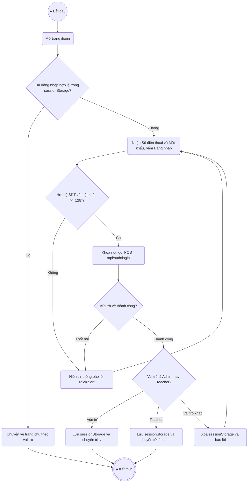

### Hàm/ sự kiện
```text
HÀM handleSubmit():
    errorMessage ← ""
    NẾU KHÔNG validatePhone(phone, required=true) THÌ gán errorMessage; THOÁT
    NẾU KHÔNG validateTextLength(password, required=true, max=128) THÌ gán errorMessage; THOÁT
    isSubmitting ← true
    THỬ:
        session ← GỌI authService.login({ phone, password })
        router.replace(session.role == "Admin" ? { name: "dashboard" } : { name: "teacher-dashboard" })
    BẮT_LỖI err:
        errorMessage ← err.response.data.message hoặc thông báo mặc định
    CUỐI_CÙNG:
        isSubmitting ← false
```

### Các ràng buộc
- Chỉ cho phép vai trò `Admin` và `Teacher` đăng nhập trên Web (`Parent` bị từ chối và xóa phiên).
- Phiên đăng nhập chỉ lưu tại `sessionStorage` (đóng tab tự đăng xuất); đổi `SecurityStamp` làm mất hiệu lực JWT cũ ngay lập tức.
- *Tham chiếu:* `Web_Frontend/src/views/LoginView.vue`, `Document/Review/Frontend/01-Router-Shell-Va-Phan-Quyen.md`.

---

## Chức năng 02: Tổng quan hệ thống (Dashboard Quản trị)

### Mục đích
Hiển thị bảng điều khiển tổng quan cho Admin gồm 4 chỉ số KPI tài chính/học viên/hội thoại, biểu đồ so sánh doanh thu – quỹ lương 6 tháng, biểu đồ phân bổ học viên theo lớp, top 5 phiếu lương tháng hiện tại và danh sách tin nhắn phụ huynh cần phản hồi.

### Giao diện
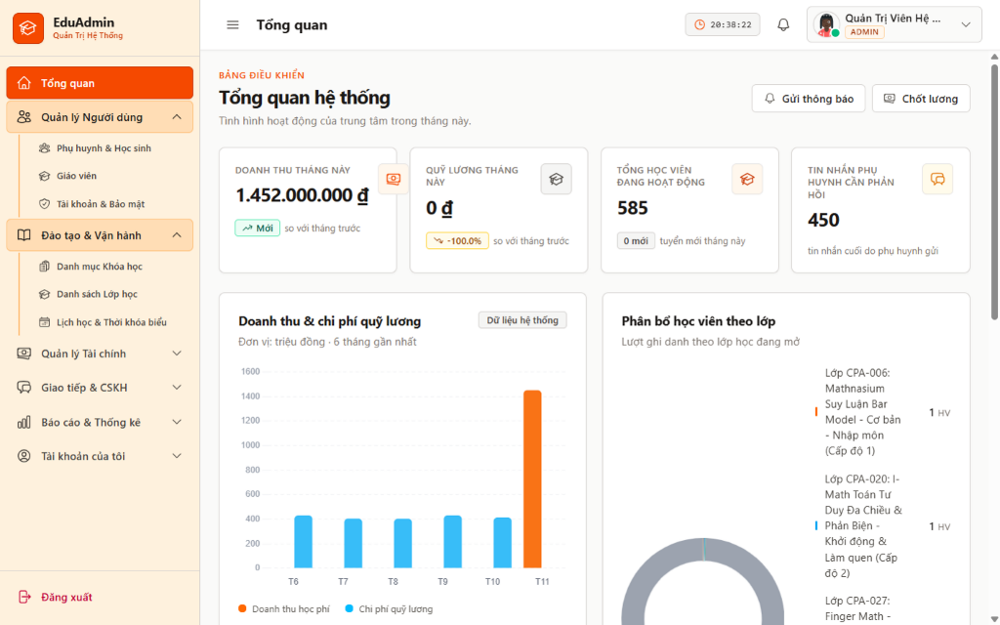

### Các thành phần trong giao diện

| STT | Loại điều khiển | Giá trị mặc định | Lưu ý |
| :--- | :--- | :--- | :--- |
| 1 | Navigation Link/Button | `"Gửi thông báo"` | Điều hướng sang `/communication/notifications`. |
| 2 | Navigation Link/Button | `"Chốt lương"` | Điều hướng sang `/finance/payroll`. |
| 3 | KPI Stat Cards (`4 thẻ`) | Quét thực tế: Doanh thu `1.452.000.000 ₫`, Quỹ lương `0 ₫ (-100.0%)`, Học viên hoạt động `585`, Tin nhắn chờ `450` | Mỗi thẻ hiển thị chỉ số chính, icon và nhãn so sánh với tháng trước. |
| 4 | Bar Chart (`vue-chartjs`) | 6 tháng (`T6`–`T11`), đơn vị triệu đồng | So sánh Doanh thu học phí (cột cam) và Chi phí quỹ lương (cột xanh dương); có nhãn `Dữ liệu hệ thống`. |
| 5 | Doughnut Chart & Legend | `Tổng lượt ghi danh: 794` | Liệt kê từng lớp đang mở bên cạnh biểu đồ tròn; *ghi nhận thực tế: danh sách legend dài làm tràn dọc phía trên biểu đồ tròn*. |
| 6 | Data Table (`Phiếu lương tháng này`) & Link `Xem tất cả` | 5 dòng giáo viên (`0 ₫ · Chưa gửi`) | Link `Xem tất cả` chuyển sang `/finance/payroll`. |
| 7 | List Widget (`Tin nhắn phụ huynh cần phản hồi`) | Badge `450 hội thoại` | Hiển thị các hội thoại gần nhất có tin nhắn cuối do phụ huynh gửi. |

**Copy CSV (Thành phần giao diện CN02):**
```csv
STT,Loại điều khiển,Giá trị mặc định,Lưu ý
1,Navigation Link/Button,Gửi thông báo,Điều hướng sang /communication/notifications.
2,Navigation Link/Button,Chốt lương,Điều hướng sang /finance/payroll.
3,KPI Stat Cards (4 thẻ),"Doanh thu 1.452.000.000 đ; Quỹ lương 0 đ; Học viên 585; Tin nhắn chờ 450",Hiển thị 4 chỉ số vận hành cốt lõi tháng hiện tại.
4,Bar Chart (vue-chartjs),6 tháng (T6-T11),So sánh Doanh thu học phí và Chi phí quỹ lương (triệu đồng).
5,Doughnut Chart & Legend,Tổng lượt ghi danh: 794,"Phân bổ học viên theo lớp; thực tế legend nhiều lớp dài làm đẩy biểu đồ xuống dưới."
6,"Data Table & Link Xem tất cả","5 dòng giáo viên (0 đ, Chưa gửi)",Link Xem tất cả mở /finance/payroll.
7,List Widget (Hội thoại phụ huynh),450 hội thoại,Hiển thị các hội thoại mới nhất có tin nhắn cuối từ phụ huynh.
```

### Dữ liệu được sử dụng

| STT | Tên bảng / Cấu trúc dữ liệu | Thêm | Sửa | Xóa | Truy vấn |
| :--- | :--- | :---: | :---: | :---: | :---: |
| 1 | `INVOICE` (`Invoice`) | | | | X |
| 2 | `CLASS_STUDENT` & `CLASSES` | | | | X |
| 3 | `PAYROLL_SUMMARY` & `TEACHER_PROFILE` | | | | X |
| 4 | `CONVERSATION`, `MESSAGE` & `PARENT_PROFILE` | | | | X |

**Copy CSV (Dữ liệu sử dụng CN02):**
```csv
STT,Tên bảng / Cấu trúc dữ liệu,Thêm,Sửa,Xóa,Truy vấn
1,INVOICE (Invoice),,,,X
2,CLASS_STUDENT & CLASSES,,,,X
3,PAYROLL_SUMMARY & TEACHER_PROFILE,,,,X
4,"CONVERSATION, MESSAGE & PARENT_PROFILE",,,,X
```

### Cách xử lý
1. Khi mount `/`, hệ thống gọi song song 4 nhóm API (`revenue`, `students`, `payroll`, `chat`) với cờ loading và thông báo lỗi tách biệt theo từng nguồn.
2. Tổng hợp dữ liệu vào 4 thẻ KPI, 2 biểu đồ `vue-chartjs`, bảng Top 5 phiếu lương và danh sách hội thoại phụ huynh chưa được phản hồi.

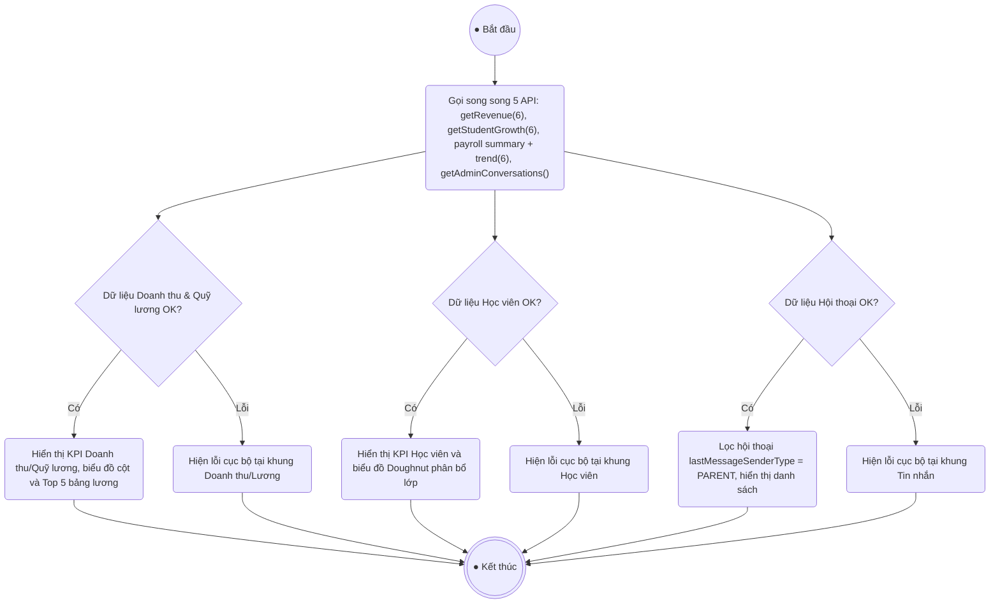

### Hàm/ sự kiện
```text
HÀM onMounted():
    Chạy độc lập 4 luồng tải (revenue, students, payroll, chat)
    Mỗi luồng cập nhật sourceLoading[k], bắt lỗi vào dashboardErrors[k] để không ảnh hưởng các khối còn lại
```

### Các ràng buộc
- Chỉ vai trò `Admin` được truy cập (`meta: { requiresAuth: true, adminOnly: true }`).
- Trục tháng của biểu đồ cột phụ thuộc vào `monthlyRevenue`; nếu 1 trong 2 API lương lỗi thì cả biểu đồ lẫn bảng Top 5 đều bị ẩn.
- *Tham chiếu:* `Web_Frontend/src/views/admin/DashboardView.vue`, `Document/Review/Frontend/03-Man-Hinh-Va-Luong-Admin.md` (mục 1.1).

---

## Chức năng 03: Quản lý Phụ huynh & Học sinh

### Mục đích
Cho phép Admin tra cứu danh sách phụ huynh và các học sinh trực thuộc có phân trang server, tìm kiếm theo tên/SĐT/email, chỉnh sửa thông tin phụ huynh (họ tên, mã PIN) và xóa hồ sơ phụ huynh.

### Giao diện
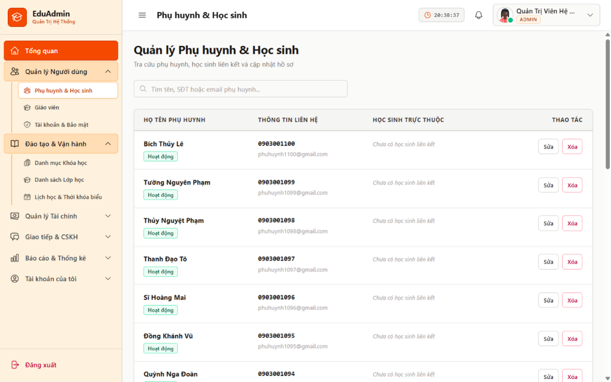

### Các thành phần trong giao diện

| STT | Loại điều khiển | Giá trị mặc định | Lưu ý |
| :--- | :--- | :--- | :--- |
| 1 | Search Textbox (`SearchBar`) | Rỗng (`""`) | Placeholder `Tìm tên, SĐT hoặc email phụ huynh...`, debounce `300ms`, reset về trang 1. |
| 2 | Data Table (`4 cột`) | `1–20 / 1100` phụ huynh (55 trang) | Cột: `HỌ TÊN PHỤ HUYNH`, `THÔNG TIN LIÊN HỆ`, `HỌC SINH TRỰC THUỘC`, `THAO TÁC`. |
| 3 | Row Action Buttons (`Sửa`, `Xóa`) | Enabled trên mọi dòng | `Sửa` mở modal cập nhật (`fullName` bắt buộc max 100, `pin` tùy chọn 4–6 chữ số); `Xóa` yêu cầu xác nhận qua `window.confirm`. |
| 4 | Pagination Bar (`select` + cụm nút trang) | `20 / trang`, trang `1 / 55`, nút `Trước` disabled | Tùy chọn số dòng: `10`, `20`, `50`, `100 / trang`. |

**Copy CSV (Thành phần giao diện CN03):**
```csv
STT,Loại điều khiển,Giá trị mặc định,Lưu ý
1,Search Textbox (SearchBar),(Rỗng),"Placeholder Tìm tên, SĐT hoặc email phụ huynh..., debounce 300ms."
2,Data Table (4 cột),"1-20 / 1100 phụ huynh (55 trang)","Cột: HỌ TÊN PHỤ HUYNH, THÔNG TIN LIÊN HỆ, HỌC SINH TRỰC THUỘC, THAO TÁC."
3,"Row Action Buttons (Sửa, Xóa)",Enabled trên từng dòng,"Sửa mở modal (fullName max 100, pin 4-6 số); Xóa xác nhận qua window.confirm."
4,Pagination Bar,"20 / trang, trang 1/55, Trước disabled","Tùy chọn 10, 20, 50, 100 dòng/trang."
```

### Dữ liệu được sử dụng

| STT | Tên bảng / Cấu trúc dữ liệu | Thêm | Sửa | Xóa | Truy vấn |
| :--- | :--- | :---: | :---: | :---: | :---: |
| 1 | `PARENT_PROFILE` (`ParentProfile`) | | X | X | X |
| 2 | `STUDENT_PROFILE` (`StudentProfile`) | | | | X |
| 3 | `ACCOUNT` (`ApplicationUser`) | | | X | X |

**Copy CSV (Dữ liệu sử dụng CN03):**
```csv
STT,Tên bảng / Cấu trúc dữ liệu,Thêm,Sửa,Xóa,Truy vấn
1,PARENT_PROFILE (ParentProfile),,X,X,X
2,STUDENT_PROFILE (StudentProfile),,,,X
3,ACCOUNT (ApplicationUser),,,X,X
```

### Cách xử lý
1. Tải danh sách phân trang `parentService.getPaged({ page, pageSize, keyword })`.
2. Tìm kiếm áp dụng debounce `300ms` và reset về trang 1.
3. Bấm **Sửa** mở modal chỉnh sửa `fullName` và `pin`, gọi `parentService.update()`; bấm **Xóa** gọi `window.confirm()` rồi `parentService.delete()` và tải lại bảng.

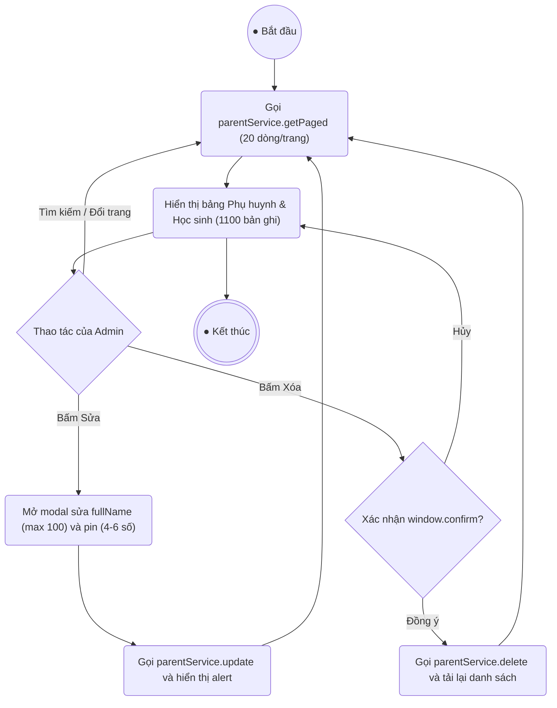

### Hàm/ sự kiện
```text
HÀM updateParent(form):
    KIỂM_TRA form.fullName (bắt buộc, <=100 ký tự) và form.pin (nếu có thì 4..6 chữ số)
    GỌI parentService.update(form.id, payload)
    Đóng modal và gọi lại loadParents()
```

### Các ràng buộc
- *Ghi nhận kỹ thuật:* Modal Sửa thiếu thuộc tính `role="dialog"`, không đóng khi bấm backdrop và chưa có cờ `isSaving` chống bấm đúp; sử dụng `window.alert`/`window.confirm` gốc trình duyệt.
- *Tham chiếu:* `Web_Frontend/src/views/admin/manage/ParentStudentView.vue`, `Document/Review/Frontend/03-Man-Hinh-Va-Luong-Admin.md` (mục 2).

---

## Chức năng 04: Quản lý Giáo viên

### Mục đích
Cho phép Admin quản lý danh sách giáo viên trong trung tâm: tìm kiếm, lọc theo trạng thái tài khoản, tạo mới tài khoản giáo viên (SĐT đăng nhập + mật khẩu ban đầu + email), cập nhật thông tin hồ sơ/chuyên môn và xóa giáo viên.

### Giao diện
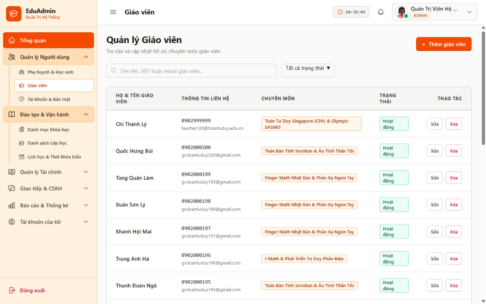

### Các thành phần trong giao diện

| STT | Loại điều khiển | Giá trị mặc định | Lưu ý |
| :--- | :--- | :--- | :--- |
| 1 | Primary Button (`+ Thêm giáo viên`) | Enabled | Mở modal tạo mới (Họ tên, SĐT đăng nhập, Mật khẩu ban đầu `6..128`, Email; *không hiện ô Chuyên môn khi tạo mới*). |
| 2 | Search Textbox (`SearchBar`) | Rỗng (`""`) | Placeholder `Tìm tên, SĐT hoặc email giáo viên...`, debounce `300ms`. |
| 3 | Combobox (`aria-label="Lọc trạng thái giáo viên"`) | `"Tất cả trạng thái"` (`ALL`) | Tùy chọn: `ALL`, `true` (`Hoạt động`), `false` (`Đã khóa`). |
| 4 | Data Table (`5 cột`) | `1–20 / 201` giáo viên (11 trang) | Cột: `HỌ & TÊN GIÁO VIÊN`, `THÔNG TIN LIÊN HỆ`, `CHUYÊN MÔN`, `TRẠNG THÁI`, `THAO TÁC` (`Sửa`, `Xóa`). |
| 5 | Pagination Bar (`select` + nút trang) | `20 / trang`, trang `1 / 11`, nút `Trước` disabled | Tùy chọn `10 / 20 / 50 / 100 / trang`. |

**Copy CSV (Thành phần giao diện CN04):**
```csv
STT,Loại điều khiển,Giá trị mặc định,Lưu ý
1,Primary Button (+ Thêm giáo viên),Enabled,"Mở modal tạo giáo viên mới (SĐT, MK >=6 ký tự, Email; ô Chuyên môn chỉ hiện khi Sửa)."
2,Search Textbox (SearchBar),(Rỗng),"Placeholder Tìm tên, SĐT hoặc email giáo viên..., debounce 300ms."
3,"Combobox (Lọc trạng thái giáo viên)","Tất cả trạng thái (ALL)","Tùy chọn: Tất cả trạng thái, Hoạt động (true), Đã khóa (false)."
4,Data Table (5 cột),"1-20 / 201 giáo viên (11 trang)","Cột: HỌ & TÊN, LIÊN HỆ, CHUYÊN MÔN, TRẠNG THÁI, THAO TÁC (Sửa, Xóa)."
5,Pagination Bar,"20 / trang, trang 1/11, Trước disabled","Tùy chọn 10, 20, 50, 100 dòng/trang."
```

### Dữ liệu được sử dụng

| STT | Tên bảng / Cấu trúc dữ liệu | Thêm | Sửa | Xóa | Truy vấn |
| :--- | :--- | :---: | :---: | :---: | :---: |
| 1 | `TEACHER_PROFILE` (`TeacherProfile`) | X | X | X | X |
| 2 | `ACCOUNT` (`ApplicationUser`) | X | X | X | X |

**Copy CSV (Dữ liệu sử dụng CN04):**
```csv
STT,Tên bảng / Cấu trúc dữ liệu,Thêm,Sửa,Xóa,Truy vấn
1,TEACHER_PROFILE (TeacherProfile),X,X,X,X
2,ACCOUNT (ApplicationUser),X,X,X,X
```

### Cách xử lý
1. Tải danh sách phân trang qua `teacherService.getPaged()` có `requestToken` chống ghi đè kết quả cũ.
2. Khi tạo mới: bắt buộc nhập Họ tên, SĐT đúng định dạng `(\+84|0)[0-9]{9}`, Mật khẩu `≥ 6` ký tự.
3. Khi sửa: SĐT bị `disabled` (không cho đổi tài khoản đăng nhập), hiển thị thêm trường `specialize` (max 100).
4. Khi xóa: xác nhận qua `window.confirm`, gọi `teacherService.delete(id)` và tải lại bảng.

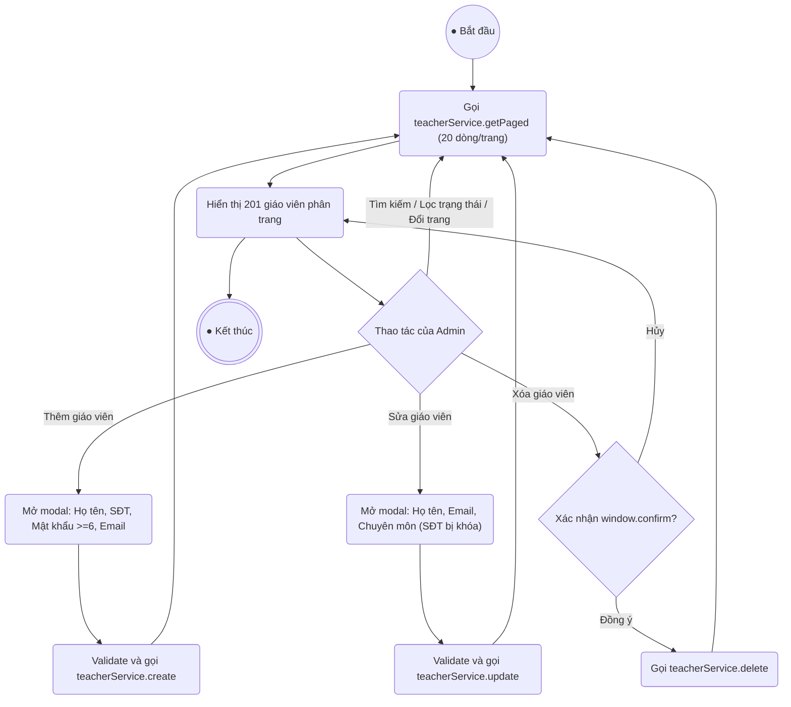

### Hàm/ sự kiện
```text
HÀM saveTeacher():
    KIỂM_TRA validateTextLength(fullName, required=true, max=100)
    NẾU isCreating THÌ KIỂM_TRA validatePhone(phone) VÀ password.length >= 6
    NẾU có email THÌ KIỂM_TRA validateEmail(email)
    isSaving ← true
    GỌI isCreating ? teacherService.create(payload) : teacherService.update(form.id, payload)
    Đóng modal; gọi fetchTeachers()
```

### Các ràng buộc
- Trường Chuyên môn (`specialize`) chỉ nhập được ở chế độ Sửa, không có trong form Tạo mới; Modal thiếu `role="dialog"`.
- *Tham chiếu:* `Web_Frontend/src/views/admin/manage/TeacherManagementView.vue`, `Document/Review/Frontend/03-Man-Hinh-Va-Luong-Admin.md` (mục 2).

---

## Chức năng 05: Quản lý Tài khoản & Bảo mật

### Mục đích
Cho phép Admin theo dõi toàn bộ tài khoản hệ thống (`Admin`, `Teacher`, `Parent`), lọc theo vai trò/trạng thái, bật/tắt khóa tài khoản (thu hồi phiên JWT ngay lập tức) và gửi mật khẩu tạm qua email cho Teacher/Parent đã xác minh email.

### Giao diện
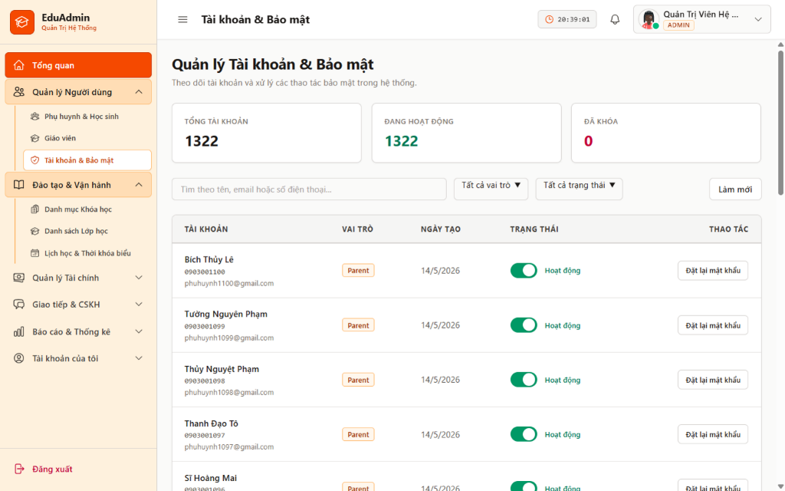

### Các thành phần trong giao diện

| STT | Loại điều khiển | Giá trị mặc định | Lưu ý |
| :--- | :--- | :--- | :--- |
| 1 | KPI Stat Cards (`3 thẻ`) | Quét thực tế: Tổng `1322`, Hoạt động `1322`, Đã khóa `0` | Tự cập nhật sau mỗi thao tác khóa/mở khóa. |
| 2 | Searchbox (`type="search"`, `#account-search`) | Rỗng (`""`) | Placeholder `Tìm theo tên, email hoặc số điện thoại...`, `maxlength="100"`, debounce `300ms`. |
| 3 | Combobox (`aria-label="Lọc theo vai trò"`) | `"Tất cả vai trò"` (`ALL`) | Tùy chọn: `ALL`, `Admin`, `Teacher`, `Parent`. |
| 4 | Combobox (`aria-label="Lọc theo trạng thái"`) | `"Tất cả trạng thái"` (`ALL`) | Tùy chọn: `ALL`, `true` (`Đang hoạt động`), `false` (`Đã khóa`). |
| 5 | Secondary Button (`Làm mới`) | Enabled | Gọi `loadAccounts()`; khóa khi `isLoading = true`. |
| 6 | Data Table (`5 cột`) | `1–20 / 1322` tài khoản (67 trang) | Cột: `TÀI KHOẢN`, `VAI TRÒ`, `NGÀY TẠO`, `TRẠNG THÁI` (Switch `role="switch"`), `THAO TÁC` (`Đặt lại mật khẩu`). |
| 7 | Toggle Switch & Reset Button trên từng dòng | Switch `checked` (`Hoạt động`), Reset enabled với Teacher/Parent đã xác minh email | Tự khóa Switch với tài khoản Admin hiện tại (`isCurrentAdmin`); Reset chỉ bật cho `Teacher`/`Parent` có `emailConfirmed = true`. |
| 8 | Pagination Bar | `20 / trang`, trang `1 / 67`, nút `Trước` disabled | Tùy chọn `10 / 20 / 50 / 100 / trang`. |

**Copy CSV (Thành phần giao diện CN05):**
```csv
STT,Loại điều khiển,Giá trị mặc định,Lưu ý
1,KPI Stat Cards (3 thẻ),"Tổng 1322; Đang hoạt động 1322; Đã khóa 0",Cập nhật tức thời sau khi khóa/mở khóa tài khoản.
2,"Searchbox (type=search, #account-search)",(Rỗng),"maxlength=100, debounce 300ms."
3,Combobox (Lọc theo vai trò),"Tất cả vai trò (ALL)","Tùy chọn: ALL, Admin, Teacher, Parent."
4,Combobox (Lọc theo trạng thái),"Tất cả trạng thái (ALL)","Tùy chọn: ALL, Đang hoạt động, Đã khóa."
5,Secondary Button (Làm mới),Enabled,"Tải lại danh sách tài khoản."
6,Data Table (5 cột),"1-20 / 1322 tài khoản (67 trang)","Hiển thị Tài khoản, Vai trò, Ngày tạo, Trạng thái, Thao tác."
7,Toggle Switch & Button Đặt lại mật khẩu,"Switch checked (Hoạt động)","Khóa Switch với chính Admin đang đăng nhập; Reset chỉ bật cho Teacher/Parent có email đã xác minh."
8,Pagination Bar,"20 / trang, trang 1/67, Trước disabled","Tùy chọn 10, 20, 50, 100 dòng/trang."
```

### Dữ liệu được sử dụng

| STT | Tên bảng / Cấu trúc dữ liệu | Thêm | Sửa | Xóa | Truy vấn |
| :--- | :--- | :---: | :---: | :---: | :---: |
| 1 | `ACCOUNT` (`ApplicationUser`) | | X | | X |
| 2 | `ADMIN_PROFILE` / `TEACHER_PROFILE` / `PARENT_PROFILE` | | | | X |
| 3 | Dịch vụ Email (`IEmailDeliveryService`) | X | | | |

**Copy CSV (Dữ liệu sử dụng CN05):**
```csv
STT,Tên bảng / Cấu trúc dữ liệu,Thêm,Sửa,Xóa,Truy vấn
1,ACCOUNT (ApplicationUser),,X,,X
2,ADMIN_PROFILE / TEACHER_PROFILE / PARENT_PROFILE,,,,X
3,IEmailDeliveryService (Gửi mật khẩu tạm),X,,,
```

### Cách xử lý
1. Tải phân trang `adminAccountService.getPaged()` kèm `loadRequestId` chống race condition.
2. Khi gạt Switch khóa/mở khóa: xác nhận `window.confirm()`, gọi `updateStatus`, Backend đổi `SecurityStamp` để vô hiệu hóa các JWT hiện hành.
3. Khi bấm **Đặt lại mật khẩu**: xác nhận `window.confirm()`, gọi `resetPassword`, Backend sinh mật khẩu tạm, đổi `SecurityStamp` và gửi email.

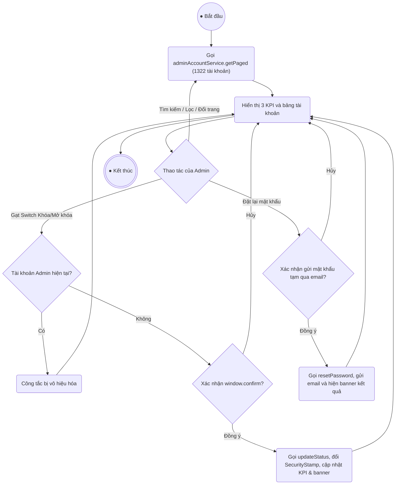

### Hàm/ sự kiện
```text
HÀM toggleStatus(account):
    NẾU KHÔNG window.confirm(...) THÌ THOÁT
    busyActions[account.id] ← "status"
    GỌI adminAccountService.updateStatus(account.id, !account.isActive)
    Cập nhật account.isActive, activeCount, blockedCount và setNotice(...)
    NẾU statusFilter != "ALL" THÌ gọi loadAccounts()
```

### Các ràng buộc
- Không cho phép Admin tự khóa tài khoản đang đăng nhập (`isCurrentAdmin`).
- Nút Đặt lại mật khẩu chỉ kích hoạt cho `Teacher`/`Parent` có email đã xác minh (`emailConfirmed = true`).
- *Tham chiếu:* `Web_Frontend/src/views/admin/manage/AccountSecurityView.vue`, `Document/Review/Backend/01-Database-And-Domain-Model.md` (mục 2.1).

---

## Chức năng 06: Quản lý Danh mục Khóa học

### Mục đích
Cho phép Admin xem, tìm kiếm, lọc nâng cao (khóa học, trạng thái, khoảng học phí), sắp xếp và chuyển chế độ Lưới/Danh sách cho toàn bộ danh mục khóa học, đồng thời tạo mới, chỉnh sửa, tải media (ảnh bìa, video, ảnh cơ sở vật chất) lên Cloudinary và xóa khóa học.

### Giao diện
**Màn hình chính:**
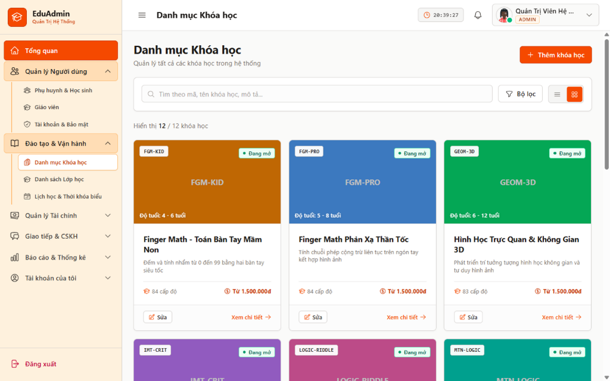

**Khi mở Bộ lọc nâng cao:**
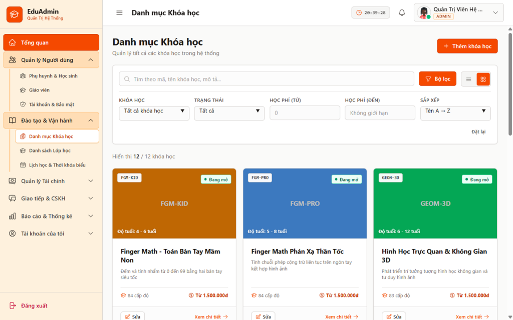

**Modal Thêm Khóa học mới:**
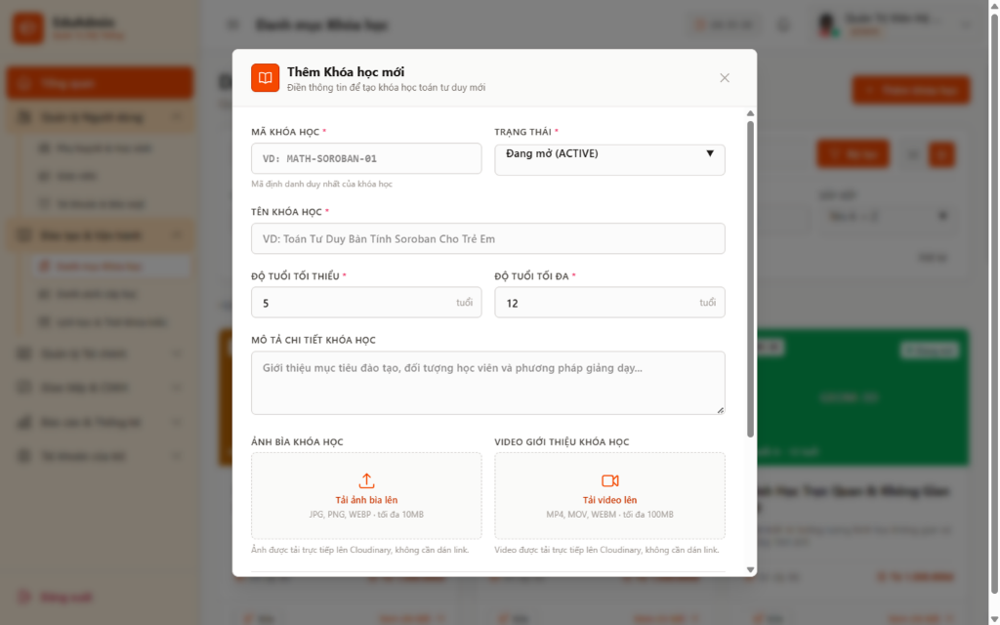

### Các thành phần trong giao diện

| STT | Loại điều khiển | Giá trị mặc định | Lưu ý |
| :--- | :--- | :--- | :--- |
| 1 | Primary Button (`+ Thêm khóa học`) | Enabled | Mở `CourseModal` ở chế độ tạo mới. |
| 2 | Search Textbox (`SearchBar`) | Rỗng (`""`) | Placeholder `Tìm theo mã, tên khóa học, mô tả...`, lọc trực tiếp ở Client. |
| 3 | Toggle Button (`Bộ lọc`) & View Toggle (`Danh sách` / `Lưới`) | Bộ lọc đóng; chế độ xem mặc định `Dạng lưới` | Bấm `Bộ lọc` mở rộng panel gồm 5 trường lọc và nút `Đặt lại`. |
| 4 | Filter Panel (`3 select`, `2 input number`, `1 button Đặt lại`) | Khóa học: `Tất cả` (12 khóa); Trạng thái: `Tất cả`; Học phí từ/đến: rỗng; Sắp xếp: `Tên A → Z` | Nếu `feeMin > feeMax` hiện cảnh báo và bỏ qua lọc học phí. |
| 5 | Grid Thẻ khóa học (`12 / 12 khóa học`) | Hiển thị 12 khóa học thật (`SRB-BASIC`..`LOGIC-RIDDLE`) | Mỗi thẻ có nút `Sửa` (mở `CourseModal`) và `Xem chi tiết →` (tới `/training/courses/:id`). |
| 6 | Modal `Thêm Khóa học mới` (`CourseModal`) | `Trạng thái = Đang mở (ACTIVE)`, `Tuổi tối thiểu = 5`, `Tuổi tối đa = 12` | Gồm: Mã khóa học (`required`), Trạng thái, Tên khóa học (`required`), Độ tuổi min/max, Mô tả, Upload Ảnh bìa (`≤10MB`), Upload Video (`≤100MB`), `+ Thêm lợi ích`, `+ Thêm ảnh` CSVC, nút `Hủy` và `Tạo khóa học`. |

**Copy CSV (Thành phần giao diện CN06):**
```csv
STT,Loại điều khiển,Giá trị mặc định,Lưu ý
1,Primary Button (+ Thêm khóa học),Enabled,Mở CourseModal chế độ tạo mới.
2,Search Textbox (SearchBar),(Rỗng),"Placeholder Tìm theo mã, tên khóa học, mô tả..., lọc trực tiếp ở client."
3,"Toggle Button Bộ lọc & View Toggle","Bộ lọc đóng; Dạng lưới","Chuyển đổi Grid/List và đóng/mở vùng lọc nâng cao."
4,"Filter Panel (3 select, 2 input number, nút Đặt lại)","Khóa học: Tất cả (12); Trạng thái: Tất cả; Sắp xếp: Tên A -> Z","Cảnh báo nếu Học phí từ > Học phí đến."
5,Grid Thẻ khóa học,"Hiển thị 12 / 12 khóa học","Mỗi thẻ có nút Sửa và Xem chi tiết -> (/training/courses/:id)."
6,Modal Thêm Khóa học mới (CourseModal),"Trạng thái=ACTIVE, minAge=5, maxAge=12","Upload ảnh bìa (<=10MB), video (<=100MB), ảnh CSVC thẳng lên Cloudinary; khóa Lưu/Đóng khi đang upload."
```

### Dữ liệu được sử dụng

| STT | Tên bảng / Cấu trúc dữ liệu | Thêm | Sửa | Xóa | Truy vấn |
| :--- | :--- | :---: | :---: | :---: | :---: |
| 1 | `COURSE` (`Course`) | X | X | X | X |
| 2 | `COURSE_LEVEL` (`CourseLevel`) | | | | X |
| 3 | Cloudinary Media Storage (`ICourseMediaStorage`) | X | | | |

**Copy CSV (Dữ liệu sử dụng CN06):**
```csv
STT,Tên bảng / Cấu trúc dữ liệu,Thêm,Sửa,Xóa,Truy vấn
1,COURSE (Course),X,X,X,X
2,COURSE_LEVEL (CourseLevel),,,,X
3,Cloudinary Media Storage,X,,,
```

### Cách xử lý
1. Gọi `courseService.getAll()`, chuẩn hóa `minFee`, `maxFee`, `totalLevels` và hiển thị 12 khóa học.
2. Tìm kiếm, lọc và sắp xếp thực hiện tức thời tại Client (`computed filteredCourses`).
3. Trong `CourseModal`, chọn tệp ảnh/video sẽ tải thẳng lên Cloudinary trước khi bấm Lưu; bấm Lưu kiểm tra hợp lệ rồi gọi `POST`/`PUT` và nạp lại danh sách.

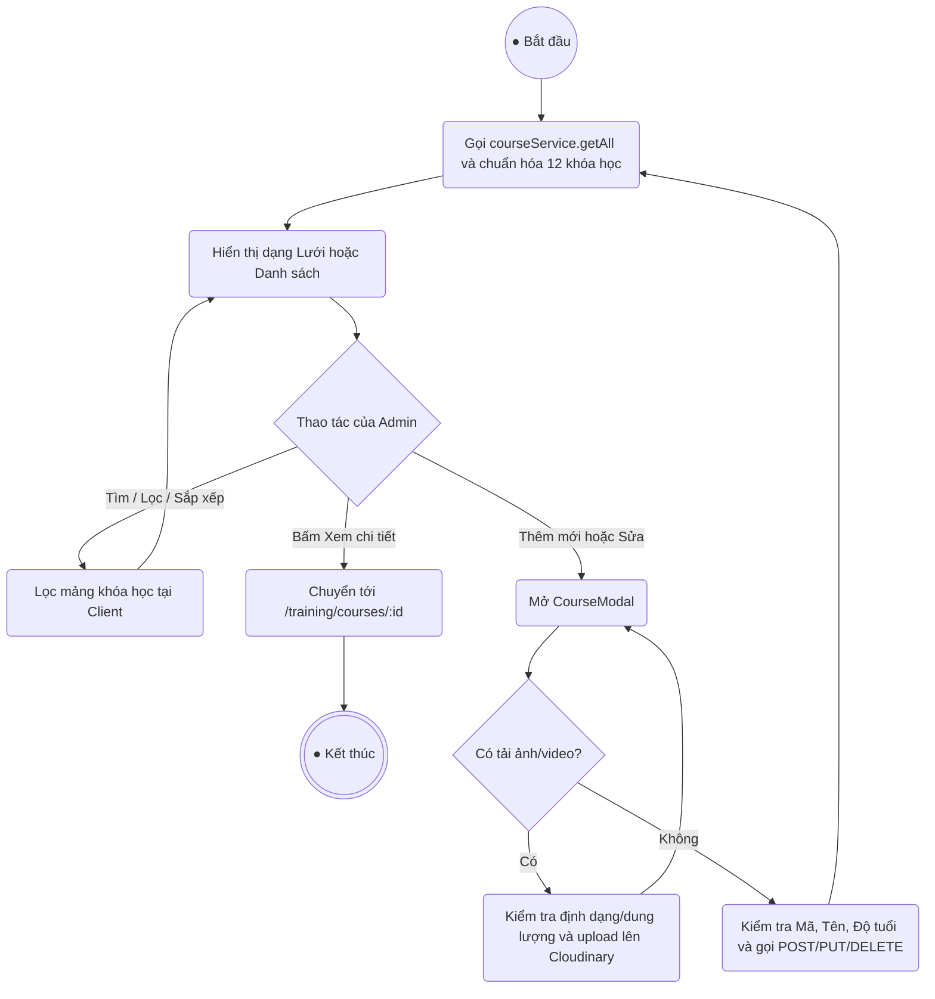

### Hàm/ sự kiện
```text
HÀM handleSubmit() trong CourseModal:
    NẾU isUploadingMedia() THÌ báo chờ tải lên hoàn tất; THOÁT
    KIỂM_TRA code (CODE_REGEX, <=50), name (<=200), 3 <= minAge <= maxAge <= 25
    GỌI isEdit ? courseService.update(...) : courseService.create(...)
    Sau 700ms đóng modal và phát sự kiện 'saved'
```

### Các ràng buộc
- Không xóa được `COURSE` nếu vẫn còn `COURSE_LEVEL` trực thuộc.
- Ảnh `JPG/PNG/WEBP ≤ 10MB`, video `MP4/MOV/WEBM/M4V ≤ 100MB`.
- *Tham chiếu:* `Web_Frontend/src/views/admin/training/CoursesView.vue`, `CourseModal.vue`.

---

## Chức năng 07: Quản lý Lớp học & Chi tiết Lớp học

### Mục đích
Cho phép Admin quản lý danh sách toàn bộ lớp học phân trang từ server (`1000` lớp học), mở lớp mới, và truy cập màn hình Chi tiết Lớp học để phân công/đổi giáo viên, cấu hình lịch tuần cố định (`CLASS_SCHEDULE`), đồng bộ tự động danh sách buổi học (`LESSON`) cùng ngày bế giảng dự kiến, và quản lý học viên trong lớp.

### Giao diện
**Danh sách Lớp học (`/training/classes`):**
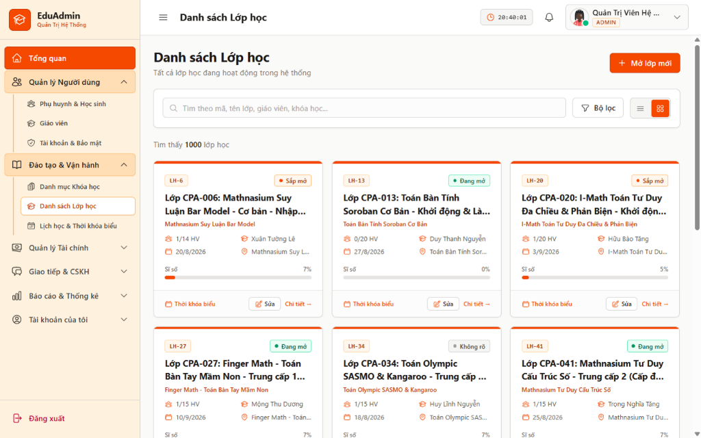

**Chi tiết Lớp học (`/training/classes/6`):**
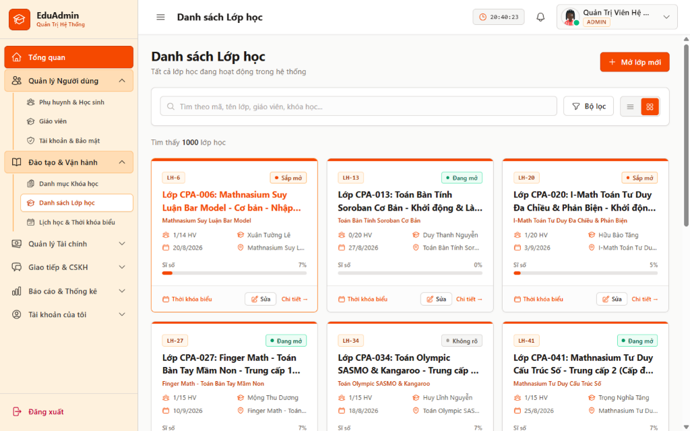

### Các thành phần trong giao diện

| STT | Loại điều khiển | Giá trị mặc định | Lưu ý |
| :--- | :--- | :--- | :--- |
| 1 | Primary Button (`+ Mở lớp mới`) | Enabled | Mở `ClassModal` chọn cấp độ khóa học, tên lớp, GV, sĩ số `1..100`, ngày khai giảng/bế giảng. |
| 2 | Toolbar (`SearchBar`, `Bộ lọc`, `Dạng danh sách` / `Dạng lưới`) | Search rỗng; chế độ `Dạng lưới` | Tìm kiếm debounce `300ms`, gọi phân trang server. |
| 3 | Class Cards Grid & `PaginationBar` | `1000` lớp học, `12 / trang` (84 trang), `Trước` disabled | Mỗi thẻ có Link `Thời khóa biểu`, nút `Sửa`, nhãn `Chi tiết →`. *Ghi nhận lỗi dữ liệu thực tế:* Các lớp `LH-34`, `LH-76`, `LH-83` hiển thị badge trạng thái `"Không rõ"`. |
| 4 | Breadcrumb & 4 Action Buttons trong Chi tiết lớp (`/training/classes/6`) | `Đổi giáo viên`, `Đồng bộ & Tính ngày kết thúc`, `Chỉnh sửa lớp học`, `+ Thêm lịch tuần` | Nút `Đồng bộ & Tính ngày kết thúc` tính lại lịch buổi học không vượt `totalSessions` của cấp độ. |
| 5 | 4 Thẻ chỉ số nhanh (Metric Cards) | Quét lớp #6: Sĩ số `1/14 (7%)`, Buổi học `1/16`, Học phí `4.200.000đ`, GV `Xuân Tường Lê` | Thẻ Giáo viên có thể bấm trực tiếp (`Đổi GV →`) mở modal phân công GV. |
| 6 | 3 Tabs chi tiết (`Lịch tuần`, `Danh sách Buổi học`, `Danh sách Học viên`) | Mặc định mở `Lịch tuần (1 ca/tuần)` | Trong `Lịch tuần` có nút `Thêm lịch`, nút `Sửa`/`Xóa` ca học và thời khóa biểu tuần trực quan (`Thứ 3 · 08:00 · Phòng Học Tư Duy 07`). |

**Copy CSV (Thành phần giao diện CN07):**
```csv
STT,Loại điều khiển,Giá trị mặc định,Lưu ý
1,Primary Button (+ Mở lớp mới),Enabled,"Mở ClassModal tạo lớp thuộc cấp độ khóa học."
2,"Toolbar (SearchBar, Bộ lọc, View Toggle)","Search rỗng; Dạng lưới","Debounce 300ms, lọc server theo khóa học, trạng thái, sĩ số, sắp xếp."
3,Class Cards Grid & PaginationBar,"1000 lớp, 12 / trang (84 trang)","Thẻ lớp có Thời khóa biểu, Sửa, Chi tiết. Ghi nhận lớp LH-34/76/83 hiện trạng thái Không rõ."
4,Header Actions trong Chi tiết lớp,"4 nút hành động","Đổi giáo viên, Đồng bộ & Tính ngày kết thúc, Chỉnh sửa lớp học, + Thêm lịch tuần."
5,4 Metric Cards Chi tiết lớp,"Lớp #6: 1/14 HV; 1/16 buổi; 4.200.000đ; GV Xuân Tường Lê","Thẻ Giáo viên clickable để đổi GV nhanh."
6,3 Tabs Chi tiết lớp,"Mặc định: Lịch tuần (1 ca/tuần)","Gồm Lịch tuần (có lưới tuần trực quan), Danh sách Buổi học (1/16) và Danh sách Học viên (1)."
```

### Dữ liệu được sử dụng

| STT | Tên bảng / Cấu trúc dữ liệu | Thêm | Sửa | Xóa | Truy vấn |
| :--- | :--- | :---: | :---: | :---: | :---: |
| 1 | `CLASSES` (`Classes`) | X | X | X | X |
| 2 | `CLASS_SCHEDULE` (`ClassSchedule`) | X | X | X | X |
| 3 | `LESSON` (`Lesson`) | X | X | X | X |
| 4 | `CLASS_STUDENT` (`ClassStudent`) | X | | X | X |
| 5 | `COURSE`, `COURSE_LEVEL`, `TEACHER_PROFILE`, `STUDENT_PROFILE` | | | | X |

**Copy CSV (Dữ liệu sử dụng CN07):**
```csv
STT,Tên bảng / Cấu trúc dữ liệu,Thêm,Sửa,Xóa,Truy vấn
1,CLASSES (Classes),X,X,X,X
2,CLASS_SCHEDULE (ClassSchedule),X,X,X,X
3,LESSON (Lesson),X,X,X,X
4,CLASS_STUDENT (ClassStudent),X,,X,X
5,"COURSE, COURSE_LEVEL, TEACHER_PROFILE, STUDENT_PROFILE",,,,X
```

### Cách xử lý
1. Ở `/training/classes`, tải phân trang 12 lớp/trang cùng danh mục khóa học.
2. Khi bấm vào thẻ lớp, điều hướng sang `/training/classes/:id`, nạp song song thông tin lớp, khóa học, cấp độ, giáo viên, lịch tuần, buổi học và học viên.
3. Mọi thay đổi trên lịch tuần hoặc bấm **Đồng bộ & Tính ngày kết thúc** sẽ đồng bộ danh sách `LESSON` và cập nhật `CLASSES.end_date`.

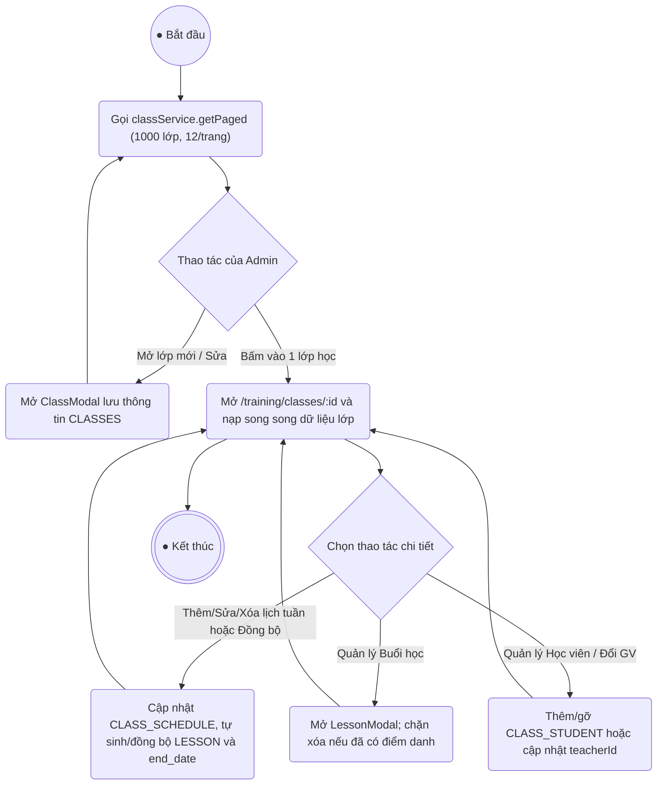

### Hàm/ sự kiện
```text
HÀM triggerManualSync():
    Dựa trên startDate, level.totalSessions và classSchedules
    Gọi hàm đồng bộ sinh đủ số buổi LESSON chuẩn và tính lại endDate của lớp
    Hiển thị banner kết quả đồng bộ và nạp lại chi tiết lớp
```

### Các ràng buộc
- Không xóa được lớp còn `CLASS_STUDENT`; không xóa được `LESSON` đã có `ATTENDANCE`.
- *Lỗi thực tế ghi nhận trên `:8088`:* Một số lớp (`LH-34`, `LH-76`, `LH-83`) hiển thị badge trạng thái `Không rõ`; 2 modal inline (Thêm học sinh, Phân công GV) thiếu `role="dialog"`.
- *Tham chiếu:* `ClassesView.vue`, `ClassDetailView.vue`, `ClassModal.vue`, `LessonModal.vue`.

---
## Chức năng 08: Quản lý Lịch học & Thời khóa biểu

### Mục đích
Cung cấp góc nhìn thời khóa biểu tổng hợp toàn trung tâm theo phong cách Google Calendar (kết hợp ngăn xếp gom các lớp trùng mốc giờ) và chế độ bảng danh sách cho Admin theo dõi, lọc theo lớp/thứ và thêm/sửa/xóa lịch học cố định.

### Giao diện
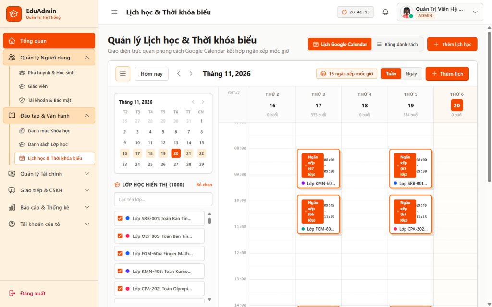

### Các thành phần trong giao diện

| STT | Loại điều khiển | Giá trị mặc định | Lưu ý |
| :--- | :--- | :--- | :--- |
| 1 | Mode Switcher (`Lịch Google Calendar`, `Bảng danh sách`) | `Lịch Google Calendar` đang chọn | Chuyển giữa `GoogleCalendarView` và bảng danh sách lịch. |
| 2 | Primary Button (`+ Thêm lịch học`) | Enabled | Mở `ScheduleModal` ở chế độ tạo mới (`create`). |
| 3 | Calendar Toolbar (`Ẩn/hiện panel`, `Hôm nay`, `<` / `>`, `Tuần` / `Ngày`, `+ Thêm lịch`) | `Tháng 11, 2026`, chế độ `Tuần`, badge `15 ngăn xếp mốc giờ` | Điều hướng tuần/ngày trên lưới lịch `GMT+7`. |
| 4 | Mini Calendar (`Tháng 11, 2026`) | Ngày `20` đang highlight | Chọn nhanh ngày trên tháng (*lưu ý code: cố định 35 ô có thể cắt ngày 30/31 ở tháng 6 hàng*). |
| 5 | Panel lọc lớp (`LỚP HỌC HIỂN THỊ (1000)`) | `1000/1000` checkbox được tích mặc định; ô `Lọc tên lớp...` rỗng | Có nút `Bỏ chọn` nhanh; *lưu ý hiệu năng thực tế: render 1000 checkbox cùng lúc tạo >1048 button trong `<main>`*. |
| 6 | Lưới lịch tuần & Thẻ ngăn xếp (`Ngăn xếp (67 lớp)`...) | 7 cột ngày × khung giờ `07:00–21:00` | Bấm thẻ ngăn xếp mở drawer bên phải xem từng lớp; *lỗi hiển thị thực tế: badge cam `Ngăn xếp (67 lớp)` rớt 3 dòng đè chữ giờ `08:00 - 09:30`*. |

**Copy CSV (Thành phần giao diện CN08):**
```csv
STT,Loại điều khiển,Giá trị mặc định,Lưu ý
1,Mode Switcher (Google Calendar / Bảng danh sách),Lịch Google Calendar,Chuyển giữa chế độ lịch trực quan và bảng danh sách.
2,Primary Button (+ Thêm lịch học),Enabled,Mở ScheduleModal chế độ tạo mới.
3,Calendar Toolbar,"Tháng 11/2026, chế độ Tuần, 15 ngăn xếp mốc giờ","Gồm nút Hôm nay, chuyển tuần </>, Tuần/Ngày, + Thêm lịch."
4,Mini Calendar,"Tháng 11, 2026 (ngày 20 đang chọn)","Chọn nhanh ngày; mảng cố định 35 ô có thể thiếu ngày 30/31 ở tháng 6 hàng."
5,Panel lọc lớp (1000 lớp),"1000/1000 checkbox đang chọn; ô Lọc tên lớp rỗng","Nút Bỏ chọn; render toàn bộ 1000 lớp làm DOM rất nặng."
6,Lưới lịch tuần & Thẻ ngăn xếp,"Khung giờ 07:00-21:00 (GMT+7)","Bấm thẻ mở drawer danh sách lớp; lỗi thực tế: badge Ngăn xếp (67 lớp) rớt dòng đè chữ giờ học."
```

### Dữ liệu được sử dụng

| STT | Tên bảng / Cấu trúc dữ liệu | Thêm | Sửa | Xóa | Truy vấn |
| :--- | :--- | :---: | :---: | :---: | :---: |
| 1 | `CLASS_SCHEDULE` (`ClassSchedule`) | X | X | X | X |
| 2 | `CLASSES` (`Classes`) | | X | | X |
| 3 | `LESSON` (`Lesson` — tự đồng bộ khi đổi lịch) | X | X | X | |

**Copy CSV (Dữ liệu sử dụng CN08):**
```csv
STT,Tên bảng / Cấu trúc dữ liệu,Thêm,Sửa,Xóa,Truy vấn
1,CLASS_SCHEDULE (ClassSchedule),X,X,X,X
2,CLASSES (Classes),,X,,X
3,LESSON (tự đồng bộ khi đổi lịch),X,X,X,
```

### Cách xử lý
1. `ScheduleView` gọi `classService.getAll()`, sau đó dùng `Promise.allSettled` gọi `classScheduleService.getByClass(c.id)` cho từng lớp để gom toàn bộ lịch học.
2. Ở chế độ Google Calendar, nhóm các lịch trùng khung giờ trong ngày thành thẻ "Ngăn xếp" mở drawer chi tiết; bấm từng lịch hoặc `+ Thêm lịch học` mở `ScheduleModal` (xem/sửa/tạo/xóa).
3. Ở chế độ Bảng danh sách, hỗ trợ lọc theo lớp (`route.query.classId`), từ khóa và thứ trong tuần (`0..6`).

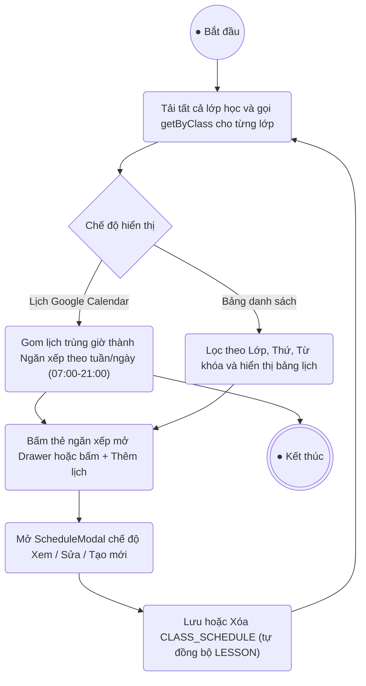

### Hàm/ sự kiện
```text
HÀM loadAllData():
    classes ← GỌI classService.getAll()
    results ← Promise.allSettled(classes.map(c => classScheduleService.getByClass(c.id)))
    Gom tất cả schedules hợp lệ vào mảng schedules[] để truyền cho GoogleCalendarView và Table
```

### Các ràng buộc
- *Lỗi hiển thị & hiệu năng thực tế trên `:8088`:* Badge `Ngăn xếp (67 lớp)` bị vỡ layout đè lên giờ học; render `1000` checkbox lớp học cùng N+1 request `getByClass` gây nặng DOM và chậm tải; `miniCalendarDays` cố định 35 ô.
- *Tham chiếu:* `ScheduleView.vue`, `GoogleCalendarView.vue`, `ScheduleModal.vue`.

---

## Chức năng 09: Quản lý Hóa đơn & Biên lai học phí

### Mục đích
Cho phép Admin theo dõi tình hình thanh toán học phí, thống kê nhanh tổng hóa đơn và doanh thu thực thu, tìm kiếm/lọc theo trạng thái hóa đơn, xem chi tiết giao dịch và in biên lai cho hóa đơn đã thanh toán (`PAID`).

### Giao diện
**Danh sách Hóa đơn (`/finance/invoices`):**
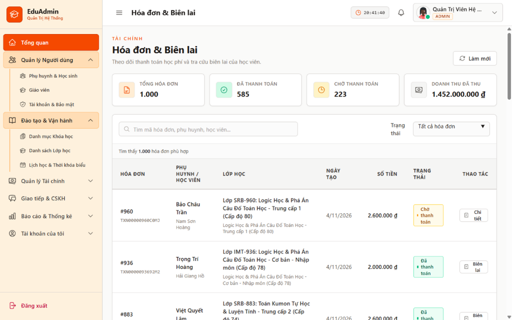

**Modal Chi tiết hóa đơn `#960`:**
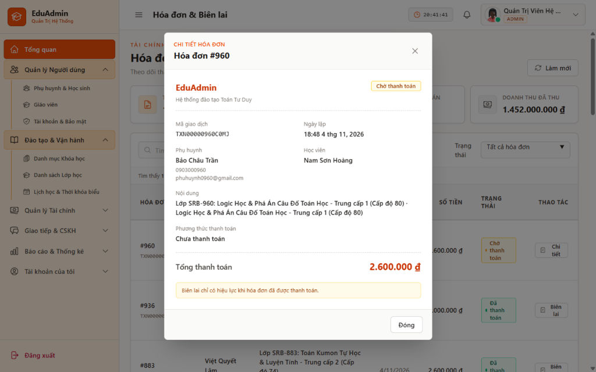

### Các thành phần trong giao diện

| STT | Loại điều khiển | Giá trị mặc định | Lưu ý |
| :--- | :--- | :--- | :--- |
| 1 | Secondary Button (`Làm mới`) | Enabled | Gọi `loadInvoices()`. |
| 2 | KPI Stat Cards (`4 thẻ`) | Quét thực tế: Tổng `1.000`, Đã thanh toán `585`, Chờ thanh toán `223`, Doanh thu đã thu `1.452.000.000 ₫` | Cập nhật cùng response phân trang từ server. |
| 3 | Searchbox (`aria-label="Tìm kiếm hóa đơn"`) | Rỗng (`""`) | Placeholder `Tìm mã hóa đơn, phụ huynh, học viên...`, `maxlength="100"`, debounce `300ms`. |
| 4 | Combobox `Trạng thái` (`#invoice-status`) | `"Tất cả hóa đơn"` (`ALL`) | Tùy chọn: `ALL`, `PENDING`, `PAID`, `FAILED`, `CANCELLED`, `REFUNDED`. |
| 5 | Data Table (`7 cột`) | `1–20 / 1000` hóa đơn (50 trang) | Cột: `HÓA ĐƠN`, `PHỤ HUYNH / HỌC VIÊN`, `LỚP HỌC`, `NGÀY TẠO`, `SỐ TIỀN`, `TRẠNG THÁI`, `THAO TÁC` (`Biên lai` nếu `PAID`, `Chi tiết` với các trạng thái khác). |
| 6 | Pagination Bar | `20 / trang`, trang `1 / 50`, nút `Trước` disabled | Tùy chọn `10 / 20 / 50 / 100 / trang`. |
| 7 | Modal `Chi tiết hóa đơn / Biên lai thanh toán` (`role="dialog"`) | Đóng mặc định (ảnh chụp mở `#960` — `2.600.000 ₫`) | Hiện mã giao dịch (`TXN00000960C0MJ`), ngày lập, phụ huynh, học viên, lớp học, phương thức, tổng tiền; nút `In biên lai` (`window.print()`) chỉ hiện khi `status === 'PAID'`, ngược lại hiện cảnh báo biên lai chưa có hiệu lực. |

**Copy CSV (Thành phần giao diện CN09):**
```csv
STT,Loại điều khiển,Giá trị mặc định,Lưu ý
1,Secondary Button (Làm mới),Enabled,Tải lại danh sách hóa đơn.
2,KPI Stat Cards (4 thẻ),"Tổng 1.000; Đã TT 585; Chờ TT 223; Doanh thu 1.452.000.000 đ",Số liệu tổng hợp từ Backend.
3,Searchbox (Tìm kiếm hóa đơn),(Rỗng),"maxlength=100, debounce 300ms."
4,Combobox Trạng thái (#invoice-status),"Tất cả hóa đơn (ALL)","Tùy chọn: ALL, PENDING, PAID, FAILED, CANCELLED, REFUNDED."
5,Data Table (7 cột),"1-20 / 1000 hóa đơn (50 trang)","Cột Thao tác hiển thị nút Biên lai (PAID) hoặc Chi tiết."
6,Pagination Bar,"20 / trang, trang 1/50, Trước disabled","Tùy chọn 10, 20, 50, 100 dòng/trang."
7,"Modal Chi tiết / Biên lai (role=dialog)",Đóng mặc định,"Nút In biên lai (window.print) chỉ xuất hiện khi status === PAID."
```

### Dữ liệu được sử dụng

| STT | Tên bảng / Cấu trúc dữ liệu | Thêm | Sửa | Xóa | Truy vấn |
| :--- | :--- | :---: | :---: | :---: | :---: |
| 1 | `INVOICE` (`Invoice`) | | | | X |
| 2 | `PARENT_PROFILE`, `STUDENT_PROFILE`, `CLASSES`, `COURSE_LEVEL` | | | | X |

**Copy CSV (Dữ liệu sử dụng CN09):**
```csv
STT,Tên bảng / Cấu trúc dữ liệu,Thêm,Sửa,Xóa,Truy vấn
1,INVOICE (Invoice),,,,X
2,"PARENT_PROFILE, STUDENT_PROFILE, CLASSES, COURSE_LEVEL",,,,X
```

### Cách xử lý
1. Gọi `adminInvoiceService.getPaged()` nạp 20 hóa đơn/trang kèm thống kê tổng hợp.
2. Khi tìm kiếm (debounce 300ms) hoặc lọc trạng thái sẽ reset về trang 1 và tải lại.
3. Bấm **Biên lai** hoặc **Chi tiết** mở Modal xem thông tin giao dịch; hóa đơn `PAID` cho phép gọi `window.print()`.

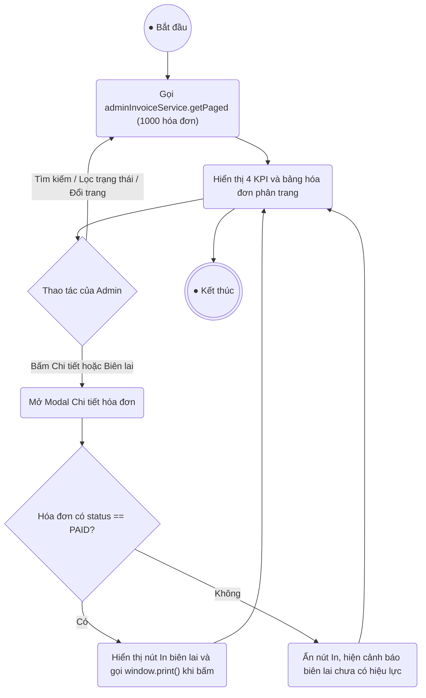

### Hàm/ sự kiện
```text
HÀM loadInvoices():
    token ← ++requestToken; loading ← true
    res ← GỌI adminInvoiceService.getPaged({ page, pageSize, keyword, status })
    NẾU token != requestToken THÌ THOÁT
    Cập nhật invoices và statsSummary (totalAllCount, paidCount, pendingCount, paidTotalAmount)
```

### Các ràng buộc
- Admin Web chỉ có quyền tra cứu và in biên lai; trạng thái hóa đơn do cổng VNPay IPN và job nền `ReservationCleanupService` cập nhật.
- *Tham chiếu:* `Web_Frontend/src/views/admin/finance/InvoicesView.vue`.

---

## Chức năng 10: Quản lý Bảng lương Giáo viên

### Mục đích
Cho phép Admin đối soát bảng lương giáo viên theo từng tháng (`MM/YYYY`), xem chi tiết các buổi dạy hợp lệ và khoản điều chỉnh, cấu hình đơn giá lương cơ bản/buổi, thêm khoản thưởng/phạt, xem trước HTML phiếu lương và gửi email phiếu lương đơn lẻ hoặc hàng loạt.

### Giao diện
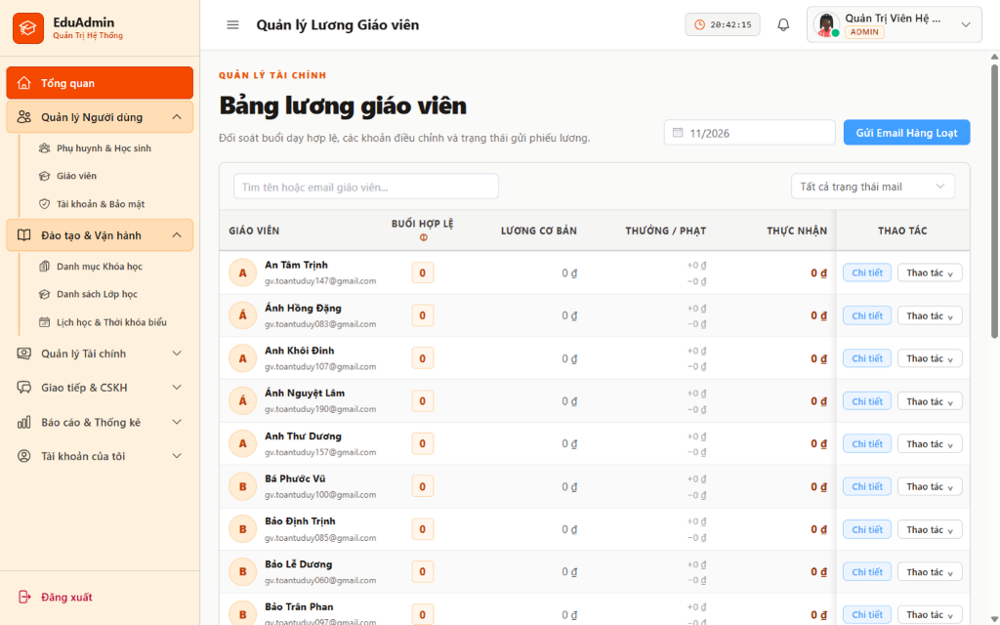

### Các thành phần trong giao diện

| STT | Loại điều khiển | Giá trị mặc định | Lưu ý |
| :--- | :--- | :--- | :--- |
| 1 | Month Picker (`el-date-picker`, `aria-label="Chọn tháng tính lương"`) | `"11/2026"` | Không cho xóa (`clearable=false`), khóa chọn tháng tương lai (`disableFutureMonth`). |
| 2 | Primary Button (`Gửi Email Hàng Loạt`) | Enabled | Yêu cầu xác nhận `ElMessageBox.confirm` trước khi đưa vào hàng đợi gửi mail; *lưu ý UI thực tế: nút vẫn dùng màu xanh dương mặc định thay vì tông cam theo `UI_RULE.md`*. |
| 3 | Search Input (`el-input`) | Rỗng (`""`) | Placeholder `Tìm tên hoặc email giáo viên...`, debounce `300ms`. |
| 4 | Select (`el-select`, lọc trạng thái mail) | `"Tất cả trạng thái mail"` (`ALL`) | Tùy chọn: `ALL`, `NotSent`, `Pending`, `Sent`, `Failed`. |
| 5 | Element Plus Data Table (`7 cột trong DOM`) | Kỳ `11/2026 · 201 giáo viên` (hiện toàn bộ `0` buổi / `0 ₫` / `NotSent`) | Cột: `GIÁO VIÊN`, `BUỔI HỢP LỆ ⓘ`, `LƯƠNG CƠ BẢN`, `THƯỞNG / PHẠT`, `THỰC NHẬN`, `TRẠNG THÁI EMAIL`, `THAO TÁC`. *Lỗi hiển thị thực tế:* cột `TRẠNG THÁI EMAIL` bị khuất/tràn ngang ở độ rộng `1281x801`. |
| 6 | Row Actions (`Chi tiết`, Dropdown `Thao tác ⌄`) | Enabled trên mọi dòng | `Chi tiết` mở bảng buổi dạy + thưởng/phạt; `Thao tác ⌄` gồm: `Thay đổi lương cơ bản`, `Thêm Phạt/Thưởng`, `Preview Mail` (`iframe sandbox=""`), `Gửi Mail`. |
| 7 | Pagination (`el-pagination`) | `20/page`, trang `1 / 11`, `Previous` disabled | Chuyển số dòng và chuyển trang. |

**Copy CSV (Thành phần giao diện CN10):**
```csv
STT,Loại điều khiển,Giá trị mặc định,Lưu ý
1,Month Picker (el-date-picker),11/2026,"clearable=false, khóa chọn tháng tương lai."
2,Primary Button (Gửi Email Hàng Loạt),Enabled,"Xác nhận ElMessageBox.confirm; thực tế nút đang hiện màu xanh dương lệch chuẩn cam UI_RULE.md."
3,Search Input (el-input),(Rỗng),"Placeholder Tìm tên hoặc email giáo viên..., debounce 300ms."
4,Select (Trạng thái mail),Tất cả trạng thái mail (ALL),"Tùy chọn: ALL, NotSent, Pending, Sent, Failed."
5,Data Table (7 cột),"Kỳ 11/2026 · 201 giáo viên (0 buổi / 0 đ)","Lỗi thực tế: cột TRẠNG THÁI EMAIL bị tràn ngang/khuất ở 1281x801; lồng 2 thẻ <main>."
6,"Row Actions (Chi tiết, Thao tác v)",Enabled,"Gồm Chi tiết, Thay đổi lương cơ bản (0..100tr), Thêm Phạt/Thưởng (1..1tỷ), Preview Mail (iframe sandbox), Gửi Mail."
7,Pagination (el-pagination),"20/page, trang 1/11, Previous disabled","Điều hướng 11 trang (201 giáo viên)."
```

### Dữ liệu được sử dụng

| STT | Tên bảng / Cấu trúc dữ liệu | Thêm | Sửa | Xóa | Truy vấn |
| :--- | :--- | :---: | :---: | :---: | :---: |
| 1 | `PAYROLL_SUMMARY` (`PayrollSummary`) | X | X | | X |
| 2 | `TEACHER_SALARY_CONFIG` (`TeacherSalaryConfig`) | X | X | | X |
| 3 | `SALARY_ADJUSTMENT` (`SalaryAdjustment`) | X | | | X |
| 4 | `LESSON`, `ATTENDANCE`, `TEACHER_PROFILE` | | | | X |
| 5 | `PayslipEmailQueue` / `PayslipEmailWorker` | X | | | |

**Copy CSV (Dữ liệu sử dụng CN10):**
```csv
STT,Tên bảng / Cấu trúc dữ liệu,Thêm,Sửa,Xóa,Truy vấn
1,PAYROLL_SUMMARY (PayrollSummary),X,X,,X
2,TEACHER_SALARY_CONFIG (TeacherSalaryConfig),X,X,,X
3,SALARY_ADJUSTMENT (SalaryAdjustment),X,,,X
4,"LESSON, ATTENDANCE, TEACHER_PROFILE",,,,X
5,PayslipEmailQueue / PayslipEmailWorker,X,,,
```

### Cách xử lý
1. Gọi `GET /api/payrolls/admin/summary/paged` theo tháng/năm đang chọn (`11/2026`).
2. Admin có thể mở **Chi tiết**, **Thay đổi lương cơ bản** (`PUT /teachers/{id}/base-rate`), **Thêm Phạt/Thưởng** (`POST /adjustments`), **Preview Mail** (`GET /{id}/preview-email` hiển thị trong `<iframe sandbox="">`), hoặc gửi mail đơn lẻ/hàng loạt vào `PayslipEmailQueue`.

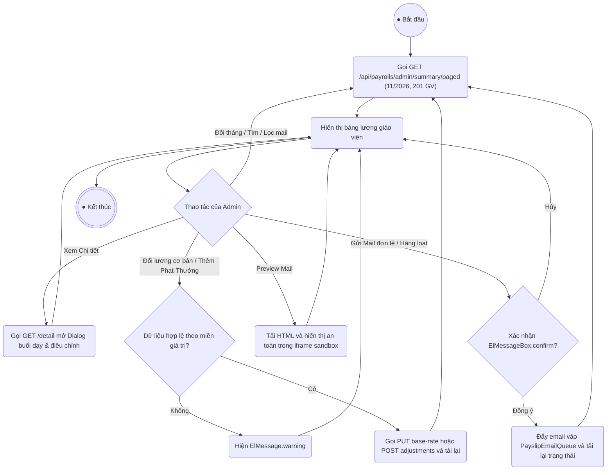

### Hàm/ sự kiện
```text
HÀM submitBaseRate():
    KIỂM_TRA baseRatePerSession là số nguyên trong [0 .. 100.000.000]
    GỌI PUT /api/payrolls/teachers/{teacherId}/base-rate
    Đóng dialog; gọi loadPayrolls()

HÀM submitAdjustment():
    KIỂM_TRA amount nguyên trong [1 .. 1.000.000.000], reason (1..500), appliedDate <= hôm nay
    GỌI POST /api/payrolls/adjustments
    Đóng dialog; gọi loadPayrolls()
```

### Các ràng buộc
- Chỉ buổi `Lesson.Status == "COMPLETED"` VÀ có ít nhất 1 bản ghi `Attendance` mới được tính `+1 Đơn vị`.
- *Lỗi hiển thị thực tế trên `:8088`:* Nút chính còn màu xanh dương (chưa đồng bộ màu cam theo `UI_RULE.md`), lồng 2 thẻ `<main>`, cột `TRẠNG THÁI EMAIL` bị khuất ngang ở `1281x801`.
- *Tham chiếu:* `Web_Frontend/src/views/admin/finance/AdminPayrollView.vue`.

---

## Chức năng 11: Quản lý & Gửi Thông báo hệ thống

### Mục đích
Cho phép Admin quản lý lịch sử thông báo đã phát hành, theo dõi trạng thái xử lý Outbox và số lượt đã đọc (`694 / 1000`), soạn thông báo mới gửi theo nhóm đối tượng (`PARENT`, `TEACHER`, `PARENT_AND_TEACHER`) kèm tùy chọn gửi email cá nhân, và xem hộp thư cá nhân (`Thông báo của tôi`).

### Giao diện
**Màn hình Quản lý Thông báo (`/communication/notifications`):**
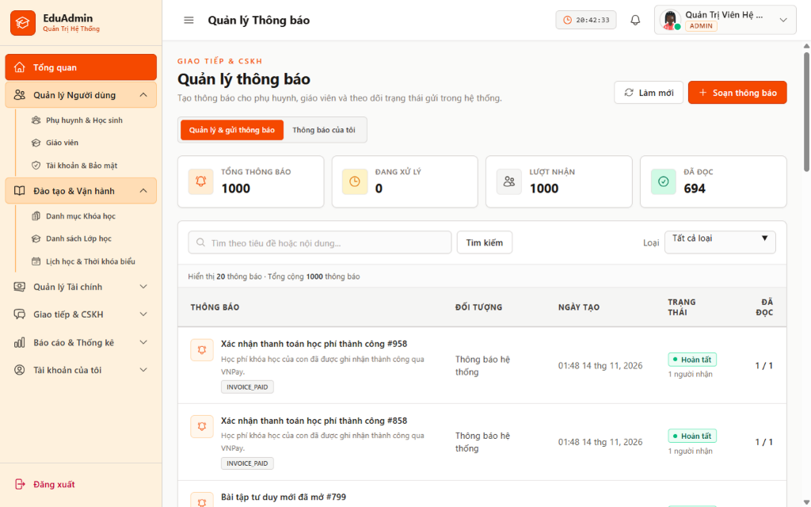

**Modal Soạn thông báo mới:**
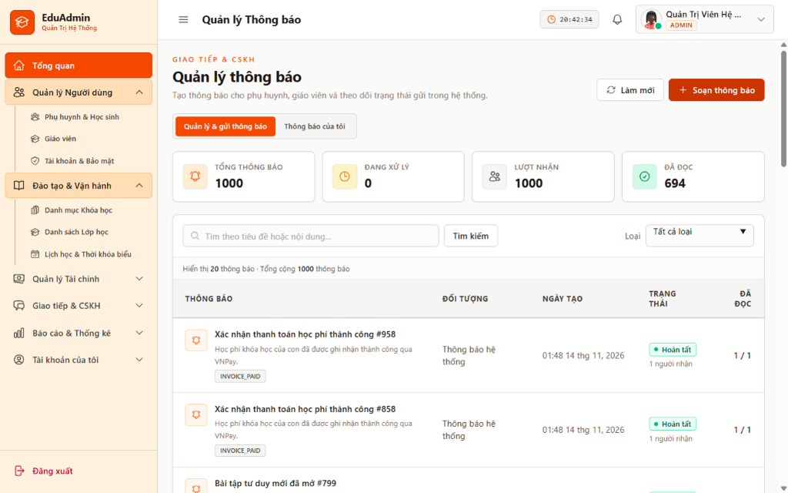

### Các thành phần trong giao diện

| STT | Loại điều khiển | Giá trị mặc định | Lưu ý |
| :--- | :--- | :--- | :--- |
| 1 | Action Buttons (`Làm mới`, `+ Soạn thông báo`) | Enabled | `+ Soạn thông báo` mở modal tạo thông báo mới. |
| 2 | Tab Switcher (`Quản lý & gửi thông báo`, `Thông báo của tôi`) | `Quản lý & gửi thông báo` đang chọn | Đồng bộ với `route.query.tab`; tab `Thông báo của tôi` hiển thị `NotificationInboxPanel`. |
| 3 | KPI Stat Cards (`4 thẻ`) | Quét thực tế: Tổng `1000`, Đang xử lý `0`, Lượt nhận `1000`, Đã đọc `694` | Thống kê toàn bộ thông báo trong hệ thống. |
| 4 | Search Form (`Searchbox` + Button `Tìm kiếm`) & Combobox `Loại` | Search rỗng; Loại `Tất cả loại` (`""`) | Tùy chọn Loại: `Tất cả loại`, `Thông báo đặc biệt`, `Thông báo chung`, `Hệ thống`. |
| 5 | Data Table (`5 cột`) & Phân trang (`Trước` / `Sau`) | `20 / 1000` thông báo, `Trang 1 / 50`, nút `Trước` disabled | Cột: `THÔNG BÁO`, `ĐỐI TƯỢNG`, `NGÀY TẠO`, `TRẠNG THÁI`, `ĐÃ ĐỌC`. |
| 6 | Modal `Soạn thông báo mới` (`role="dialog"`) | Đối tượng `Tất cả phụ huynh (PARENT)`, Loại `Thông báo chung (ANNOUNCEMENT)`, Checkbox email `unchecked`, Tiêu đề & Nội dung rỗng, nút `Đưa vào hàng đợi` **disabled** | Nút `Đưa vào hàng đợi` chỉ bật khi đã nhập Tiêu đề (`required`, max 200); chọn `Thông báo đặc biệt (SPECIAL)` tự bật và khóa checkbox gửi email cá nhân. |

**Copy CSV (Thành phần giao diện CN11):**
```csv
STT,Loại điều khiển,Giá trị mặc định,Lưu ý
1,"Action Buttons (Làm mới, + Soạn thông báo)",Enabled,Mở modal tạo thông báo hoặc làm mới lịch sử.
2,Tab Switcher,Quản lý & gửi thông báo,"Chuyển giữa Quản lý & gửi thông báo và Thông báo của tôi."
3,KPI Stat Cards (4 thẻ),"Tổng 1000; Đang xử lý 0; Lượt nhận 1000; Đã đọc 694",Thống kê phân phát và lượt đọc.
4,"Search Form & Combobox Loại","Search rỗng; Loại: Tất cả loại","Lọc theo SPECIAL, ANNOUNCEMENT, SYSTEM."
5,"Data Table (5 cột) & Phân trang","20 / 1000 thông báo, Trang 1/50, Trước disabled","Hiển thị nội dung, đối tượng, ngày tạo, trạng thái Outbox, số đã đọc."
6,"Modal Soạn thông báo mới (role=dialog)","PARENT, ANNOUNCEMENT, sendEmail=false, nút gửi disabled","Nút Đưa vào hàng đợi bị khóa khi Tiêu đề rỗng; chọn SPECIAL tự bật và khóa checkbox gửi email."
```

### Dữ liệu được sử dụng

| STT | Tên bảng / Cấu trúc dữ liệu | Thêm | Sửa | Xóa | Truy vấn |
| :--- | :--- | :---: | :---: | :---: | :---: |
| 1 | `NOTIFICATION` & `OUTBOX` | X | X | | X |
| 2 | `USER_INBOX` & `NOTIFICATION_SETTING` | X | X | | X |
| 3 | SignalR `/hubs/notifications` & Email Service | X | | | |

**Copy CSV (Dữ liệu sử dụng CN11):**
```csv
STT,Tên bảng / Cấu trúc dữ liệu,Thêm,Sửa,Xóa,Truy vấn
1,NOTIFICATION & OUTBOX,X,X,,X
2,USER_INBOX & NOTIFICATION_SETTING,X,X,,X
3,SignalR /hubs/notifications & Email Service,X,,,
```

### Cách xử lý
1. Tải lịch sử thông báo và 4 chỉ số thống kê.
2. Trong modal **Soạn thông báo mới**, nhập tiêu đề/nội dung, chọn nhóm nhận và loại thông báo, bấm **Đưa vào hàng đợi** để Backend ghi `NOTIFICATION` + `OUTBOX (Pending)`, sau đó `NotificationFanoutWorker` phát tới `USER_INBOX`, SignalR và email.

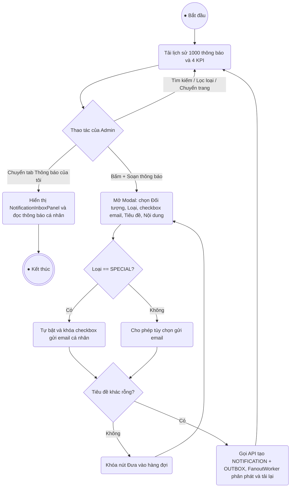

### Hàm/ sự kiện
```text
HÀM submitNotification():
    NẾU form.title.trim() rỗng THÌ THOÁT
    GỌI adminNotificationService.create({ recipientGroup, type, sendEmail, title, body })
    Đóng modal; hiện banner thành công (hoặc cảnh báo màu hổ phách nếu thiếu cấu hình SMTP); tải lại lịch sử
```

### Các ràng buộc
- `USER_INBOX` bảo đảm chống trùng lặp bằng Unique Index `(notification_id, account_id)` và `(account_id, type, ref_id)`.
- *Tham chiếu:* `Web_Frontend/src/views/admin/communication/AdminNotificationsView.vue`.

---

## Chức năng 12: Báo cáo Doanh thu

### Mục đích
Cho phép Admin theo dõi tổng doanh thu học phí theo chu kỳ (`3`, `6`, `12` tháng gần nhất), xem biểu đồ doanh thu theo tháng, top lớp có doanh thu cao nhất, tra cứu 10 giao dịch đã thanh toán gần nhất và xuất toàn bộ danh sách hóa đơn đã thanh toán trong kỳ ra tệp CSV (`bao-cao-doanh-thu.csv`).

### Giao diện
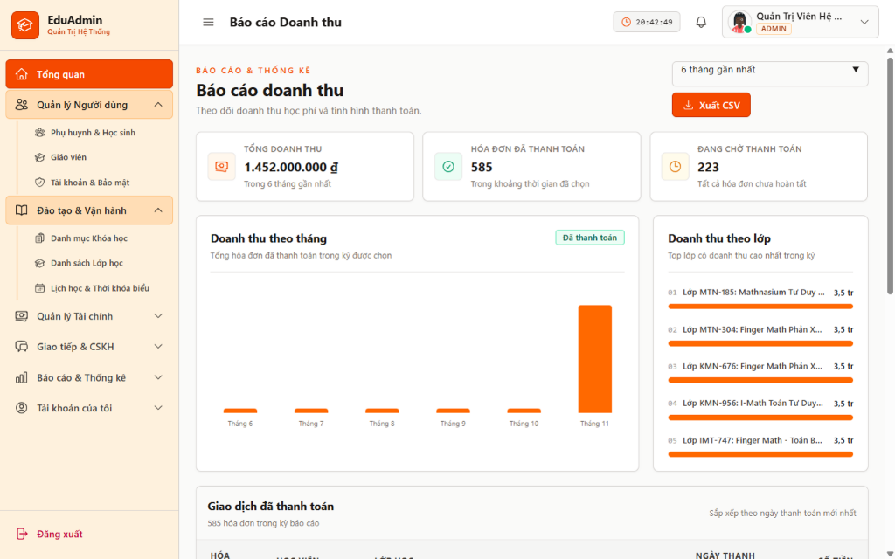

### Các thành phần trong giao diện

| STT | Loại điều khiển | Giá trị mặc định | Lưu ý |
| :--- | :--- | :--- | :--- |
| 1 | Combobox (`aria-label="Khoảng thời gian báo cáo"`) | `"6 tháng gần nhất"` (`6`) | Tùy chọn: `3 tháng gần nhất`, `6 tháng gần nhất`, `12 tháng gần nhất`; thay đổi tự gọi lại API. |
| 2 | Primary Button (`Xuất CSV`) | Enabled (khóa khi đang tải hoặc không có hóa đơn) | Sinh tệp `bao-cao-doanh-thu.csv` (UTF-8 BOM) ngay tại trình duyệt chứa toàn bộ `585` hóa đơn trong kỳ. |
| 3 | KPI Stat Cards (`3 thẻ`) | Quét thực tế: Tổng doanh thu `1.452.000.000 ₫`, Hóa đơn đã thanh toán `585`, Đang chờ thanh toán `223` | Hiển thị số liệu thực từ `admin-report.service.js`. |
| 4 | 2 Biểu đồ (`Doanh thu theo tháng`, `Doanh thu theo lớp`) | Tháng 6–11; Top 5 lớp (`3,5 tr`) | Biểu đồ cột CSS có tooltip hover và thanh tiến độ top lớp. |
| 5 | Data Table (`Giao dịch đã thanh toán`, `5 cột`) | `585 hóa đơn trong kỳ`, hiển thị 10 giao dịch mới nhất | Cột: `HÓA ĐƠN`, `HỌC VIÊN`, `LỚP HỌC`, `NGÀY THANH TOÁN`, `SỐ TIỀN`, kèm ghi chú `Xuất CSV để xem toàn bộ`. |

**Copy CSV (Thành phần giao diện CN12):**
```csv
STT,Loại điều khiển,Giá trị mặc định,Lưu ý
1,Combobox (Khoảng thời gian báo cáo),6 tháng gần nhất (6),"Tùy chọn: 3, 6, 12 tháng gần nhất."
2,Primary Button (Xuất CSV),Enabled,"Xuất toàn bộ 585 hóa đơn trong kỳ ra tệp bao-cao-doanh-thu.csv (UTF-8 BOM)."
3,KPI Stat Cards (3 thẻ),"Tổng 1.452.000.000 đ; Đã TT 585; Chờ TT 223",Dữ liệu trực tiếp từ adminReportService.getRevenue.
4,2 Biểu đồ (Theo tháng & Theo lớp),"Tháng 6-11; Top 5 lớp (3,5 tr)",Biểu đồ cột CSS và xếp hạng top lớp.
5,Data Table (5 cột),"10 giao dịch mới nhất / 585 hóa đơn","Sắp xếp mới nhất trước; ghi chú Xuất CSV để xem toàn bộ."
```

### Dữ liệu được sử dụng

| STT | Tên bảng / Cấu trúc dữ liệu | Thêm | Sửa | Xóa | Truy vấn |
| :--- | :--- | :---: | :---: | :---: | :---: |
| 1 | `INVOICE` (`Invoice`) | | | | X |
| 2 | `CLASSES` & `STUDENT_PROFILE` | | | | X |

**Copy CSV (Dữ liệu sử dụng CN12):**
```csv
STT,Tên bảng / Cấu trúc dữ liệu,Thêm,Sửa,Xóa,Truy vấn
1,INVOICE (Invoice),,,,X
2,CLASSES & STUDENT_PROFILE,,,,X
```

### Cách xử lý
1. Khi mount hoặc đổi `period` (`3`/`6`/`12`), gọi `reportService.getRevenue(Number(period))`.
2. Hiển thị 3 thẻ KPI, 2 biểu đồ và 10 dòng đầu của `paidInvoices`.
3. Khi bấm **Xuất CSV**, dựng chuỗi CSV có BOM `\uFEFF` từ toàn bộ `filteredInvoices` và kích hoạt tải file `bao-cao-doanh-thu.csv`.

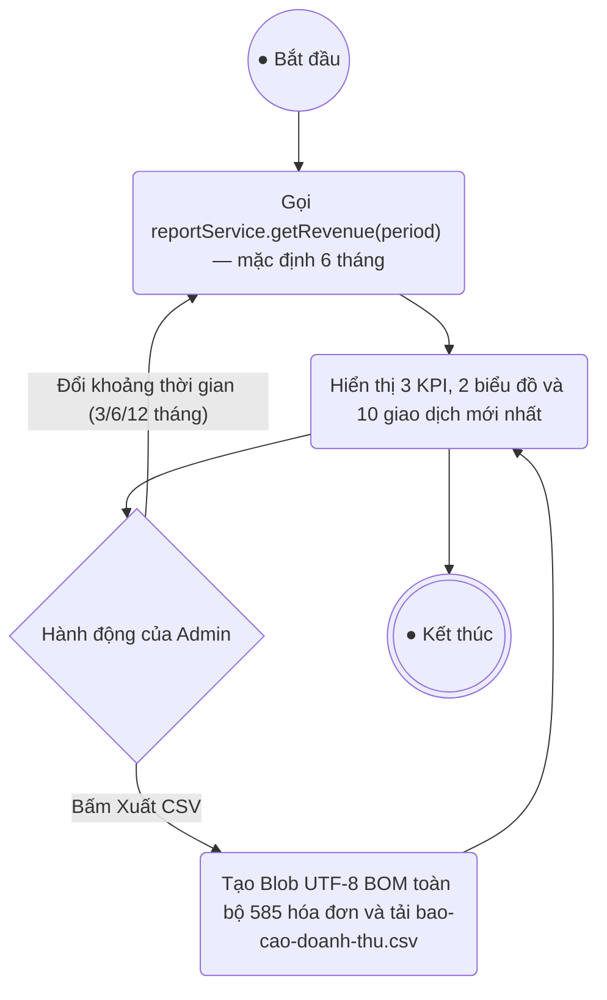

### Hàm/ sự kiện
```text
HÀM exportCsv():
    Dựng header + toàn bộ dòng từ filteredInvoices (escape dấu nháy kép)
    Thêm BOM \uFEFF, tạo Blob text/csv và kích hoạt thẻ <a> download="bao-cao-doanh-thu.csv"
```

### Các ràng buộc
- *Lưu ý kỹ thuật:* `RevenueReportView` chưa có `requestId` guard chống race condition khi người dùng đổi nhanh `period`.
- *Tham chiếu:* `Web_Frontend/src/views/admin/reports/RevenueReportView.vue`.

---

## Chức năng 13: Tổng quan Giáo viên (Dashboard Teacher)

### Mục đích
Cung cấp bảng điều khiển hàng ngày cho **Giáo viên** (`Thầy Giáo Test Toàn Năng`) theo dõi nhanh số lớp phụ trách, tổng số học sinh, ca dạy hôm nay/tuần này, tỷ lệ chuyên cần, trạng thái bài tập cần chấm, đơn xin nghỉ phép chờ duyệt và thông báo từ trung tâm.

### Giao diện
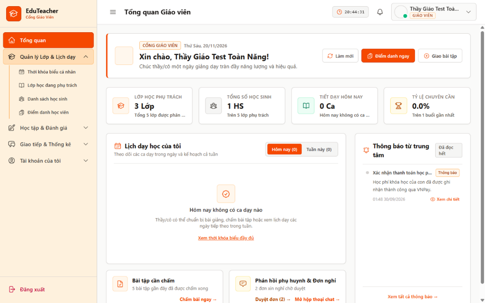

### Các thành phần trong giao diện

| STT | Loại điều khiển | Giá trị mặc định | Lưu ý |
| :--- | :--- | :--- | :--- |
| 1 | Action Buttons Banner (`Làm mới`, `Điểm danh ngay`, `Giao bài tập`) | Tất cả Enabled | `Điểm danh ngay` → `/teacher/attendance`; `Giao bài tập` → `/teacher/assignments`. *Lỗi thực tế:* Avatar banner & header không hiển thị ảnh (ô trống). |
| 2 | KPI Stat Cards (`4 thẻ`) | Quét thực tế: Lớp phụ trách `3 Lớp` (Tổng 5), Học sinh `1 HS`, Tiết dạy hôm nay `0 Ca`, Chuyên cần `0.0%` | Dữ liệu tổng hợp qua nhiều API theo lớp/buổi. |
| 3 | Schedule Tabs (`Hôm nay (0)`, `Tuần này (0)`) & Link `Xem thời khóa biểu đầy đủ` | Tab `Hôm nay (0)` active; nội dung `"Hôm nay không có ca dạy nào"` | Link dẫn tới `/teacher/schedule`. |
| 4 | Card `Bài tập cần chấm` & Card `Phản hồi phụ huynh & Đơn nghỉ` | `5 bài tập gần đây đã được chấm xong`; `2 đơn xin nghỉ chờ duyệt` | Có 3 link nhanh: `Chấm bài ngay →`, `Duyệt đơn (2) →`, `Mở hộp thoại chat →`. |
| 5 | Card `Thông báo từ trung tâm` | Trạng thái `Đã đọc hết`; mục `Xác nhận thanh toán học phí thành công #22` + nút `Xem chi tiết` | Bấm mở `NotificationDetailModal`; link `Xem tất cả thông báo →` mở `/teacher/communication/notices?tab=inbox`. |

**Copy CSV (Thành phần giao diện CN13):**
```csv
STT,Loại điều khiển,Giá trị mặc định,Lưu ý
1,"Action Buttons Banner (Làm mới, Điểm danh ngay, Giao bài tập)",Enabled,"Điều hướng nhanh tới Điểm danh và Giao bài tập; lỗi thực tế: avatar banner trống."
2,KPI Stat Cards (4 thẻ),"3 Lớp (tổng 5); 1 HS; 0 Ca hôm nay; Chuyên cần 0.0%",Tổng hợp từ dữ liệu thực của giáo viên.
3,"Schedule Tabs (Hôm nay / Tuần này) & Link TKB","Hôm nay (0) active","Link Xem thời khóa biểu đầy đủ tới /teacher/schedule."
4,"Cards Bài tập cần chấm & Đơn nghỉ / Chat","5 bài đã chấm; 2 đơn xin nghỉ chờ duyệt","Gồm các link Chấm bài ngay, Duyệt đơn (2), Mở hộp thoại chat."
5,Card Thông báo từ trung tâm,"Đã đọc hết (1 thông báo hiển thị)","Có nút Xem chi tiết mở modal và link Xem tất cả thông báo."
```

### Dữ liệu được sử dụng

| STT | Tên bảng / Cấu trúc dữ liệu | Thêm | Sửa | Xóa | Truy vấn |
| :--- | :--- | :---: | :---: | :---: | :---: |
| 1 | `CLASSES`, `CLASS_SCHEDULE`, `LESSON` | | | | X |
| 2 | `ATTENDANCE`, `LEAVE_REQUEST` | | | | X |
| 3 | `ASSIGNMENT`, `STUDENT_ASSIGNMENT` | | | | X |
| 4 | `USER_INBOX`, `NOTIFICATION` | | X | | X |

**Copy CSV (Dữ liệu sử dụng CN13):**
```csv
STT,Tên bảng / Cấu trúc dữ liệu,Thêm,Sửa,Xóa,Truy vấn
1,"CLASSES, CLASS_SCHEDULE, LESSON",,,,X
2,"ATTENDANCE, LEAVE_REQUEST",,,,X
3,"ASSIGNMENT, STUDENT_ASSIGNMENT",,,,X
4,"USER_INBOX, NOTIFICATION",,X,,X
```

### Cách xử lý
1. Khi mount `/teacher`, hệ thống tải toàn bộ lớp được phân công của giáo viên, sau đó gọi song song lịch học, buổi học, điểm danh, bài tập, đơn xin nghỉ và thông báo.
2. Hiển thị 4 thẻ KPI, lịch dạy hôm nay/tuần này, nhắc việc chấm bài/duyệt đơn và thông báo trung tâm.

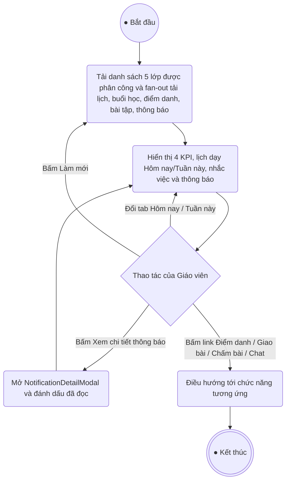

### Hàm/ sự kiện
```text
HÀM refreshDashboard():
    Tải getAssignedClasses() → fan-out tải lịch/buổi học (tối đa 12 API điểm danh, 24 API bài tập)
    Cập nhật KPI, lịch hôm nay/tuần này, số đơn xin nghỉ chờ duyệt và danh sách thông báo
```

### Các ràng buộc
- Fan-out nhiều API khi mount (cần chú ý hiệu năng khi số lớp/buổi tăng).
- *Lỗi hiển thị thực tế:* Avatar ban đầu trống khi chưa load xong; Console có lỗi SignalR disconnect tại một số thời điểm.
- *Tham chiếu:* `Web_Frontend/src/views/teacher/TeacherDashboardView.vue`.

---

## Chức năng 14: Thời khóa biểu cá nhân (Giáo viên)

### Mục đích
Cho phép Giáo viên xem thời khóa biểu giảng dạy cá nhân theo từng tuần (dạng Lưới tuần 7 ngày hoặc Danh sách), lọc theo từng lớp phụ trách, điều hướng tuần trước/tuần sau và đồng bộ lại lịch dạy.

### Giao diện
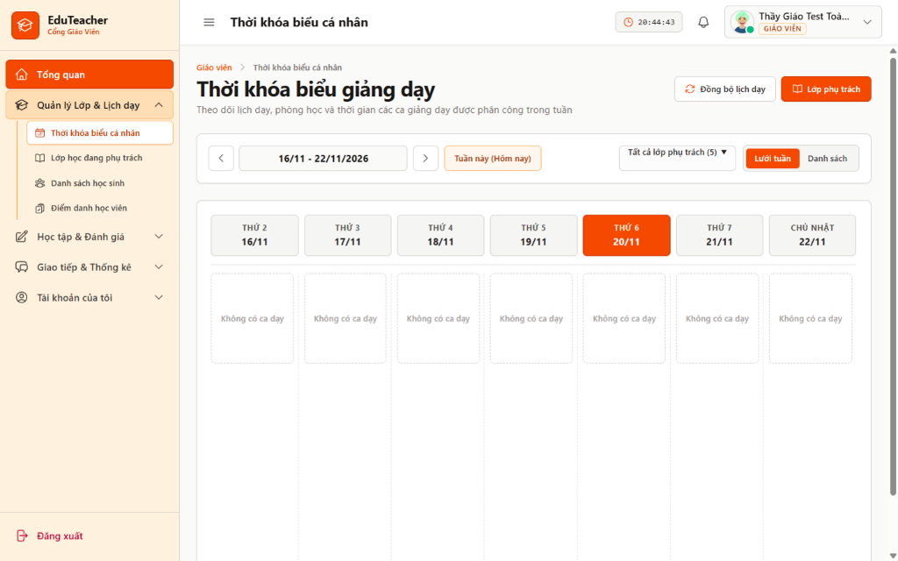

### Các thành phần trong giao diện

| STT | Loại điều khiển | Giá trị mặc định | Lưu ý |
| :--- | :--- | :--- | :--- |
| 1 | Action Buttons (`Đồng bộ lịch dạy`, Link `Lớp phụ trách`) | Enabled | `Lớp phụ trách` chuyển tới `/teacher/classes`. |
| 2 | Week Navigator (`Tuần trước`, Text khoảng tuần, `Tuần sau`, `Tuần này (Hôm nay)`) | `"16/11 - 22/11/2026"` (`weekOffset = 0`) | Di chuyển tuần để xem ca dạy quá khứ hoặc tương lai. |
| 3 | Combobox Lọc lớp | `"Tất cả lớp phụ trách (5)"` | 6 options gồm 5 lớp phụ trách (*lỗi dữ liệu/text thực tế: `Lớp KMN-403... (Cấp độ 34` bị cắt mất dấu ngoặc `)` cuối*). |
| 4 | View Toggle (`Lưới tuần`, `Danh sách`) | `Lưới tuần` active | Chuyển đổi hiển thị lưới 7 cột (`Thứ 2` → `Chủ Nhật`) và danh sách dọc. |
| 5 | Lưới 7 ngày trong tuần | Tuần `16/11–22/11/2026`: cả 7 ngày hiển thị `"Không có ca dạy"` | Bấm vào ca dạy (khi có) điều hướng nhanh sang điểm danh hoặc chi tiết lớp. |

**Copy CSV (Thành phần giao diện CN14):**
```csv
STT,Loại điều khiển,Giá trị mặc định,Lưu ý
1,"Action Buttons (Đồng bộ lịch dạy, Lớp phụ trách)",Enabled,Đồng bộ lịch hoặc chuyển sang /teacher/classes.
2,Week Navigator,"16/11 - 22/11/2026 (weekOffset=0)","Gồm Tuần trước, Tuần sau, Tuần này (Hôm nay)."
3,Combobox Lọc lớp,"Tất cả lớp phụ trách (5)","6 options; lỗi hiển thị thực tế: tên Lớp KMN-403 bị cắt thiếu dấu ngoặc ) cuối."
4,"View Toggle (Lưới tuần / Danh sách)",Lưới tuần active,Chuyển đổi giữa lưới 7 ngày và danh sách.
5,Lưới 7 ngày trong tuần,"7 cột Thứ 2 -> Chủ Nhật (Không có ca dạy)",Hiển thị các ca dạy trong tuần đang chọn.
```

### Dữ liệu được sử dụng

| STT | Tên bảng / Cấu trúc dữ liệu | Thêm | Sửa | Xóa | Truy vấn |
| :--- | :--- | :---: | :---: | :---: | :---: |
| 1 | `CLASSES`, `CLASS_SCHEDULE`, `LESSON` | | | | X |

**Copy CSV (Dữ liệu sử dụng CN14):**
```csv
STT,Tên bảng / Cấu trúc dữ liệu,Thêm,Sửa,Xóa,Truy vấn
1,"CLASSES, CLASS_SCHEDULE, LESSON",,,,X
```

### Cách xử lý
1. Đọc `route.query.classId` (nếu có) để lọc sẵn lớp, tải danh sách lớp phụ trách cùng lịch/buổi học.
2. Tính khoảng ngày theo `weekOffset` (mặc định tuần hiện tại) và phân bổ các ca dạy vào 7 cột ngày.

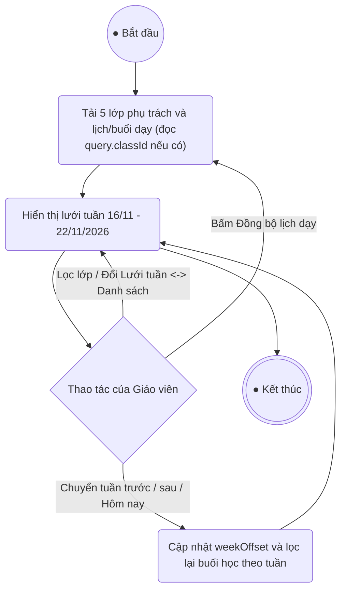

### Hàm/ sự kiện
```text
HÀM changeWeek(delta):
    weekOffset ← delta == 0 ? 0 : weekOffset + delta
    Tính lại weekStart, weekEnd và render danh sách ca dạy thuộc khoảng tuần mới
```

### Các ràng buộc
- Chỉ hiển thị lịch các lớp được gán cho giáo viên; lỗi API chỉ ghi `console.error` không hiện banner.
- *Tham chiếu:* `Web_Frontend/src/views/teacher/TeacherScheduleView.vue`.

---

## Chức năng 15: Lớp học đang phụ trách (Giáo viên)

### Mục đích
Cho phép Giáo viên tra cứu danh sách toàn bộ các lớp mình được phân công giảng dạy (`5` lớp), tìm kiếm theo tên lớp/khóa học/phòng học, lọc theo trạng thái lớp và truy cập nhanh tới danh sách học sinh, lịch học hoặc điểm danh của từng lớp.

### Giao diện
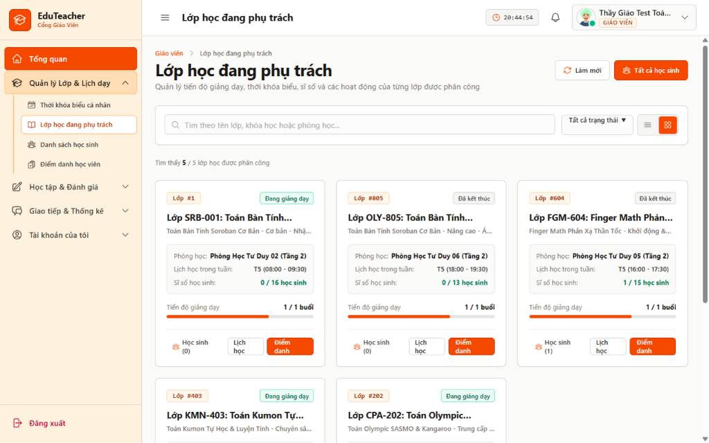

### Các thành phần trong giao diện

| STT | Loại điều khiển | Giá trị mặc định | Lưu ý |
| :--- | :--- | :--- | :--- |
| 1 | Action Buttons (`Làm mới`, Link `Tất cả học sinh`) | Enabled | `Tất cả học sinh` chuyển tới `/teacher/students`. |
| 2 | Search Input | Rỗng (`""`) | Placeholder `Tìm theo tên lớp, khóa học hoặc phòng học...`, lọc client. |
| 3 | Combobox Trạng thái & View Toggle (`Danh sách` / `Lưới`) | `"Tất cả trạng thái"` (`all`); `Dạng lưới` active | 4 trạng thái: `Tất cả`, `Đang giảng dạy (Mở lớp)`, `Sắp khai giảng`, `Đã kết thúc`. |
| 4 | Danh sách 5 Card lớp học (`5 / 5 lớp học`) | `SRB-001`, `OLY-805`, `FGM-604`, `KMN-403`, `CPA-202` | Mỗi thẻ có 3 nút điều hướng: `Học sinh (n)`, `Lịch học`, `Điểm danh`. *Lỗi hiển thị thực tế:* 3 nút trên card bị bóp hẹp nên chữ bị xuống 2 dòng. |
| 5 | Pagination Bar (Client) | `9 / trang`, `1–5 / 5`, `Trước` & `Sau` disabled | Tùy chọn: `9`, `18`, `36`, `72 / trang`. |

**Copy CSV (Thành phần giao diện CN15):**
```csv
STT,Loại điều khiển,Giá trị mặc định,Lưu ý
1,"Action Buttons (Làm mới, Tất cả học sinh)",Enabled,Tải lại danh sách lớp hoặc mở /teacher/students.
2,Search Input,(Rỗng),"Placeholder Tìm theo tên lớp, khóa học hoặc phòng học..."
3,"Combobox Trạng thái & View Toggle","Tất cả trạng thái; Dạng lưới",Lọc theo 4 trạng thái và chuyển đổi Grid/List.
4,Danh sách Card lớp học (5 lớp),"SRB-001, OLY-805, FGM-604, KMN-403, CPA-202","Mỗi thẻ có nút Học sinh (n), Lịch học, Điểm danh (lỗi thực tế: chữ trong 3 nút bị xuống 2 dòng)."
5,Pagination Bar (Client),"9 / trang, trang 1/1, Trước & Sau disabled","Tùy chọn 9, 18, 36, 72 lớp/trang."
```

### Dữ liệu được sử dụng

| STT | Tên bảng / Cấu trúc dữ liệu | Thêm | Sửa | Xóa | Truy vấn |
| :--- | :--- | :---: | :---: | :---: | :---: |
| 1 | `CLASSES`, `CLASS_SCHEDULE`, `LESSON`, `CLASS_STUDENT` | | | | X |

**Copy CSV (Dữ liệu sử dụng CN15):**
```csv
STT,Tên bảng / Cấu trúc dữ liệu,Thêm,Sửa,Xóa,Truy vấn
1,"CLASSES, CLASS_SCHEDULE, LESSON, CLASS_STUDENT",,,,X
```

### Cách xử lý
1. Gọi `getAssignedClasses()` nạp toàn bộ lớp giáo viên phụ trách, phân trang client 9 lớp/trang rồi tải thêm lịch học & buổi học cho các lớp trong trang hiện tại.
2. Bấm vào các nút trên card sẽ điều hướng kèm `query.classId` tới Học sinh, Lịch học hoặc Điểm danh.

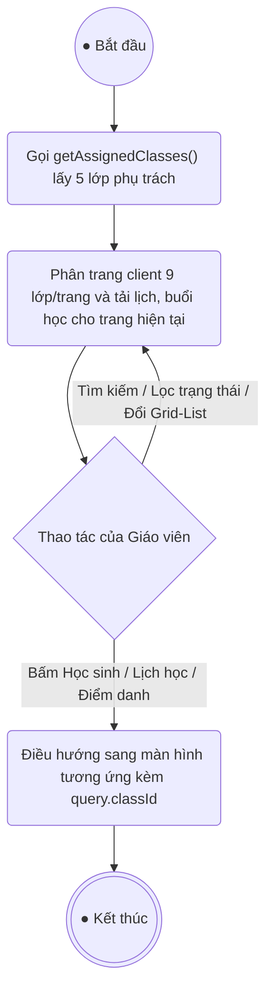

### Hàm/ sự kiện
```text
HÀM loadTeacherClasses():
    allClasses ← GỌI classService.getAssignedClasses()
    Lọc theo search và statusFilter → cắt theo trang hiện tại (pageSize=9)
    Nạp bổ sung schedules và lessons cho danh sách lớp đang hiển thị
```

### Các ràng buộc
- *Lỗi hiển thị thực tế trên `:8088`:* Cụm 3 nút hành động trong mỗi thẻ lớp bị hẹp làm chữ rớt xuống 2 dòng.
- *Tham chiếu:* `Web_Frontend/src/views/teacher/TeacherClassesView.vue`.

---
## Chức năng 16: Danh sách học sinh theo lớp (Giáo viên)

### Mục đích
Cho phép Giáo viên xem danh sách học sinh từng lớp phụ trách, tra cứu thông tin liên hệ phụ huynh, điểm tích lũy/sao, xem lịch sử chuyên cần, chuyển nhanh sang chấm điểm hoặc chat/gọi phụ huynh, và xuất danh sách học sinh ra file CSV.

### Giao diện
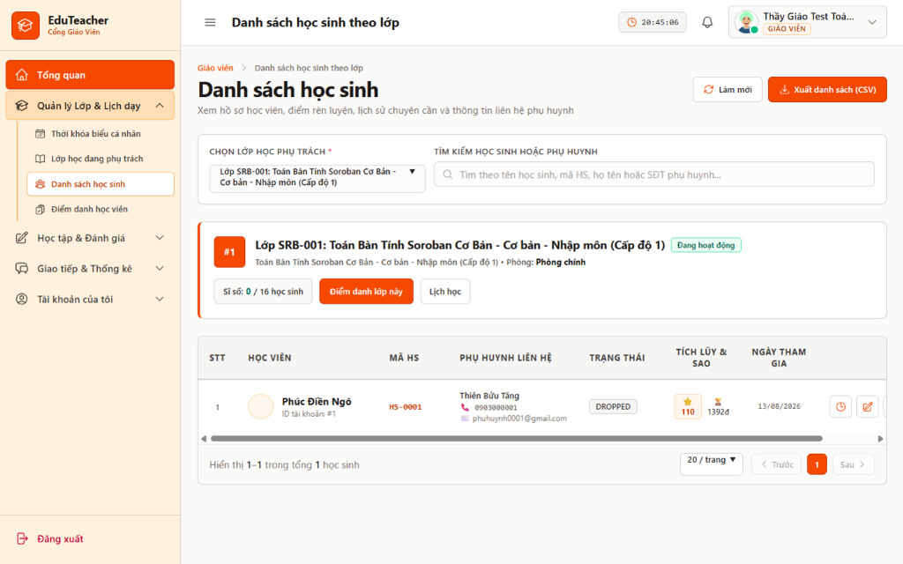

### Các thành phần trong giao diện

| STT | Loại điều khiển | Giá trị mặc định | Lưu ý |
| :--- | :--- | :--- | :--- |
| 1 | Action Buttons (`Làm mới`, `Xuất danh sách (CSV)`) | Enabled | `Xuất danh sách (CSV)` tải danh sách học sinh lớp đang chọn về máy. |
| 2 | Combobox `Chọn lớp học phụ trách *` | `Lớp SRB-001... (Cấp độ 1)` (`value=1`) | 6 options (option nhắc chọn bị disabled + 5 lớp; `Lớp KMN-403` bị cắt thiếu dấu `)` cuối). |
| 3 | Text Input `Tìm kiếm học sinh hoặc phụ huynh` | Rỗng (`""`) | Placeholder `Tìm theo tên học sinh, mã HS, họ tên hoặc SĐT phụ huynh...`, debounce `300ms`. |
| 4 | Banner thông tin lớp & 2 Link nhanh | `#1 Lớp SRB-001` (`Đang hoạt động`, `Sĩ số: 0 / 16 học sinh`) + Link `Điểm danh lớp này`, `Lịch học` | *Ghi nhận mâu thuẫn dữ liệu thực tế:* Banner ghi `Sĩ số: 0 / 16` nhưng bảng bên dưới vẫn hiển thị 1 học sinh có trạng thái `DROPPED`. |
| 5 | Data Table (`8 cột`) | 1 bản ghi (`Phúc Điền Ngô · HS-0001 · PH Thiên Bửu Tăng · DROPPED · ⭐110 🏆1392đ`) | Cột Thao tác có 4 hành động: `Lịch sử chuyên cần`, `Chấm điểm`, `Chat với phụ huynh`, `Gọi cho phụ huynh`. *Lỗi hiển thị thực tế:* Bảng tràn ngang làm khuất 2 nút cuối (`Chat`, `Gọi`) ở `1281x801`. |
| 6 | Pagination Bar | `20 / trang`, `1–1 / 1`, `Trước` & `Sau` disabled | Tùy chọn `10 / 20 / 50 / 100 / trang`. |

**Copy CSV (Thành phần giao diện CN16):**
```csv
STT,Loại điều khiển,Giá trị mặc định,Lưu ý
1,"Action Buttons (Làm mới, Xuất danh sách CSV)",Enabled,Xuất danh sách học sinh ra file CSV tại trình duyệt.
2,Combobox Chọn lớp học phụ trách *,"Lớp SRB-001 (value=1)","5 lớp phụ trách; tên Lớp KMN-403 bị cắt thiếu dấu ) cuối."
3,Text Input Tìm kiếm HS/PH,(Rỗng),"Tìm theo tên HS, mã HS, tên/SĐT phụ huynh; debounce 300ms."
4,Banner lớp & 2 Link nhanh,"Sĩ số: 0 / 16 + Điểm danh + Lịch học","Mâu thuẫn thực tế: banner ghi 0/16 trong khi bảng có 1 HS trạng thái DROPPED."
5,Data Table (8 cột),"1 bản ghi (Phúc Điền Ngô - HS-0001 - DROPPED)","Lỗi hiển thị thực tế: bảng tràn ngang khuất 2 nút Chat và Gọi ở 1281x801."
6,Pagination Bar,"20 / trang, trang 1/1, Trước & Sau disabled","Phân trang server."
```

### Dữ liệu được sử dụng

| STT | Tên bảng / Cấu trúc dữ liệu | Thêm | Sửa | Xóa | Truy vấn |
| :--- | :--- | :---: | :---: | :---: | :---: |
| 1 | `CLASS_STUDENT`, `STUDENT_PROFILE`, `PARENT_PROFILE` | | | | X |
| 2 | `CLASSES`, `ATTENDANCE` (lịch sử chuyên cần) | | | | X |

**Copy CSV (Dữ liệu sử dụng CN16):**
```csv
STT,Tên bảng / Cấu trúc dữ liệu,Thêm,Sửa,Xóa,Truy vấn
1,"CLASS_STUDENT, STUDENT_PROFILE, PARENT_PROFILE",,,,X
2,"CLASSES, ATTENDANCE",,,,X
```

### Cách xử lý
1. Nạp lớp phụ trách (ưu tiên `route.query.classId` nếu có), tải danh sách học sinh phân trang server (`20/trang`).
2. Bấm xem lịch sử chuyên cần mở modal chi tiết điểm danh; bấm `Chat` chuyển tới `/teacher/communication/chat?parentId=...`; bấm `Xuất danh sách (CSV)` tải tệp CSV.

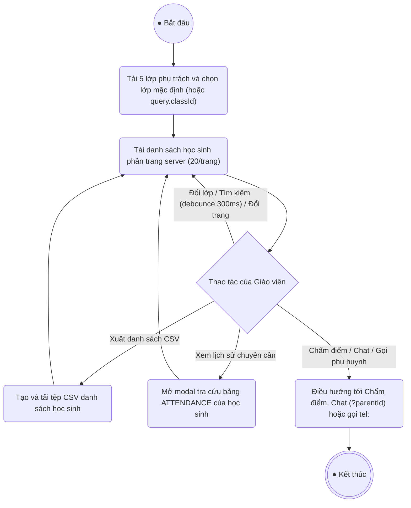

### Hàm/ sự kiện
```text
HÀM exportStudentsCsv():
    Tổng hợp danh sách học sinh đang hiển thị thành chuỗi CSV UTF-8 BOM và kích hoạt tải xuống
```

### Các ràng buộc
- *Lỗi hiển thị thực tế trên `:8088`:* Bảng 8 cột tràn ngang che khuất 2 nút cuối (`Chat`, `Gọi`); sĩ số banner (`0/16`) chỉ đếm `ACTIVE` trong khi bảng vẫn hiển thị học sinh `DROPPED`.
- *Tham chiếu:* `Web_Frontend/src/views/teacher/TeacherStudentsView.vue`.

---

## Chức năng 17: Điểm danh học viên & Duyệt đơn xin nghỉ phép

### Mục đích
Cho phép Giáo viên điểm danh chuyên cần (`PRESENT`, `LATE`, `EXCUSED`, `ABSENT`) từng học sinh hoặc hàng loạt cho buổi học trong phạm vi **24 giờ sau khi kết thúc buổi**, duyệt đơn xin nghỉ phép từ phụ huynh, nhập ghi chú và xem lịch sử chuyên cần; tự động chuyển sang **Chế độ chỉ xem** khi quá hạn 24 giờ.

### Giao diện
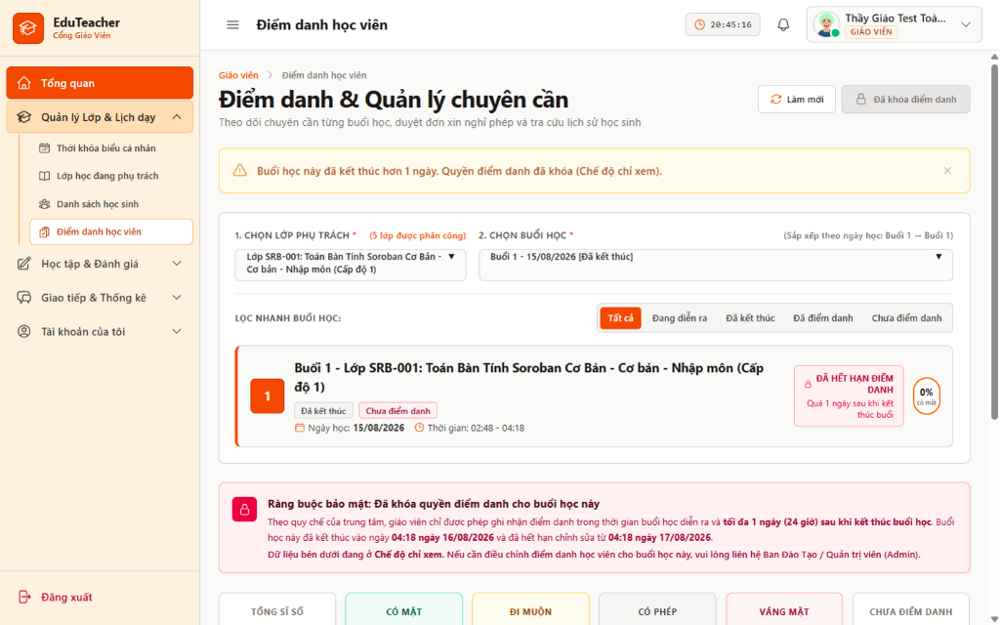

### Các thành phần trong giao diện

| STT | Loại điều khiển | Giá trị mặc định | Lưu ý |
| :--- | :--- | :--- | :--- |
| 1 | Action Buttons (`Làm mới`, `Đã khóa điểm danh` / `Lưu tất cả điểm danh`) | Quét thực tế: `Làm mới` enabled; `Đã khóa điểm danh` **disabled** | Tự đổi sang nút cam `Lưu tất cả điểm danh` khi buổi học còn trong hạn 24h; hiện `window.confirm` nếu còn HS `UNMARKED`. |
| 2 | Warning Banner (`Buổi học này đã kết thúc hơn 1 ngày...`) | Hiện khi buổi học quá hạn 24h (có nút đóng `X`) | Đi kèm box đỏ `Ràng buộc bảo mật: Đã khóa quyền điểm danh` hiển thị thời điểm kết thúc (`04:18 16/08/2026`) và hạn chót (`04:18 17/08/2026`). |
| 3 | Combobox `1. Chọn lớp phụ trách *` & `2. Chọn buổi học *` | Lớp `SRB-001` (`5 lớp`); `Buổi 1 - 15/08/2026 [Đã kết thúc]` | Sắp xếp buổi học theo ngày tăng dần (`Buổi 1 → N`). |
| 4 | 5 Filter Tabs (`Lọc nhanh buổi học`) | `Tất cả` active | `Tất cả`, `Đang diễn ra`, `Đã kết thúc`, `Đã điểm danh`, `Chưa điểm danh`. |
| 5 | Card trạng thái buổi học & 6 Thẻ KPI chuyên cần | `0% có mặt`; 6 thẻ đều `0` (`Tổng sĩ số`, `Có mặt`, `Đi muộn`, `Có phép`, `Vắng mặt`, `Chưa điểm danh`) | Cập nhật realtime khi chấm điểm danh. |
| 6 | Batch Toolbar (`Tất cả CÓ MẶT`, `Duyệt đơn nghỉ phép (0)`, `Đặt lại`, tìm tên HS, lọc trạng thái) | Cả 3 nút batch **disabled** do buổi đã khóa; Select `Tất cả trạng thái (0)` | Select gồm 7 options kể cả `Có đơn xin nghỉ (0)`. |
| 7 | Bảng học sinh điểm danh | Quét buổi #1: `"Không tìm thấy học sinh nào"` | Khi có học sinh & còn hạn: hiển thị đơn nghỉ + `Duyệt có phép`, 4 nút trạng thái, ô ghi chú, nút lưu lẻ và xem lịch sử. |

**Copy CSV (Thành phần giao diện CN17):**
```csv
STT,Loại điều khiển,Giá trị mặc định,Lưu ý
1,"Action Buttons (Làm mới, Lưu/Đã khóa điểm danh)","Làm mới enabled; Đã khóa điểm danh disabled","Khóa tự động sau 24h kết thúc buổi; hỏi confirm nếu còn HS UNMARKED."
2,Warning Banner & Security Lock Box,Hiển thị do buổi 15/08/2026 đã quá hạn,"Ghi rõ giờ kết thúc và hạn chót chỉnh sửa; chuyển toàn bảng sang chỉ xem."
3,"2 Combobox (Chọn lớp, Chọn buổi học)","Lớp SRB-001 (5 lớp); Buổi 1 - 15/08/2026 [Đã kết thúc]","Đánh số buổi tăng dần theo ngày học."
4,5 Filter Tabs (Lọc nhanh buổi học),Tất cả active,"Tất cả, Đang diễn ra, Đã kết thúc, Đã điểm danh, Chưa điểm danh."
5,Card trạng thái buổi học & 6 Thẻ KPI,"0% có mặt; 6 thẻ KPI = 0","Tổng sĩ số, Có mặt, Đi muộn, Có phép, Vắng mặt, Chưa điểm danh."
6,Batch Toolbar (3 nút + Search + Select),"3 nút batch disabled; Select Tất cả trạng thái (0)","Tất cả CÓ MẶT, Duyệt đơn nghỉ phép, Đặt lại, lọc 7 trạng thái kể cả HAS_LEAVE."
7,Bảng học sinh điểm danh,Không tìm thấy học sinh nào (buổi #1),"Khi có HS còn hạn: 4 nút PRESENT/LATE/EXCUSED/ABSENT, duyệt đơn nghỉ, ghi chú, lưu lẻ."
```

### Dữ liệu được sử dụng

| STT | Tên bảng / Cấu trúc dữ liệu | Thêm | Sửa | Xóa | Truy vấn |
| :--- | :--- | :---: | :---: | :---: | :---: |
| 1 | `ATTENDANCE` (`Attendance`) | X | X | | X |
| 2 | `LEAVE_REQUEST` (`LeaveRequest`) | | X | | X |
| 3 | `CLASSES`, `LESSON`, `CLASS_STUDENT`, `STUDENT_PROFILE` | | | | X |

**Copy CSV (Dữ liệu sử dụng CN17):**
```csv
STT,Tên bảng / Cấu trúc dữ liệu,Thêm,Sửa,Xóa,Truy vấn
1,ATTENDANCE (Attendance),X,X,,X
2,LEAVE_REQUEST (LeaveRequest),,X,,X
3,"CLASSES, LESSON, CLASS_STUDENT, STUDENT_PROFILE",,,,X
```

### Cách xử lý
1. Chọn lớp phụ trách → chọn buổi học → tải bảng điểm danh & đơn xin nghỉ.
2. Hệ thống tính `lockState`: nếu `now > endTime + 24 giờ` thì hiển thị cảnh báo khóa và vô hiệu hóa toàn bộ thao tác ghi nhận.
3. Nếu còn trong hạn 24 giờ: giáo viên có thể chấm nhanh cả lớp, duyệt đơn xin nghỉ (`LEAVE_REQUEST = APPROVED` → `ATTENDANCE = EXCUSED`), lưu lẻ từng em (`PUT`) hoặc lưu hàng loạt (`POST`).

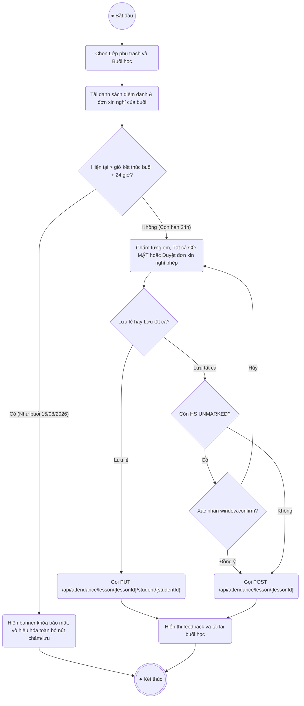

### Hàm/ sự kiện
```text
HÀM handleSaveBatchAttendance():
    NẾU lockState.isLocked THÌ THOÁT
    NẾU có học sinh UNMARKED VÀ KHÔNG window.confirm(...) THÌ THOÁT
    GỌI attendanceService.saveBatch(selectedLessonId, validRows)
    Tải lại dữ liệu buổi học và thông báo kết quả
```

### Các ràng buộc
- **Quy chế khóa 24 giờ:** Chỉ cho phép giáo viên chỉnh sửa điểm danh tối đa 24 giờ sau giờ kết thúc buổi học.
- *Tham chiếu:* `Web_Frontend/src/views/teacher/TeacherAttendanceView.vue`, `Document/Review/Frontend/04-Man-Hinh-Va-Luong-Teacher.md` (mục 2.1).

---

## Chức năng 18: Quản lý Ngân hàng câu hỏi & AI Import đề thi

### Mục đích
Cho phép Giáo viên quản lý kho ngân hàng câu hỏi (`1000` ngân hàng) phân theo khóa học, tạo/sửa/xóa/lọc câu hỏi theo độ khó & loại câu hỏi, xóa hàng loạt, và dùng **AI Import Worker** (3 bước) tự động bóc tách đề thi từ `.docx`/`.pdf` (tối đa `50MB`).

### Giao diện
**Màn hình Ngân hàng câu hỏi (`/teacher/questions`):**
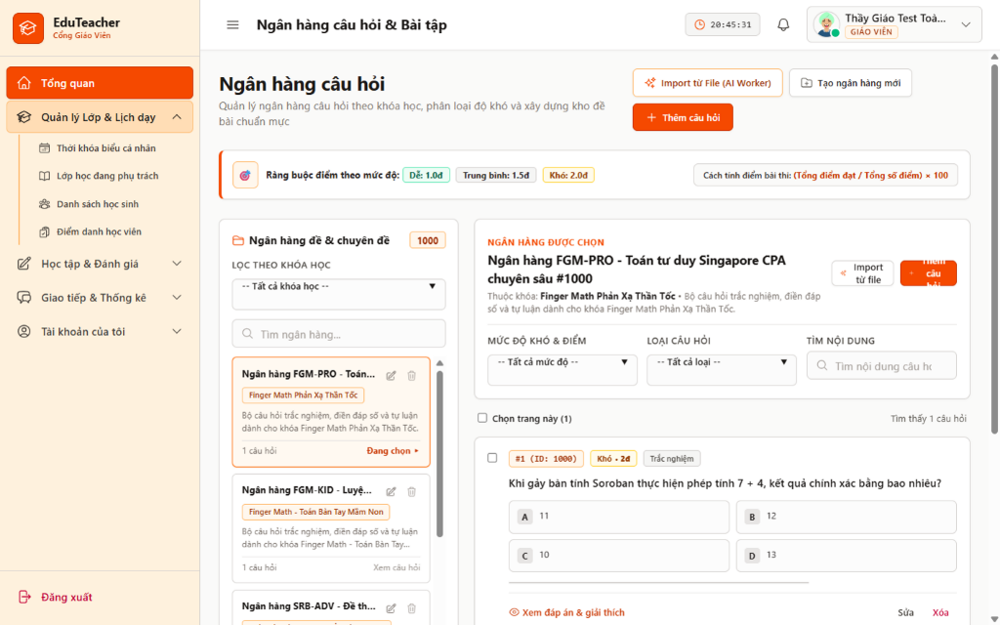

**Modal Nhập câu hỏi từ File (AI Import Worker):**
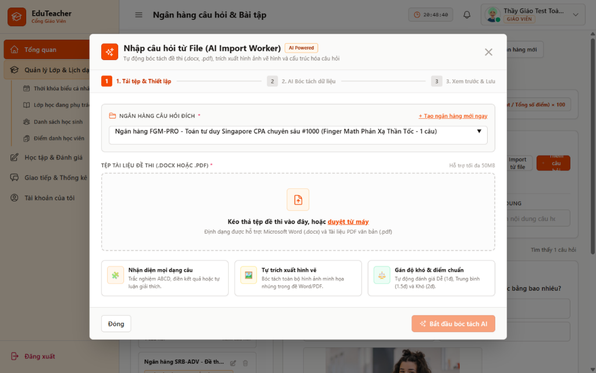

### Các thành phần trong giao diện

| STT | Loại điều khiển | Giá trị mặc định | Lưu ý |
| :--- | :--- | :--- | :--- |
| 1 | 3 Header Action Buttons (`Import từ File (AI Worker)`, `Tạo ngân hàng mới`, `Thêm câu hỏi`) | Tất cả Enabled (khi đã chọn ngân hàng `#1000`) | Mở modal AI Import, modal Tạo ngân hàng hoặc modal Thêm câu hỏi. |
| 2 | Banner Quy chuẩn điểm | `Dễ: 1.0đ \| Trung bình: 1.5đ \| Khó: 2.0đ` | Ghi công thức quy đổi thang 100. |
| 3 | Cột trái: Lọc khóa học, SearchBar, 10 Card ngân hàng (`#1000` → `#991`) & Phân trang | `-- Tất cả khóa học --` (12 khóa); `1–10 / 1000` (100 trang) | Mỗi card có 2 nút icon Sửa/Xóa ngân hàng; card `#1000` đang chọn (`Đang chọn ▸`). |
| 4 | Cột phải: Header ngân hàng đang chọn & 2 nút `Import từ file`, `Thêm câu hỏi` | Ngân hàng `#1000` | *Lỗi hiển thị thực tế:* 2 nút `Import từ file` và `Thêm câu hỏi` bị ép quá hẹp làm chữ rớt xuống 3 dòng và tràn nhẹ khung nút. |
| 5 | Bộ lọc câu hỏi (`Mức độ khó`, `Loại câu hỏi`, `Tìm nội dung`) & Checkbox `Chọn trang này (1)` | `-- Tất cả mức độ --`, `-- Tất cả loại --`, ô tìm rỗng, checkbox unchecked | Chọn câu hỏi sẽ hiện nút `Xóa đã chọn` và `Trích xuất câu hỏi` *(stub)*. |
| 6 | Danh sách Card câu hỏi & Phân trang cột phải | `1–1 / 1 câu hỏi` (`ID: 1000 · Khó 2đ · Trắc nghiệm`), `20 / trang` | Mỗi câu có nút `Xem đáp án & giải thích`, `Sửa`, `Xóa`. |
| 7 | Modal `Nhập câu hỏi từ File (AI Import Worker)` (3 bước) | Bước 1 active; Ngân hàng đích `#1000`; chưa chọn tệp; nút `Bắt đầu bóc tách AI` **disabled** | Hỗ trợ `+ Tạo ngân hàng mới ngay` và Dropzone `.docx`/`.pdf` (≤50MB); Bước 2 polling `2.5s`; Bước 3 xem trước & lưu hàng loạt. |

**Copy CSV (Thành phần giao diện CN18):**
```csv
STT,Loại điều khiển,Giá trị mặc định,Lưu ý
1,3 Header Action Buttons,Enabled,"Import từ File (AI Worker), Tạo ngân hàng mới, Thêm câu hỏi."
2,Banner Quy chuẩn điểm,"Dễ 1.0đ; Trung bình 1.5đ; Khó 2.0đ",Công thức quy đổi thang 100.
3,Cột trái (Danh sách 1000 ngân hàng),"1-10 / 1000 (100 trang); #1000 đang chọn","Lọc theo 12 khóa học, tìm debounce 300ms, nút Sửa/Xóa từng ngân hàng."
4,Header cột phải (2 nút thao tác),Ngân hàng #1000,"Lỗi hiển thị thực tế: 2 nút Import từ file và Thêm câu hỏi bị hẹp làm chữ rớt 3 dòng."
5,"Bộ lọc câu hỏi & Chọn trang này","Tất cả mức độ; Tất cả loại; unchecked","Lọc độ khó/loại/nội dung; chọn nhiều để xóa hàng loạt hoặc trích xuất (stub)."
6,Card câu hỏi & Phân trang,"1 câu (ID 1000 - Khó 2đ - Trắc nghiệm); 20 / trang","Có nút Xem đáp án & giải thích, Sửa, Xóa."
7,Modal AI Import Worker (3 bước),"Bước 1 active; nút Bắt đầu bóc tách AI disabled","Dropzone .docx/.pdf <=50MB; Bước 2 polling 2.5s; Bước 3 xem trước & bulkCreateQuestions."
```

### Dữ liệu được sử dụng

| STT | Tên bảng / Cấu trúc dữ liệu | Thêm | Sửa | Xóa | Truy vấn |
| :--- | :--- | :---: | :---: | :---: | :---: |
| 1 | `QUESTION_BANK` & `QUESTION` | X | X | X | X |
| 2 | `QUESTION_ASSIGNMENT` (gỡ khi xóa) & `COURSE` | | | X | X |
| 3 | Python AI Import Worker (`/api/parser/process-file`, `/job/{id}`) | X | | | X |

**Copy CSV (Dữ liệu sử dụng CN18):**
```csv
STT,Tên bảng / Cấu trúc dữ liệu,Thêm,Sửa,Xóa,Truy vấn
1,QUESTION_BANK & QUESTION,X,X,X,X
2,QUESTION_ASSIGNMENT & COURSE,,,X,X
3,Python AI Import Worker (/api/parser/*),X,,,X
```

### Cách xử lý
1. Cột trái nạp phân trang `10` ngân hàng/trang từ tổng `1000` ngân hàng; chọn ngân hàng nạp `20` câu hỏi/trang bên phải.
2. Khi dùng AI Import: Bước 1 upload `.docx`/`.pdf` ≤ 50MB lên FastAPI worker → Bước 2 polling `/api/parser/job/{jobId}` mỗi `2.5s` → Bước 3 xem trước, hiệu chỉnh và gọi `bulkCreateQuestions` (fallback lưu từng câu nếu lỗi batch).

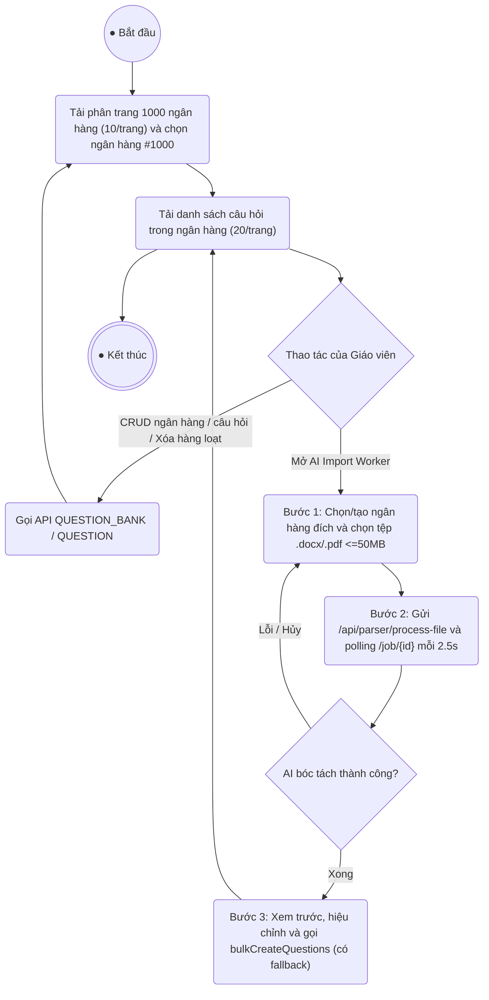

### Hàm/ sự kiện
```text
HÀM startAiImport():
    KIỂM_TRA tệp thuộc .docx/.pdf và size <= 50MB
    jobId ← GỌI POST /api/parser/process-file
    Polling GET /api/parser/job/{jobId} mỗi 2500ms đến khi COMPLETED
    Chuyển Bước 3 xem trước và gọi bulkCreateQuestions (fallback createQuestion từng câu)
```

### Các ràng buộc
- *Lỗi thực tế & kỹ thuật:* 2 nút hành động header cột phải bị rớt 3 dòng; `exportSelectedQuestions` là stub; Bước 3 `ImportQuestionsModal` bị lệch index khi thao tác lúc đang bật lọc loại câu hỏi.
- *Tham chiếu:* `TeacherQuestionsView.vue`, `ImportQuestionsModal.vue`.

---

## Chức năng 19: Tạo & Giao bài tập về nhà

### Mục đích
Cho phép Giáo viên tạo bài kiểm tra/bài tập đính kèm từng buổi học từ ngân hàng câu hỏi, cấu hình thời gian mở/hạn nộp/thời lượng, phân công cho toàn bộ lớp hoặc từng học sinh, đồng thời quản lý giao lẻ, xem đề, nhân bản sang buổi khác, sửa và xóa bài tập.

### Giao diện
**Màn hình Giao bài tập (`/teacher/assignments`):**
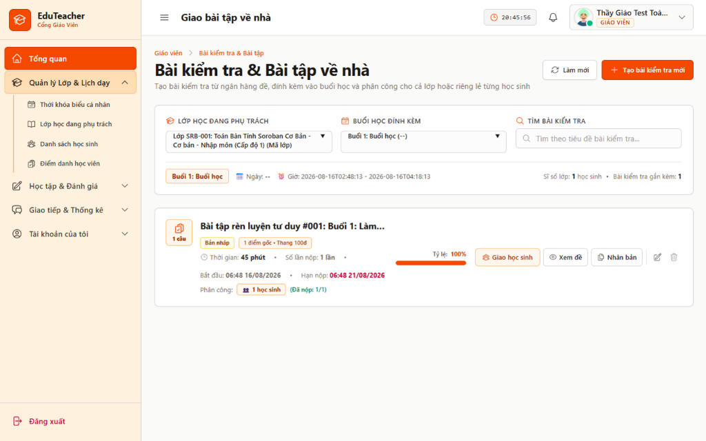

**Modal Tạo bài kiểm tra mới:**
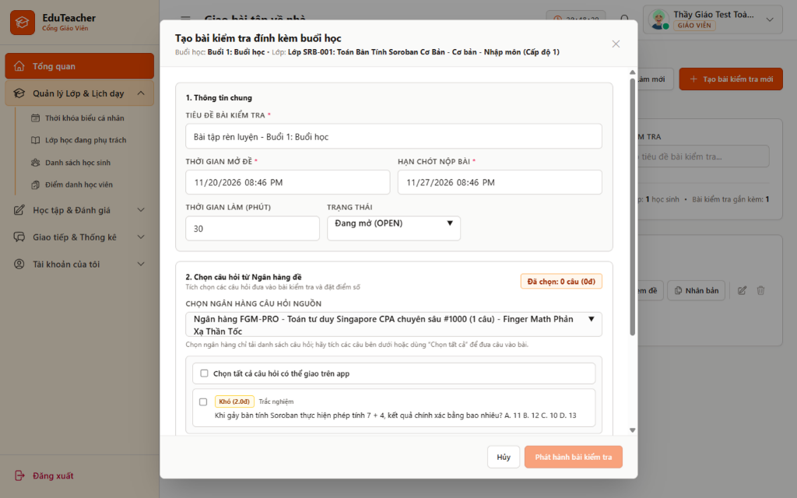

### Các thành phần trong giao diện

| STT | Loại điều khiển | Giá trị mặc định | Lưu ý |
| :--- | :--- | :--- | :--- |
| 1 | Action Buttons (`Làm mới`, `Tạo bài kiểm tra mới`) | Cả hai Enabled | Bấm `Tạo bài kiểm tra mới` mở Modal soạn bài tập đính kèm buổi học đang chọn. |
| 2 | 2 Combobox (`Lớp học đang phụ trách`, `Buổi học đính kèm`) & `SearchBar` | `Lớp SRB-001`; `Buổi 1: Buổi học (--)`; tìm kiếm rỗng | *Lỗi hiển thị thực tế:* Ngày buổi học hiện `(--)` và giờ học hiển thị chuỗi ISO thô `2026-08-16T02:48:13 - 2026-08-16T04:18:13`. |
| 3 | Card bài kiểm tra (`1 bài`) | `#001` (`Bản nháp`, `1 câu`, `1 điểm gốc`, `45 phút`, `Đã nộp: 1/1 (100%)`) | Kèm 5 nút: `Giao học sinh`, `Xem đề`, `Nhân bản`, icon `Sửa`, icon `Xóa` (`window.confirm`). |
| 4 | Modal `Tạo bài kiểm tra đính kèm buổi học` — Thông tin chung | Tiêu đề `"Bài tập rèn luyện - Buổi 1: Buổi học"`, Mở đề `20/11 20:46`, Hạn nộp `27/11 20:46`, Thời gian `30` phút, Trạng thái `Đang mở (OPEN)` | 3 trạng thái: `OPEN`, `DRAFT`, `SCHEDULED`. |
| 5 | Modal — Chọn Ngân hàng nguồn, Câu hỏi & Đối tượng giao | Ngân hàng `#1000` (`1001 options` trong `<select>`); chưa chọn câu hỏi (`0 câu`); Radio `Giao toàn bộ lớp (1 HS)` checked; nút `Phát hành bài kiểm tra` **disabled** | Nút `Phát hành bài kiểm tra` chỉ bật khi đã chọn `≥ 1` câu hỏi; chặn chọn câu tự luận `ESSAY`; *lưu ý hiệu năng: render 1001 `<option>` cùng lúc*. |

**Copy CSV (Thành phần giao diện CN19):**
```csv
STT,Loại điều khiển,Giá trị mặc định,Lưu ý
1,"Action Buttons (Làm mới, Tạo bài kiểm tra mới)",Enabled,Mở modal tạo mới bài kiểm tra cho buổi học.
2,"2 Combobox (Lớp, Buổi học) & SearchBar","Lớp SRB-001; Buổi 1: Buổi học (--)","Lỗi thực tế: ngày hiện (--) và giờ hiện chuỗi ISO thô 2026-08-16T02:48:13."
3,Card bài kiểm tra (1 bài),"#001 (Bản nháp, 1 câu, 45 phút, 1/1 đã nộp)","Gồm 5 nút: Giao học sinh, Xem đề, Nhân bản, Sửa, Xóa (confirm)."
4,Modal Tạo mới - Thông tin chung,"Tiêu đề tự điền; 30 phút; OPEN; mở 20/11 -> hạn 27/11","Nhập tiêu đề, datetime mở/hạn nộp, thời lượng, trạng thái."
5,Modal Tạo mới - Chọn đề & Đối tượng,"1001 options ngân hàng; 0 câu đã chọn; Radio cả lớp; nút Phát hành disabled","Chặn câu ESSAY; nút Phát hành chỉ bật khi chọn >=1 câu; dropdown 1001 options khá nặng."
```

### Dữ liệu được sử dụng

| STT | Tên bảng / Cấu trúc dữ liệu | Thêm | Sửa | Xóa | Truy vấn |
| :--- | :--- | :---: | :---: | :---: | :---: |
| 1 | `ASSIGNMENT` & `QUESTION_ASSIGNMENT` | X | X | X | X |
| 2 | `STUDENT_ASSIGNMENT` | X | | X | X |
| 3 | `QUESTION_BANK`, `QUESTION`, `CLASSES`, `LESSON`, `CLASS_STUDENT` | | | | X |

**Copy CSV (Dữ liệu sử dụng CN19):**
```csv
STT,Tên bảng / Cấu trúc dữ liệu,Thêm,Sửa,Xóa,Truy vấn
1,ASSIGNMENT & QUESTION_ASSIGNMENT,X,X,X,X
2,STUDENT_ASSIGNMENT,X,,X,X
3,"QUESTION_BANK, QUESTION, CLASSES, LESSON, CLASS_STUDENT",,,,X
```

### Cách xử lý
1. Chọn lớp → chọn buổi học → tải bài tập đính kèm cùng sĩ số lớp.
2. Mở modal **Tạo bài kiểm tra mới**: hệ thống điền sẵn tiêu đề gợi ý, thời gian mở (hiện tại) và hạn nộp (+7 ngày), tải danh sách ngân hàng đề; giáo viên chọn câu hỏi (không gồm `ESSAY`) và đối tượng giao (cả lớp hoặc lẻ từng em) rồi bấm **Phát hành bài kiểm tra**.
3. Hỗ trợ mở modal **Giao học sinh**, **Xem đề**, **Nhân bản**, **Sửa** hoặc **Xóa**.

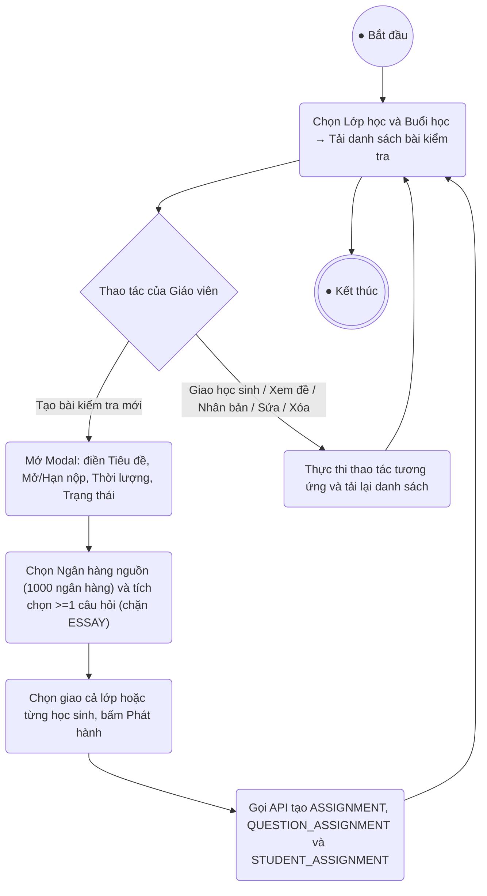

### Hàm/ sự kiện
```text
HÀM submitCreateAssignment():
    KIỂM_TRA title, startTime < deadline, selectedQuestions.length > 0 (không chứa ESSAY)
    GỌI assignmentService.create({ lessonId, title, startTime, deadline, timeLimitMinutes, maxAttempt: 1, questions, studentIds })
    Đóng modal và tải lại danh sách bài tập
```

### Các ràng buộc
- Chỉ cho phép 4 loại câu hỏi trắc nghiệm/tự chấm (chặn `ESSAY`); số lần nộp cố định `maxAttempt = 1`.
- *Lỗi thực tế & code:* Ngày buổi học hiện `(--)` và giờ hiện ISO thô; modal Sửa thiếu khởi tạo `editForm.maxAttempt`; dropdown chọn ngân hàng render 1001 `<option>`.
- *Tham chiếu:* `Web_Frontend/src/views/teacher/TeacherAssignmentsView.vue`.

---

## Chức năng 20: Chấm điểm & Nhập nhận xét

### Mục đích
Cho phép Giáo viên xem danh sách bài làm của học sinh theo từng lớp và bài kiểm tra, lọc theo trạng thái nộp/chấm, nhập điểm thang 100 và lời nhận xét trực tiếp (lưu lẻ từng học sinh hoặc lưu hàng loạt), hoặc mở màn hình chi tiết bài làm để chấm theo từng câu.

### Giao diện
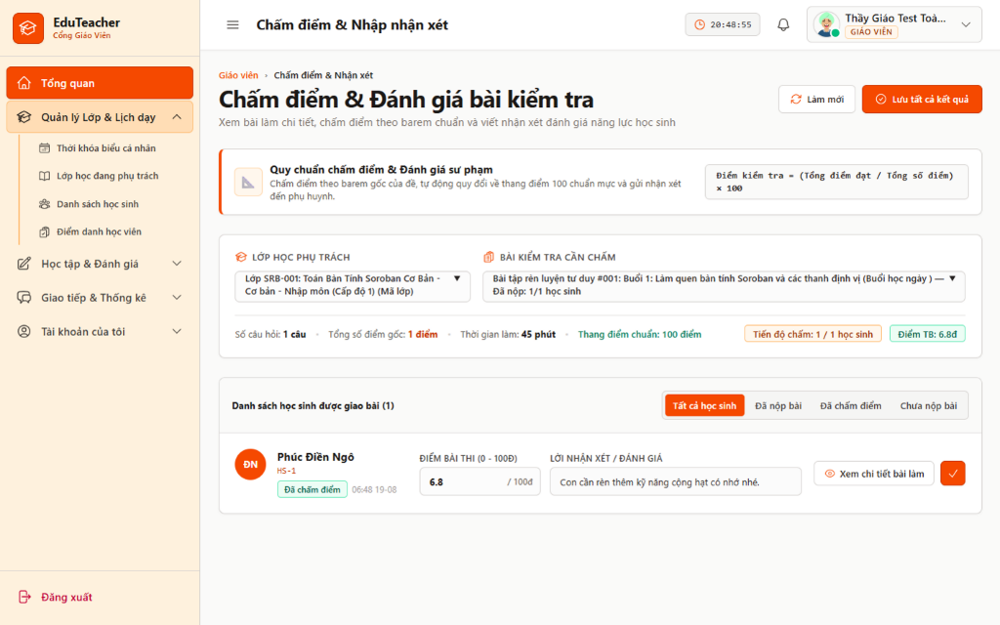

### Các thành phần trong giao diện

| STT | Loại điều khiển | Giá trị mặc định | Lưu ý |
| :--- | :--- | :--- | :--- |
| 1 | Action Buttons (`Làm mới`, `Lưu tất cả kết quả`) | Cả hai Enabled | `Lưu tất cả kết quả` gọi `batchGrade` lưu đồng loạt. |
| 2 | 2 Combobox (`Lớp học phụ trách`, `Bài kiểm tra cần chấm`) & Dải chỉ số | `Lớp SRB-001`; `Bài tập #001` (`1 câu · 1đ gốc · 45 phút · Tiến độ 1/1 · Điểm TB 6.8đ`) | Chọn lớp sẽ quét danh sách bài kiểm tra thuộc các buổi của lớp đó. |
| 3 | 4 Tab lọc trạng thái | `Tất cả học sinh` active | `Tất cả học sinh`, `Đã nộp bài`, `Đã chấm điểm`, `Chưa nộp bài`. |
| 4 | Input điểm (`0 - 100đ`) & Input `Lời nhận xét / Đánh giá` trên dòng học sinh | Quét thực tế (`Phúc Điền Ngô · HS-1`): Điểm `"6.8"`, Nhận xét `"Con cần rèn thêm kỹ năng cộng hạt có nhớ nhé."` | Ô điểm chuẩn hóa tức thì qua `normalizeScore` tại `@input`; nhận xét `maxlength="1000"`. |
| 5 | Row Action Buttons (`Xem chi tiết bài làm`, icon `Lưu`) | Cả hai Enabled | `Xem chi tiết bài làm` chuyển tới `/teacher/grading/submission/:assignmentId/:studentId` (bắt buộc nhập nhận xét, có 6 mẫu nhận xét nhanh). |

**Copy CSV (Thành phần giao diện CN20):**
```csv
STT,Loại điều khiển,Giá trị mặc định,Lưu ý
1,"Action Buttons (Làm mới, Lưu tất cả kết quả)",Enabled,Lưu hàng loạt điểm và nhận xét cho cả lớp.
2,"2 Combobox (Lớp, Bài kiểm tra) & Chỉ số","Lớp SRB-001; Bài #001; Tiến độ 1/1; TB 6.8đ",Tự động nạp danh sách bài kiểm tra của lớp đang chọn.
3,4 Tab lọc trạng thái,Tất cả học sinh active,"Tất cả học sinh, Đã nộp bài, Đã chấm điểm, Chưa nộp bài."
4,"Input Điểm (0-100đ) & Input Nhận xét","HS-1: Điểm 6.8; Nhận xét có sẵn","Điểm chuẩn hóa qua normalizeScore khi @input; nhận xét maxlength=1000."
5,"Row Buttons (Xem chi tiết bài làm, Lưu lẻ)",Enabled,"Chuyển tới TeacherSubmissionDetailView hoặc lưu riêng 1 học sinh."
```

### Dữ liệu được sử dụng

| STT | Tên bảng / Cấu trúc dữ liệu | Thêm | Sửa | Xóa | Truy vấn |
| :--- | :--- | :---: | :---: | :---: | :---: |
| 1 | `STUDENT_ASSIGNMENT` (`StudentAssignment`) | | X | | X |
| 2 | `ASSIGNMENT`, `QUESTION_ASSIGNMENT`, `QUESTION`, `LESSON`, `CLASSES`, `STUDENT_PROFILE` | | | | X |

**Copy CSV (Dữ liệu sử dụng CN20):**
```csv
STT,Tên bảng / Cấu trúc dữ liệu,Thêm,Sửa,Xóa,Truy vấn
1,STUDENT_ASSIGNMENT (StudentAssignment),,X,,X
2,"ASSIGNMENT, QUESTION_ASSIGNMENT, QUESTION, LESSON, CLASSES, STUDENT_PROFILE",,,,X
```

### Cách xử lý
1. Chọn Lớp → nạp danh sách Bài kiểm tra → tải danh sách học sinh được giao và điểm/nhận xét hiện có.
2. Giáo viên lọc trạng thái, chỉnh sửa điểm (`0..100`) và nhận xét ngay trên bảng để lưu lẻ/hàng loạt, hoặc vào Chi tiết bài làm chấm từng câu.

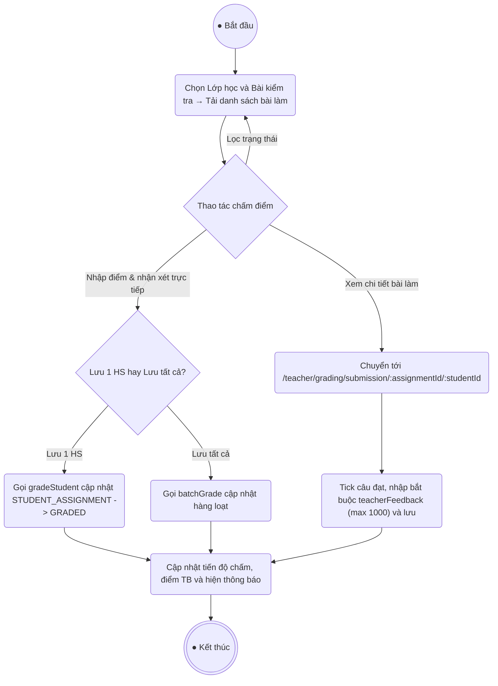

### Hàm/ sự kiện
```text
HÀM saveSingleStudentGrade(st):
    KIỂM_TRA 0 <= st.score <= 100 và st.teacherFeedback.length <= 1000
    GỌI assignmentService.gradeStudent(assignmentId, st.studentId, { score, teacherFeedback })
    Đặt st.status ← "GRADED" và thông báo thành công
```

### Các ràng buộc
- Điểm thang `[0..100]`; màn hình chi tiết bắt buộc có `teacherFeedback` mới cho phép lưu.
- *Tham chiếu:* `TeacherGradingView.vue`, `TeacherSubmissionDetailView.vue`.

---

## Chức năng 21: Chat trực tuyến với Phụ huynh (Chat Realtime)

### Mục đích
Cho phép Giáo viên trao đổi tin nhắn 2 chiều theo thời gian thực (SignalR `/chathub`) với phụ huynh của học sinh trong các lớp mình phụ trách, hỗ trợ gửi văn bản, ảnh hoặc tệp đính kèm (tối đa `20MB`), gọi điện/gửi email nhanh và xóa tin nhắn của chính mình.

### Giao diện
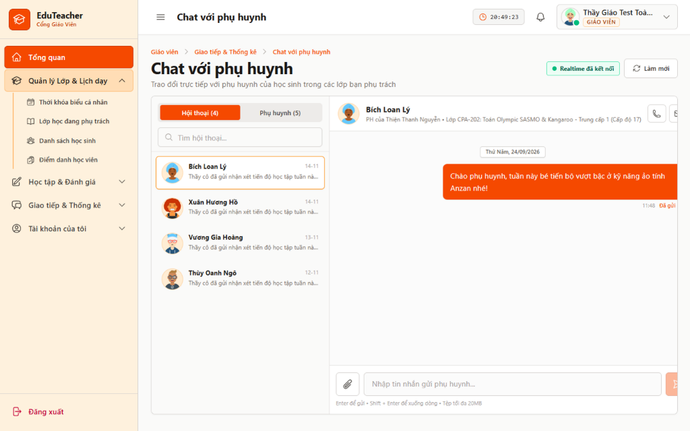

### Các thành phần trong giao diện

| STT | Loại điều khiển | Giá trị mặc định | Lưu ý |
| :--- | :--- | :--- | :--- |
| 1 | Connection Badge & Button `Làm mới` | Badge xanh `"Realtime đã kết nối"`, nút `Làm mới` enabled | Phản ánh trạng thái kết nối SignalR `/chathub`. |
| 2 | 2 Tab cột trái (`Hội thoại (4)`, `Phụ huynh (5)`) & Ô tìm kiếm | `Hội thoại (4)` active; ô `"Tìm hội thoại..."` rỗng | Chuyển giữa danh sách hội thoại đã chat và danh bạ phụ huynh lớp phụ trách. |
| 3 | Danh sách hội thoại (`4` mục) | Đang chọn `Bích Loan Lý (14-11)` | Gồm `Bích Loan Lý`, `Xuân Hương Hồ`, `Vương Gia Hoàng`, `Thùy Oanh Ngô`. |
| 4 | Header khung chat & 2 Link nhanh (`tel:`, `mailto:`) | `Bích Loan Lý` (`PH của Thiện Thanh Nguyễn • Lớp CPA-202...`) | *Lỗi hiển thị thực tế:* Tên lớp dài đẩy tràn khung chat bên phải ở `1281x801`, cắt mất nửa nút email. |
| 5 | Luồng tin nhắn & Nút xóa tin nhắn (hover) | 1 tin nhắn ngày `Thứ Năm, 24/09/2026` (`11:48 · Đã gửi`) | *Lỗi hiển thị thực tế:* Cạnh phải bong bóng tin nhắn bị cắt sát mép phải container. |
| 6 | Thanh soạn tin (`Gửi tệp/ảnh`, Textarea, nút `Gửi tin nhắn`) | Textarea rỗng (`maxlength="2000"`); nút `Gửi tin nhắn` **disabled** khi rỗng | Tệp đính kèm tối đa `20MB`; *lỗi hiển thị thực tế: nút `Gửi tin nhắn` góc dưới phải bị cắt mất nửa do tràn ngang*. |

**Copy CSV (Thành phần giao diện CN21):**
```csv
STT,Loại điều khiển,Giá trị mặc định,Lưu ý
1,Connection Badge & Button Làm mới,"Realtime đã kết nối; Làm mới enabled",Hiển thị trạng thái kết nối SignalR /chathub.
2,"2 Tab cột trái & SearchBar","Hội thoại (4) active; Phụ huynh (5); search rỗng",Tìm kiếm hội thoại hoặc danh bạ phụ huynh.
3,Danh sách hội thoại (4 mục),Bích Loan Lý đang chọn,"Hiển thị avatar, tên, tin cuối và ngày."
4,"Header khung chat & Link gọi/email","Bích Loan Lý (Lớp CPA-202...)","Lỗi thực tế: dòng tên lớp dài đẩy tràn ngang làm cắt nửa nút email ở 1281x801."
5,Luồng tin nhắn,"1 tin ngày 24/09/2026 (11:48 · Đã gửi)","Hỗ trợ TEXT/IMAGE/FILE và xóa tin của mình; lỗi thực tế: cạnh phải bong bóng bị cắt sát mép."
6,"Thanh soạn tin (File, Textarea, Gửi)","Textarea rỗng; nút Gửi disabled","Tệp tối đa 20MB, text max 2000; lỗi thực tế: nút Gửi tin nhắn bị cắt nửa mép phải."
```

### Dữ liệu được sử dụng

| STT | Tên bảng / Cấu trúc dữ liệu | Thêm | Sửa | Xóa | Truy vấn |
| :--- | :--- | :---: | :---: | :---: | :---: |
| 1 | `CONVERSATION` (`chat_type = 'HUMAN'`) & `MESSAGE` | X | X | X | X |
| 2 | `PARENT_PROFILE`, `STUDENT_PROFILE`, `CLASS_STUDENT`, `CLASSES` | | | | X |
| 3 | SignalR `/chathub` & Cloudinary Chat Storage | X | | | X |

**Copy CSV (Dữ liệu sử dụng CN21):**
```csv
STT,Tên bảng / Cấu trúc dữ liệu,Thêm,Sửa,Xóa,Truy vấn
1,CONVERSATION (HUMAN) & MESSAGE,X,X,X,X
2,"PARENT_PROFILE, STUDENT_PROFILE, CLASS_STUDENT, CLASSES",,,,X
3,SignalR /chathub & Cloudinary Storage,X,,,X
```

### Cách xử lý
1. Tải danh sách hội thoại (`4`), danh bạ phụ huynh (`5`) và mở kết nối SignalR `/chathub`.
2. Chọn hội thoại tải `30` tin nhắn gần nhất, đánh dấu đã đọc.
3. Gửi tin nhắn văn bản (`≤ 2000` ký tự) hoặc upload ảnh/tệp (`≤ 20MB`) lên Cloudinary rồi gửi tin realtime; xóa tin nhắn của chính mình qua modal xác nhận.

```mermaid
flowchart TD
    Start(("● Bắt đầu")) --> Connect("Tải 4 hội thoại, 5 phụ huynh và kết nối SignalR /chathub")
    Connect --> Select("Chọn hội thoại Bích Loan Lý → Tải 30 tin nhắn gần nhất")
    Select --> Ev{"Sự kiện"}
    Ev -- "Nhận tin mới từ SignalR" --> Append("Nối tin vào khung chat hoặc tăng unreadCount")
    Append --> Ev
    Ev -- "Gửi tin văn bản" --> SendTxt("Kiểm tra không rỗng (<=2000) và gửi tin TEXT")
    SendTxt --> Ev
    Ev -- "Đính kèm tệp/ảnh" --> UpFile("Kiểm tra <=20MB, upload Cloudinary và gửi tin IMAGE/FILE")
    UpFile --> Ev
    Ev -- "Xóa tin nhắn của mình" --> Del("Xác nhận modal và gọi API xóa MESSAGE")
    Del --> Ev
    Ev -- "Rời trang" --> End((("● Kết thúc")))
```

### Hàm/ sự kiện
```text
HÀM handleFileSelected(event):
    KIỂM_TRA file.size <= 20MB
    url ← GỌI chatService.uploadAttachment(file)
    Gửi tin nhắn loại IMAGE (nếu image/*) hoặc FILE kèm attachmentUrl = url
```

### Các ràng buộc
- Filtered Unique Index `(parent_id, teacher_id) WHERE chat_type = 'HUMAN'`; tệp đính kèm `≤ 20MB`.
- *Lỗi hiển thị thực tế nghiêm trọng trên `:8088`:* Khung chat phải bị tràn ngang cắt mất nửa nút email, cạnh phải tin nhắn và nút `Gửi tin nhắn` (thiếu `min-w-0` trên flex/grid container khi tiêu đề lớp dài).
- *Tham chiếu:* `Web_Frontend/src/views/teacher/TeacherChatView.vue`.

---

## Chức năng 22: Phiếu lương cá nhân (Giáo viên)

### Mục đích
Cho phép Giáo viên tra cứu phiếu lương hàng tháng cá nhân (`MM/YYYY`) gồm tổng thực nhận, số buổi dạy hợp lệ, bảng chi tiết từng buổi dạy (`+1 Đơn vị` hoặc `0`) và bảng các khoản thưởng/phạt do Admin ghi nhận.

### Giao diện
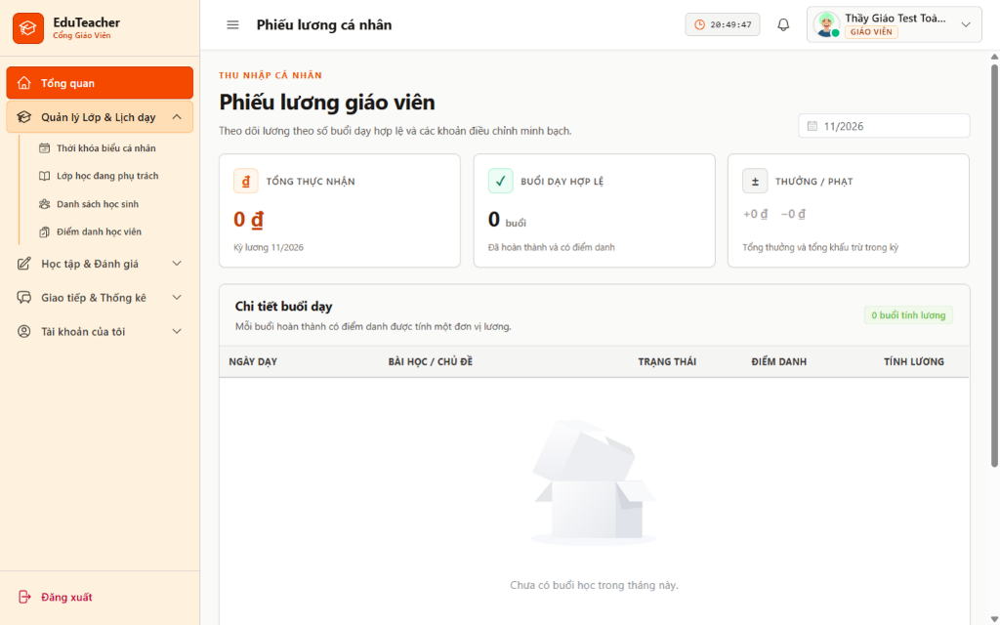

### Các thành phần trong giao diện

| STT | Loại điều khiển | Giá trị mặc định | Lưu ý |
| :--- | :--- | :--- | :--- |
| 1 | Month Picker (`el-date-picker`, `aria-label="Chọn tháng tra cứu lương"`) | `"11/2026"` | Không cho xóa (`clearable=false`), khóa chọn tháng tương lai (`disableFutureMonth`). |
| 2 | 3 Thẻ KPI (`Tổng thực nhận`, `Buổi dạy hợp lệ`, `Thưởng / Phạt`) | Quét thực tế (`11/2026`): `0 ₫`, `0 buổi`, `+0 ₫ / −0 ₫` | *Ghi nhận mâu thuẫn dữ liệu thực tế:* Bên dưới có 1 khoản điều chỉnh `−500.000 ₫` trong ngày `10/11/2026` nhưng KPI vẫn hiển thị `0 ₫`. |
| 3 | Bảng 1 (`Chi tiết buổi dạy`, `5 cột`) | `0 buổi tính lương` (`"Chưa có buổi học trong tháng này."`) | Cột: `NGÀY DẠY`, `BÀI HỌC / CHỦ ĐỀ`, `TRẠNG THÁI`, `ĐIỂM DANH`, `TÍNH LƯƠNG`. |
| 4 | Bảng 2 (`Khoản thưởng / phạt`, `4 cột`) | 1 dòng: `10/11/2026 \| Phạt \| −500.000 ₫ \| Thưởng thành tích học viên...` | Cột: `NGÀY ÁP DỤNG`, `LOẠI`, `SỐ TIỀN`, `LÝ DO`. *Mâu thuẫn dữ liệu:* Loại ghi `Phạt (−500.000 ₫)` nhưng lý do lại là `"Thưởng thành tích..."`. |

**Copy CSV (Thành phần giao diện CN22):**
```csv
STT,Loại điều khiển,Giá trị mặc định,Lưu ý
1,Month Picker (el-date-picker),11/2026,"clearable=false, khóa chọn tháng tương lai."
2,3 Thẻ KPI,"Tổng thực nhận 0 đ; 0 buổi; Thưởng/Phạt +0 đ / -0 đ","Mâu thuẫn thực tế: bảng dưới có khoản -500.000 đ trong 11/2026 nhưng KPI vẫn hiện 0 đ."
3,Bảng Chi tiết buổi dạy (5 cột),"0 buổi tính lương (trống)","Ngày dạy, Bài học, Trạng thái, Điểm danh, Tính lương (+1 Đơn vị / 0)."
4,Bảng Khoản thưởng / phạt (4 cột),"1 dòng: 10/11/2026 | Phạt | -500.000 đ","Mâu thuẫn dữ liệu seed: loại Phạt nhưng lý do ghi Thưởng thành tích; lồng 2 thẻ <main>."
```

### Dữ liệu được sử dụng

| STT | Tên bảng / Cấu trúc dữ liệu | Thêm | Sửa | Xóa | Truy vấn |
| :--- | :--- | :---: | :---: | :---: | :---: |
| 1 | `PAYROLL_SUMMARY` & `SALARY_ADJUSTMENT` | | | | X |
| 2 | `LESSON` & `ATTENDANCE` | | | | X |

**Copy CSV (Dữ liệu sử dụng CN22):**
```csv
STT,Tên bảng / Cấu trúc dữ liệu,Thêm,Sửa,Xóa,Truy vấn
1,PAYROLL_SUMMARY & SALARY_ADJUSTMENT,,,,X
2,LESSON & ATTENDANCE,,,,X
```

### Cách xử lý
1. Đọc `teacherId` từ `authService.getProfileId()`, gọi `GET /api/payrolls/detail?teacherId=...&month=...&year=...`.
2. Hiển thị 3 thẻ tổng hợp, bảng chi tiết buổi dạy và bảng khoản thưởng/phạt theo tháng đang chọn.

```mermaid
flowchart TD
    Start(("● Bắt đầu")) --> CheckId{"Có authService.getProfileId()?"}
    CheckId -- "Không" --> ErrId("Hiển thị ElMessage.error yêu cầu đăng nhập lại")
    ErrId --> End((("● Kết thúc")))
    CheckId -- "Có" --> Fetch("Gọi GET /api/payrolls/detail theo teacherId và tháng 11/2026")
    Fetch --> Show("Hiển thị 3 KPI, bảng Chi tiết buổi dạy và bảng Khoản thưởng/phạt")
    Show --> Change{"Giáo viên đổi tháng tra cứu?"}
    Change -- "Có" --> Fetch
    Change -- "Không" --> End
```

### Hàm/ sự kiện
```text
HÀM loadPayslip():
    NẾU !teacherId THÌ ElMessage.error(...); THOÁT
    detail ← GỌI GET /api/payrolls/detail { teacherId, month, year }
    Cập nhật payslip, sessions và adjustments
```

### Các ràng buộc
- Chỉ đọc (read-only); yêu cầu `profileId` khác null trong `sessionStorage`.
- *Lỗi thực tế ghi nhận trên `:8088`:* Lồng 2 thẻ `<main>`; mâu thuẫn hiển thị giữa bảng `Khoản thưởng / phạt` (`−500.000 ₫`) với thẻ KPI `0 ₫`.
- *Tham chiếu:* `Web_Frontend/src/views/teacher/TeacherPayslipView.vue`.

---

## Phụ lục: Tổng hợp các lỗi giao diện & dữ liệu phát hiện thực tế trên `http://localhost:8088`

| STT | Màn hình / Route | Mức độ | Mô tả lỗi quan sát thực tế trên `http://localhost:8088` |
| :--- | :--- | :--- | :--- |
| 1 | Toàn cục — `Sidebar` (Admin & Teacher) | Trung bình | Khi điều hướng sang route con, mục `Tổng quan` vẫn giữ trạng thái nền cam active; các nhóm accordion không tự mở theo URL hiện tại. |
| 2 | `TeacherChatView` (`/teacher/communication/chat`) | Cao | Dòng phụ đề tên lớp dài đẩy khung chat tràn ngang ở viewport `1281x801`, cắt mất nửa nút email, cạnh phải tin nhắn và nút `Gửi tin nhắn`. |
| 3 | `ScheduleView` (`/training/schedule`) | Cao | Badge cam `Ngăn xếp (67 lớp)` bị rớt 3 dòng đè chữ giờ `08:00 - 09:30`; render đồng thời `1000` checkbox lớp học tạo >1048 button làm DOM rất nặng. |
| 4 | `AdminPayrollView` (`/finance/payroll`) | Trung bình | Cột `TRẠNG THÁI EMAIL` bị khuất/tràn ngang ở `1281x801`; nút `Gửi Email Hàng Loạt` còn màu xanh dương lệch tông cam `UI_RULE.md`; lồng 2 thẻ `<main>`. |
| 5 | `TeacherPayslipView` (`/teacher/payslip`) | Trung bình | Mâu thuẫn số liệu: bảng dưới có khoản `Phạt −500.000 ₫` (lý do ghi `"Thưởng thành tích..."`) nhưng KPI trên vẫn hiện `0 ₫` và `+0 ₫ / −0 ₫`; lồng 2 thẻ `<main>`. |
| 6 | `TeacherAssignmentsView` (`/teacher/assignments`) | Trung bình | Ngày buổi học hiển thị `(--)` và giờ hiển thị chuỗi ISO thô `2026-08-16T02:48:13`; dropdown chọn ngân hàng render `1001` options; modal Sửa thiếu `maxAttempt`. |
| 7 | `TeacherQuestionsView` (`/teacher/questions`) | Thấp | Hai nút `Import từ file` và `Thêm câu hỏi` trong header cột phải bị ép hẹp làm chữ rớt xuống 3 dòng và tràn nhẹ khỏi nút. |
| 8 | `TeacherStudentsView` (`/teacher/students`) | Trung bình | Bảng 8 cột tràn ngang khuất 2 nút cuối (`Chat`, `Gọi`) ở `1281x801`; banner ghi `Sĩ số: 0 / 16` nhưng bảng hiển thị 1 học sinh `DROPPED`. |
| 9 | `TeacherClassesView` & `TeacherScheduleView` | Thấp | 3 nút trên card lớp bị ép xuống 2 dòng; tên `Lớp KMN-403... (Cấp độ 34` trong dropdown bị cắt thiếu dấu `)` cuối. |
| 10 | `ClassesView` (`/training/classes`) | Thấp | Các lớp `LH-34`, `LH-76`, `LH-83` hiển thị badge trạng thái `"Không rõ"`. |
| 11 | `DashboardView` (`/`) | Thấp | Legend biểu đồ Doughnut `Phân bổ học viên theo lớp` quá dài làm tràn dọc phía trên hình tròn biểu đồ. |
| 12 | `TeacherDashboardView` (`/teacher`) & SignalR | Thấp | Ảnh avatar ban đầu trống chưa load ở banner; ghi nhận lỗi console SignalR disconnect tại một số thời điểm. |

**Copy CSV (Phát hiện lỗi giao diện thực tế):**
```csv
STT,Màn hình / Route,Mức độ,Mô tả lỗi quan sát thực tế trên http://localhost:8088
1,"Sidebar (Admin & Teacher)",Trung bình,"Mục Tổng quan vẫn giữ nền cam active khi vào route con; nhóm accordion không tự mở theo URL."
2,"TeacherChatView (/teacher/communication/chat)",Cao,"Khung chat phải bị tràn ngang ở 1281x801 làm cắt nửa nút email, cạnh phải tin nhắn và nút Gửi tin nhắn."
3,"ScheduleView (/training/schedule)",Cao,"Badge Ngăn xếp (67 lớp) rớt 3 dòng đè chữ giờ học; render 1000 checkbox lớp gây nặng DOM (>1048 button)."
4,"AdminPayrollView (/finance/payroll)",Trung bình,"Cột TRẠNG THÁI EMAIL bị khuất ngang ở 1281x801; nút Gửi Email Hàng Loạt màu xanh dương lệch tông cam; lồng 2 thẻ <main>."
5,"TeacherPayslipView (/teacher/payslip)",Trung bình,"Mâu thuẫn số liệu: bảng điều chỉnh có -500.000 đ (loại Phạt nhưng lý do Thưởng) trong khi KPI hiện 0 đ; lồng 2 thẻ <main>."
6,"TeacherAssignmentsView (/teacher/assignments)",Trung bình,"Ngày buổi học hiện (--), giờ hiện ISO thô 2026-08-16T02:48:13; dropdown ngân hàng có 1001 options; modal Sửa thiếu maxAttempt."
7,"TeacherQuestionsView (/teacher/questions)",Thấp,"Hai nút Import từ file và Thêm câu hỏi ở header cột phải bị hẹp làm chữ rớt 3 dòng."
8,"TeacherStudentsView (/teacher/students)",Trung bình,"Bảng 8 cột tràn ngang khuất 2 nút Chat và Gọi ở 1281x801; banner sĩ số 0/16 mâu thuẫn với 1 HS DROPPED."
9,"TeacherClassesView & TeacherScheduleView",Thấp,"3 nút trên card lớp bị ép xuống 2 dòng; tên Lớp KMN-403 trong dropdown bị cắt thiếu dấu ) cuối."
10,"ClassesView (/training/classes)",Thấp,"Các lớp LH-34, LH-76, LH-83 hiển thị badge trạng thái Không rõ."
11,"DashboardView (/)",Thấp,"Legend biểu đồ Doughnut Phân bổ học viên theo lớp quá dài đẩy biểu đồ xuống dưới."
12,"TeacherDashboardView (/teacher) & SignalR",Thấp,"Avatar banner hiển thị trống lúc đầu; console phát sinh lỗi SignalR disconnect tại một số thời điểm."
```
