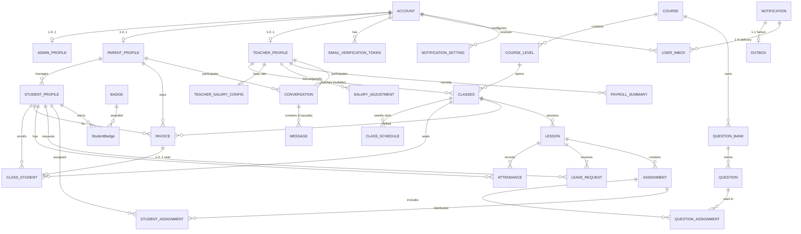

# 01. Cơ sở dữ liệu, Domain Model & State Machines

Tài liệu mô tả toàn bộ schema ánh xạ trong [`ApplicationDbContext.cs`](file:///d:/ASP.NET/Hethongtoantuduy/Backend/ToanTuDuy/Data/ApplicationDbContext.cs), các file `Models/*.cs`, ràng buộc toàn vẹn và vòng đời trạng thái của từng thực thể để phục vụ thiết kế test data & assertion.

---

## 1. Sơ đồ quan hệ thực thể (ER Diagram)

---

## 2. Chi tiết bảng & Ràng buộc quan trọng khi kiểm thử

### 2.1. Cụm Identity, Profile & Xác minh Email
Nguồn: [`Models/UserEntities.cs`](file:///d:/ASP.NET/Hethongtoantuduy/Backend/ToanTuDuy/Models/UserEntities.cs), [`Models/EmailVerificationToken.cs`](file:///d:/ASP.NET/Hethongtoantuduy/Backend/ToanTuDuy/Models/EmailVerificationToken.cs)

| Bảng SQL | Entity C# | Khóa & Ràng buộc đặc biệt | Lưu ý nghiệp vụ / Test |
| :--- | :--- | :--- | :--- |
| `ACCOUNT` | `ApplicationUser` | `id` (PK), `UserName` (thường là SĐT), `phone`, `pending_email`, `role`, `refresh_token`, `is_active`, `password_reset_sent_at` | `SecurityStamp` thay đổi khi khóa/mở khóa hoặc admin reset password → JWT cũ mất hiệu lực ngay |
| `ADMIN_PROFILE` | `AdminProfile` | Unique `account_id` | Bắt buộc tồn tại để `ProfileController` của Admin hoạt động |
| `PARENT_PROFILE` | `ParentProfile` | Unique `account_id`, `pin` (`max 255`) | `PinService` hash PIN bằng `IPasswordHasher<ParentProfile>`; `ParentStudentService` lại ghi thô nếu truyền trực tiếp |
| `TEACHER_PROFILE` | `TeacherProfile` | Unique `account_id`, `specialize`, `created_at` (`string?`) | `TeacherProfile.Email` và `Account.Email` tồn tại song song; Payroll/Email ưu tiên `TeacherProfile.Email` nếu có |
| `STUDENT_PROFILE` | `StudentProfile` | FK `parent_id` → `PARENT_PROFILE.id` (không trỏ trực tiếp `ACCOUNT`) | Có `total_points`, `stars`, `streak_days`, `gender`, `is_active` |
| `EMAIL_VERIFICATION_TOKEN` | `EmailVerificationToken` | Unique `token_hash` (SHA-256 hex 64 ký tự), `email_at_issue`, `expires_at`, `used_at` | Token thô không lưu DB; phát hành token mới sẽ xóa token chưa dùng cũ của cùng `account_id` |

### 2.2. Cụm Khóa học, Lớp học, Lịch học & Buổi học
Nguồn: [`Models/LearningEntities.cs`](file:///d:/ASP.NET/Hethongtoantuduy/Backend/ToanTuDuy/Models/LearningEntities.cs)

| Bảng SQL | Entity C# | Cột / Kiểu đáng chú ý | Lưu ý nghiệp vụ / Test |
| :--- | :--- | :--- | :--- |
| `COURSE` | `Course` | `code`, `benefits` (JSON array string), `facility_images` (JSON array string), `rating` (default `5.0`), `reviews` (default `0`) | Không xóa được `Course` nếu còn `CourseLevel` |
| `COURSE_LEVEL` | `CourseLevel` | `fee` (`decimal(10,2)`), `total_sessions`, `order_index`, `syllabus` (JSON), `faqs` (JSON) | Không xóa được `CourseLevel` nếu còn `Classes` |
| `CLASSES` | `Classes` | `course_level_id`, `teacher_id` (nullable), `max_capacity`, `start_date`, `end_date` (nullable) | Không xóa được `Classes` nếu còn bản ghi `CLASS_STUDENT` |
| `CLASS_SCHEDULE` | `ClassSchedule` | `day_of_week` (`0` = Chủ nhật .. `6` = Thứ bảy), `start_time` (`TimeSpan`), `end_time` (`TimeSpan`), `room` (`max 100`) | Tạo/sửa/xóa `ClassSchedule` tự động chạy thuật toán sinh/cập nhật `LESSON` và tính lại `CLASSES.end_date` |
| `LESSON` | `Lesson` | `title`, `lesson_date` (`DateTime`), `start_time` (`DateTime?`), `end_time` (`DateTime?`), `status`, `is_importan` (chính tả thiếu chữ `t` trong DB/DTO!) | Tên cột và property trong `Lesson`/`LessonRequest`/`LessonResponse` là `IsImportan` (riêng `StudentLessonResponse` là `IsImportant`) |

### 2.3. Cụm Ghi danh & Hóa đơn
Nguồn: [`Models/LearningEntities.cs#L201-L303`](file:///d:/ASP.NET/Hethongtoantuduy/Backend/ToanTuDuy/Models/LearningEntities.cs#L201-L303), [`ApplicationDbContext.cs#L115-L143`](file:///d:/ASP.NET/Hethongtoantuduy/Backend/ToanTuDuy/Data/ApplicationDbContext.cs#L115-L143)

| Bảng SQL | Entity C# | Unique / Filter Indexes | Lưu ý nghiệp vụ / Test |
| :--- | :--- | :--- | :--- |
| `CLASS_STUDENT` | `ClassStudent` | 1. Unique `invoice_id` (`WHERE [invoice_id] IS NOT NULL`) 2. Unique `(class_id, student_id)` (`WHERE [status] IN ('ACTIVE', 'PENDING')`) | 1 học sinh không thể có 2 bản ghi `ACTIVE`/`PENDING` trong cùng 1 lớp. Ở tầng service `EnrollmentService` còn chặn rộng hơn theo **cùng `CourseLevelId`** |
| `INVOICE` | `Invoice` | 1. Unique `txn_ref` (`max 100`) 2. Unique `transaction_id` (`WHERE [transaction_id] IS NOT NULL`) | `Amount` là `int` (VNĐ, làm tròn từ `CourseLevel.Fee`). `Invoice` ↔ `ClassStudent` là quan hệ `1 - 0..1` (`OnDelete(DeleteBehavior.Restrict)`) |

### 2.4. Cụm Ngân hàng câu hỏi, Bài tập, Điểm danh & Xin nghỉ
| Bảng SQL | Entity C# | Khóa & Quan hệ | Lưu ý nghiệp vụ / Test |
| :--- | :--- | :--- | :--- |
| `QUESTION_BANK` | `QuestionBank` | FK `course_id` → `COURSE` | Xóa Bank sẽ tự gỡ `QUESTION_ASSIGNMENT` liên quan và xóa toàn bộ `QUESTION` bên trong |
| `QUESTION` | `Question` | FK `bank_id` → `QUESTION_BANK`, `type`, `content`, `image_url`, `difficulty`, `answer` | Xóa Question tự gỡ khỏi `QUESTION_ASSIGNMENT` |
| `ASSIGNMENT` | `Assignment` | FK `lesson_id` → `LESSON`, `stage_id`, `max_attempt` (service ép `== 1`) | Thuộc `Lesson`, không còn thuộc `Classes` |
| `QUESTION_ASSIGNMENT` | `QuestionAssignment` | FK `assignment_id`, `question_id`, `order_index`, `point_value` (`float`) | Bảng trung gian gắn câu hỏi vào bài tập |
| `STUDENT_ASSIGNMENT` | `StudentAssignment` | FK `assignment_id`, `student_id`, `score` (`float?`), `status`, `teacher_feedback`, `completed_at` | Không lưu chi tiết từng câu trả lời của học sinh khi submit |
| `ATTENDANCE` | `Attendance` | FK `lesson_id`, `student_id`, `status`, `teacher_notes` | Không có unique index `(lesson_id, student_id)` ở mức DB; service tự upsert |
| `LEAVE_REQUEST` | `LeaveRequest` | FK `student_id`, `lesson_id`, `reason`, `status`, `created_at` | Chú ý: có thể tồn tại nhiều row cho `(student_id, lesson_id)` nếu đơn cũ đã `CANCELLED` |
| `BADGE`, `StudentBadge` | `Badge`, `StudentBadge` | `StudentBadge` có `id` riêng | Hiện chưa thấy controller nào expose API cho `Badge` |

### 2.5. Cụm Lương giáo viên (`Models/PayrollEntities.cs`)
- `TEACHER_SALARY_CONFIG`: Unique `teacher_id`, `base_rate_per_session` (`decimal(18,2)`).
- `SALARY_ADJUSTMENT`: Index `(teacher_id, applied_date)`, `type` (`Penalty` | `Bonus`), `amount` (`decimal(18,2)`), `applied_date` (`DateOnly`).
- `PAYROLL_SUMMARY`: Unique `(teacher_id, month, year)`, lưu snapshot lương + `email_status`, `email_sent_at`, `email_error_message`.

### 2.6. Cụm Chat & Thông báo
- `CONVERSATION` & `MESSAGE`:
  - Filter Unique Index 1: `(parent_id, teacher_id) WHERE [chat_type] = 'HUMAN' AND [teacher_id] IS NOT NULL`.
  - Filter Unique Index 2: `(parent_id) WHERE [chat_type] = 'AI'` (được khai báo ở DB/Model nhưng `ChatService` hiện chỉ xử lý `HUMAN`).
  - **Ngoại lệ DeleteBehavior:** Toàn bộ FK khác trong `ApplicationDbContext` bị đổi từ `Cascade` sang `Restrict` (dòng 190–197), **riêng `Message.Conversation` giữ `DeleteBehavior.Cascade`**.
- `NOTIFICATION`, `OUTBOX`, `USER_INBOX`, `NOTIFICATION_SETTING`:
  - `OUTBOX`: Unique `notification_id`, Index `(status, available_at)`.
  - `USER_INBOX`: Unique `(notification_id, account_id)` và Filter Unique `(account_id, type, ref_id) WHERE [ref_id] IS NOT NULL` (đây là cơ chế **idempotency** chống gửi trùng thông báo cùng `RefId` cho 1 user!).
  - `NOTIFICATION_SETTING`: Unique `(account_id, type)`.

---

## 3. State Machines & Giá trị trạng thái chuẩn

| Thực thể | Trường | Các giá trị hợp lệ / quan sát được trong code | Luồng chuyển trạng thái chính |
| :--- | :--- | :--- | :--- |
| **Invoice** | `Status` | `PENDING`, `PAID`, `FAILED`, `CANCELLED`, (`REFUNDED` trong comment) | `PENDING` → `PAID` (VNPay 00/00) `PENDING` → `FAILED` (VNPay lỗi) `FAILED` → `PENDING` (khi gọi lại `CreatePaymentUrl` mà `ClassStudent` vẫn `PENDING`) `PENDING` → `CANCELLED` (Phụ huynh hủy hoặc Cleanup job) |
| **ClassStudent** | `Status` | `PENDING`, `ACTIVE`, `CANCELLED` (`DROPPED` trong comment) | `EnrollmentService`: tạo `PENDING` → `PaymentService` xác nhận `PAID` đổi thành `ACTIVE`; hủy hóa đơn đổi thành `CANCELLED`. `ClassService.AddStudentToClass`: tạo trực tiếp `ACTIVE` |
| **Lesson** | `Status` | `SCHEDULED`, `COMPLETED`, `HOLIDAY`, `CANCELED` (`CANCELLED`), `MAKE_UP` | `ClassScheduleService` tạo `SCHEDULED`; khi giảm số buổi hoặc đổi lịch có thể set `CANCELED`. `PayrollService` chỉ tính buổi `COMPLETED` và `Attendances.Any()` |
| **StudentRoadmap** | `Status` (computed) | `COMPLETED`, `IN_PROGRESS`, `LOCKED`, `HOLIDAY`, `CANCELED`, `MAKE_UP` | Trong `LessonService.GetRoadmapsByStudentIdAsync`: buổi `SCHEDULED` đầu tiên trả về `IN_PROGRESS`, các buổi `SCHEDULED` sau (và slot chưa có lesson) trả về `LOCKED` |
| **Attendance** | `Status` | `PRESENT`, `ABSENT`, `LATE`, `EXCUSED`, (`UNMARKED` khi chưa điểm danh ở response) | DTO regex chỉ nhận `PRESENT \| ABSENT \| LATE \| EXCUSED` |
| **LeaveRequest** | `Status` | `PENDING`, `APPROVED`, `REJECTED`, `CANCELLED` | Parent tạo `PENDING`; Parent hủy → `CANCELLED`; Teacher duyệt → `APPROVED` (tự động lưu Attendance `EXCUSED`) hoặc `REJECTED` |
| **Assignment** | `Status` | `OPEN`, `DRAFT`, `CLOSED`, `SCHEDULED` | Parent chỉ làm/nộp bài khi `Status == "OPEN"` và `StartTime <= UtcNow <= Deadline` |
| **StudentAssignment** | `Status` | `ASSIGNED`, `SUBMITTED`, `GRADED` | Giao bài → `ASSIGNED`; Parent nộp practice → `SUBMITTED` (chống nộp đúp bằng `ExecuteUpdateAsync`); Teacher chấm → `GRADED` |
| **Question** | `Type` | `MULTIPLE_CHOICE`, `FILL_IN`, `TRUE_FALSE`, `TIMED_SEQUENCE`, `ESSAY` | `AssignmentService` chỉ cho phép giao/làm 4 loại đầu (chặn `ESSAY`) |
| **Question** | `Difficulty` | `EASY`, `MEDIUM`, `HARD` | Chuẩn hóa uppercase khi lưu |
| **PayrollSummary** | `EmailStatus` | `NotSent`, `Queued`, `Sent`, `Failed` (`Processing` được check ở scheduler) | Khi số liệu lương tháng thay đổi (`financialsChanged`), `Sent`/`Failed` tự reset về `NotSent` |
| **OutboxMessage** | `Status` | `0 = Pending`, `1 = Processing`, `2 = Done`, `3 = Dead`, `4 = Relayed` | `Pending` → `Processing` → `Done` (hoặc `Pending` retry tối đa 5 lần → `Dead`) |
