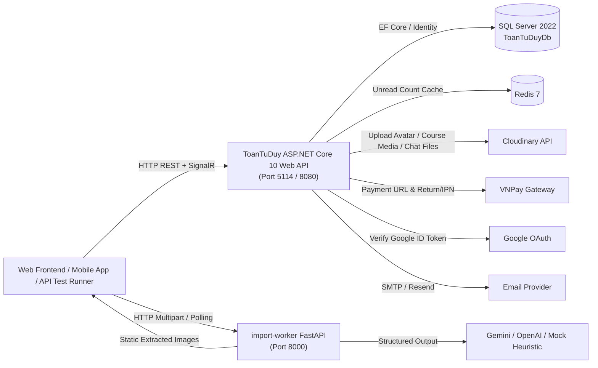

# Review Backend — Hệ thống Toán Tư Duy (`ToanTuDuy`)

Tài liệu này tổng hợp kết quả rà soát toàn bộ mã nguồn Backend trong thư mục `Backend/` nhằm phục vụ:
1. Nắm bắt nhanh kiến trúc tổng thể, luồng xử lý request, xác thực/phân quyền và các thành phần chạy nền.
2. Tra cứu chi tiết toàn bộ REST API, SignalR Hubs, schema Request/Response và quy tắc nghiệp vụ.
3. Làm đầu vào trực tiếp để thiết kế và triển khai **Kế hoạch kiểm thử API tự động (Automated API Testing)**.

---

## Mục lục tài liệu

| STT | Tài liệu | Nội dung chính |
| :--- | :--- | :--- |
| 0 | [README.md](./README.md) | Tổng quan kiến trúc, HTTP pipeline, Auth/JWT/PIN, SignalR, Background Jobs, cấu hình & dữ liệu seed |
| 1 | [01-Database-And-Domain-Model.md](./01-Database-And-Domain-Model.md) | Mô hình thực thể (ER), bảng CSDL, Unique/Filter Indexes, quy tắc DeleteBehavior và State Machines |
| 2 | [02-API-Catalog-Auth-Users.md](./02-API-Catalog-Auth-Users.md) | API Auth, Email Verification, Profile/PIN, Admin Accounts, Parents, Students, Teachers, DevSeed |
| 3 | [03-API-Catalog-Academic-Learning.md](./03-API-Catalog-Academic-Learning.md) | API Courses, CourseLevels, Classes, ClassSchedules, Lessons, Attendances, LeaveRequests, QuestionBanks, Assignments |
| 4 | [04-API-Catalog-Finance-Comms-ImportWorker.md](./04-API-Catalog-Finance-Comms-ImportWorker.md) | API Enrollment, Invoice, VNPay Payment, Payrolls, Admin Reports, Chat, Notifications & Python `import-worker` |
| 5 | [05-Security-Gaps-And-Code-Findings.md](./05-Security-Gaps-And-Code-Findings.md) | Các lỗ hổng phân quyền, bất nhất error format, bug logic & điểm cần xác nhận trước khi assert test |
| 6 | [06-Automated-API-Testing-Plan.md](./06-Automated-API-Testing-Plan.md) | Chiến lược, phân tầng test, Role×Endpoint Matrix, E2E Flows, giả lập dịch vụ ngoài (VNPay/Email/LLM) |

---

## 1. Kiến trúc tổng thể các thành phần Backend

Trong `Backend/` và cấu hình `docker-compose.yml`, phần backend gồm **2 service độc lập** phối hợp với SQL Server, Redis và các dịch vụ bên thứ ba:



### 1.1. Core Backend — `Backend/ToanTuDuy` (ASP.NET Core `.NET 10.0`)
- **Framework & ORM:** ASP.NET Core Web API (`net10.0`), Entity Framework Core 10 (`SqlServer`), ASP.NET Core Identity (`ApplicationUser : IdentityUser<int>` ánh xạ vào bảng `ACCOUNT`).
- **Số lượng thành phần:**
  - **25 Controllers** trong `ToanTuDuy/Controllers/`.
  - **2 SignalR Hubs:** `ChatHub` (`/chathub`), `NotificationHub` (`/hubs/notifications`).
  - **4 Hosted Background Services đang kích hoạt** (`NotificationFanoutWorker`, `UpcomingLessonReminderService`, `PayslipEmailWorker`, `MonthlyPayslipEmailScheduler`) và **1 service bị comment out** (`ReservationCleanupService`).
- **Entry point:** [`Program.cs`](file:///d:/ASP.NET/Hethongtoantuduy/Backend/ToanTuDuy/Program.cs).

### 1.2. Question Import Worker — `Backend/import-worker` (Python FastAPI)
- Microservice chuyên bóc tách file đề thi `.docx` và `.pdf` (qua `python-docx`, `PyMuPDF/fitz`) thành danh sách câu hỏi có cấu trúc (`QuestionItem`) để Frontend/Admin kiểm duyệt và đẩy vào Core Backend qua `POST /api/question-banks/questions/bulk`.
- Hỗ trợ 3 chế độ `LLM_PROVIDER`: `gemini`, `openai`, và `mock` (`heuristic` offline, không cần gọi AI thật).
- Lưu trữ job tạm trong RAM (`JobManager._jobs` dict) và file/ảnh trên đĩa (`./storage/uploads`, `./storage/images`, mount ra `/static/images`).

---

## 2. HTTP Pipeline, Middleware & Quy ước chung (`ToanTuDuy`)

Thứ tự middleware cấu hình trong [`Program.cs`](file:///d:/ASP.NET/Hethongtoantuduy/Backend/ToanTuDuy/Program.cs#L243-L256):
1. `if (app.Environment.IsDevelopment()) app.MapOpenApi();` — endpoint OpenAPI chỉ bật ở môi trường `Development`.
2. `app.UseExceptionHandler();` — dùng [`GlobalExceptionHandler`](file:///d:/ASP.NET/Hethongtoantuduy/Backend/ToanTuDuy/Middleware/GlobalExceptionHandler.cs).
3. `app.UseCors("DevCors");` — `SetIsOriginAllowed(_ => true)`, `AllowAnyHeader()`, `AllowAnyMethod()`, `AllowCredentials()`.
4. `app.UseHttpsRedirection();` — lưu ý khi test HTTP thuần nếu cấu hình HTTPS port.
5. `app.UseAuthentication();`
6. `app.UseAuthorization();`
7. `app.MapControllers();`
8. `app.MapHub<ChatHub>("/chathub");` & `app.MapHub<NotificationHub>("/hubs/notifications");`

### 2.1. Định dạng lỗi chuẩn (`GlobalExceptionHandler`)
[`GlobalExceptionHandler`](file:///d:/ASP.NET/Hethongtoantuduy/Backend/ToanTuDuy/Middleware/GlobalExceptionHandler.cs#L40-L59) map mọi unhandled exception về JSON:
```json
{
  "code": 400,
  "message": "Thông báo lỗi tiếng Việt",
  "details": null
}
```
Mapping mặc định:
- `ApiException` → `(api.StatusCode, api.Message, api.Details)` (`400`, `401`, `403`, `404`, `409`, `429`, `502`, `503`).
- `UnauthorizedAccessException` → `401`
- `ArgumentException` → `400`
- `InvalidOperationException` → `400`
- `KeyNotFoundException` → `404`
- Exception khác → `500` (`message`: `"Đã xảy ra lỗi hệ thống, vui lòng thử lại sau."`, `details`: `exception.Message`).

> [!IMPORTANT]
> Một số controller cũ (`CoursesController`, `CourseLevelsController`, `ClassesController`, `LessonsController`, `ParentsController`, `TeachersController`, `AttendancesController`) tự `try/catch` và trả `{ "message": "..." }` hoặc `{ "message": "...", "error": "..." }` thay vì để `GlobalExceptionHandler` xử lý. Chi tiết liệt kê trong [05-Security-Gaps-And-Code-Findings.md](./05-Security-Gaps-And-Code-Findings.md).
> Validation tự động của `[ApiController]` (ModelState invalid) trả chuẩn `ValidationProblemDetails` (HTTP `400`).

### 2.2. Authentication & JWT Validation
- **Scheme mặc định:** `JwtBearerDefaults.AuthenticationScheme` (HMAC-SHA256, `ClockSkew = TimeSpan.Zero`).
- **Claims trong Access Token** ([`AuthService.GenerateJwtToken`](file:///d:/ASP.NET/Hethongtoantuduy/Backend/ToanTuDuy/Services/AuthService.cs#L362-L390)):
  - `sub` & `ClaimTypes.NameIdentifier`: `user.Id` (`AccountId`)
  - `ClaimTypes.MobilePhone`: `user.PhoneNumber`
  - `ClaimTypes.Role`: `"Parent"` | `"Teacher"` | `"Admin"`
  - `"security_stamp"`: `user.SecurityStamp`
  - Expiration mặc định trong `appsettings.json`: `900` phút (15 giờ); fallback trong code: `120` phút.
- **Kiểm tra động mỗi request (`OnTokenValidated`)** ([`Program.cs`](file:///d:/ASP.NET/Hethongtoantuduy/Backend/ToanTuDuy/Program.cs#L85-L116)):
  - Truy vấn bảng `ACCOUNT` (`AsNoTracking`) lấy `IsActive` và `SecurityStamp`.
  - Nếu `!account.IsActive` hoặc `SecurityStamp` trong DB khác claim `"security_stamp"` → fail xác thực (`401`).
  - Nhờ cơ chế này, khi Admin khóa tài khoản (`PUT /api/admin/accounts/{id}/status`) hoặc reset mật khẩu (`POST /api/admin/accounts/{id}/reset-password`), `UpdateSecurityStampAsync` làm JWT cũ bị thu hồi ngay lập tức!
- **SignalR Auth (`OnMessageReceived`)** ([`Program.cs`](file:///d:/ASP.NET/Hethongtoantuduy/Backend/ToanTuDuy/Program.cs#L71-L84)):
  - Đọc query string `?access_token=...` cho path `/chathub` và `/hubs/notifications`.

### 2.3. Authorization Policies & PIN Filter
- **Roles:** `"Admin"`, `"Teacher"`, `"Parent"`.
- **Policy `"AdminOrDevelopmentTesting"`** ([`Program.cs`](file:///d:/ASP.NET/Hethongtoantuduy/Backend/ToanTuDuy/Program.cs#L123-L126)):
  - Cho phép nếu `builder.Environment.IsDevelopment()` **HOẶC** `User.IsInRole("Admin")`.
  - Được dùng trên `ClassSchedulesController` (`POST`, `PUT`, `DELETE`).
  - **Lưu ý khi test:** Khi chạy API dưới `ASPNETCORE_ENVIRONMENT=Development`, mọi request (kể cả ẩn danh / Parent / Teacher) đều qua được policy này! Muốn test RBAC thật phải chạy môi trường `Production`/`Staging`.
- **`[RequirePin]` (`PinFilter`)** ([`Filters/PinFilter.cs`](file:///d:/ASP.NET/Hethongtoantuduy/Backend/ToanTuDuy/Filters/PinFilter.cs)):
  - Đọc header `X-Pin`.
  - Thiếu header `X-Pin` → `400 BadRequest` (`"Thiếu mã PIN. Gửi kèm header 'X-Pin'."`).
  - Tài khoản chưa set PIN → `400 BadRequest` (`"Chưa thiết lập PIN."`).
  - Sai PIN → `403 Forbidden` (`"Mã PIN không đúng."`).
  - Hiện áp dụng duy nhất tại `DELETE /api/students/{id}`.

### 2.4. Quy ước phân trang (`PagedResult<T>`)
Định nghĩa trong [`DTOs/Common/PaginationDtos.cs`](file:///d:/ASP.NET/Hethongtoantuduy/Backend/ToanTuDuy/DTOs/Common/PaginationDtos.cs) và [`QueryablePaginationExtensions.cs`](file:///d:/ASP.NET/Hethongtoantuduy/Backend/ToanTuDuy/Extensions/QueryablePaginationExtensions.cs):
- Mặc định: `page = 1` (nhỏ hơn 1 tự chuẩn hóa thành `1`), `pageSize = 20` (riêng `ClassesController.GetPaged` là `12`), tối đa `100` (`pageSize <= 0` dùng default, `> 100` bị chặn về `100`).
- Cấu trúc trả về:
  ```json
  {
    "items": [],
    "page": 1,
    "pageSize": 20,
    "totalCount": 0,
    "totalPages": 0,
    "hasPreviousPage": false,
    "hasNextPage": false
  }
  ```
- Mở rộng riêng cho Admin:
  - `AdminAccountPagedResponse`: thêm `activeCount`, `blockedCount`.
  - `AdminInvoicePagedResponse`: thêm `totalAllCount`, `paidCount`, `pendingCount`, `paidTotalAmount`.

---

## 3. SignalR Hubs & Background Workers

### 3.1. SignalR Hubs
| Hub Path | Auth | Server Events Push xuống Client | Nguồn kích hoạt |
| :--- | :--- | :--- | :--- |
| `/chathub` | `[Authorize]` | `ReceiveNewMessage(ChatMessageDto)`<br>`MessageDeleted(conversationId, messageId)` | `ChatService.SendMessageAsync` / `SendAttachmentAsync`<br>`ChatService.DeleteMessageAsync` |
| `/hubs/notifications` | `[Authorize]` | `ReceiveNotification({ id, type, title, body, createdAt })` | `NotificationFanoutWorker.PublishAsync` |

Cả hai hub dùng `Clients.User(accountId.ToString())` — ánh xạ dựa trên `ClaimTypes.NameIdentifier` (`accountId`).

### 3.2. Background Services (`IHostedService`)
1. **`NotificationFanoutWorker`** ([`NotificationFanoutWorker.cs`](file:///d:/ASP.NET/Hethongtoantuduy/Backend/ToanTuDuy/Services/Notifications/NotificationFanoutWorker.cs)):
   - Poll bảng `OUTBOX` mỗi `2 giây`, batch `20` bản ghi `Status = Pending (0)` có `AvailableAt <= DateTime.UtcNow`.
   - Resolve người nhận (`AudienceSpec` → `AccountId`), kiểm tra opt-out `IN_APP_NOTIFICATION`, chống trùng `(AccountId, Type, RefId)`, chèn `USER_INBOX`, tăng unread count trên Redis (`RedisUnreadCountStore`), đẩy SignalR `"ReceiveNotification"`, và gửi email nếu `SendEmail == true` hoặc `Type == "SPECIAL"`.
   - Retry tối đa `5` lần (backoff `min(300, 2^attempts * 5)` giây), quá 5 lần chuyển `Dead (3)`.
2. **`UpcomingLessonReminderService`** ([`UpcomingLessonReminderService.cs`](file:///d:/ASP.NET/Hethongtoantuduy/Backend/ToanTuDuy/Services/BackgroundJobs/UpcomingLessonReminderService.cs)):
   - Poll mỗi `1 phút` theo múi giờ Việt Nam (`Asia/Ho_Chi_Minh` / `SE Asia Standard Time`).
   - Tìm các buổi `Lesson.Status == "SCHEDULED"` trong ngày hiện tại có `0 < StartTime - vietnamNow <= 60 phút`.
   - Gửi thông báo `ATTENDANCE` + email cho Giáo viên (`RefId = LESSON_REMINDER_1H:{lessonId}:TEACHER`) và Phụ huynh (`LESSON_REMINDER_1H:{lessonId}:PARENT`).
3. **`PayslipEmailWorker`** ([`PayslipEmailWorker.cs`](file:///d:/ASP.NET/Hethongtoantuduy/Backend/ToanTuDuy/Services/PayslipEmailWorker.cs)):
   - Khi khởi động: nạp lại các `PAYROLL_SUMMARY` có `EmailStatus == "Queued"` bị gián đoạn.
   - Đọc `PayslipEmailQueue` (in-memory `Channel`), render template `Templates/Payslip.html`, gửi email và cập nhật `EmailStatus` (`Sent` / `Failed`), đồng thời tạo notification `SYSTEM` cho giáo viên.
4. **`MonthlyPayslipEmailScheduler`** ([`MonthlyPayslipEmailScheduler.cs`](file:///d:/ASP.NET/Hethongtoantuduy/Backend/ToanTuDuy/Services/MonthlyPayslipEmailScheduler.cs)):
   - Nếu `PayrollEmailSchedule:IntervalMinutes > 0`: chạy chế độ test gửi phiếu lương tháng trước theo chu kỳ phút.
   - Mặc định (`0`): 08:00 ngày cuối tháng gửi email nhắc Admin rà soát lương; 08:00 ngày 01 tháng sau tự động đưa email phiếu lương tháng trước vào hàng đợi.
5. **`ReservationCleanupService`** ([`ReservationCleanupService.cs`](file:///d:/ASP.NET/Hethongtoantuduy/Backend/ToanTuDuy/Services/BackgroundJobs/ReservationCleanupService.cs)):
   - **Đang bị comment out** tại [`Program.cs#L179`](file:///d:/ASP.NET/Hethongtoantuduy/Backend/ToanTuDuy/Program.cs#L179). Nếu bật lại, nó quét `INVOICE` có `Status == "PENDING"` và `CreatedAt < UtcNow - ExpirationMinutes` (`appsettings.json` đang đặt `2` phút, `CheckIntervalSeconds = 30`), chuyển `Invoice.Status = "CANCELLED"` và `ClassStudent.Status = "CANCELLED"`.

---

## 4. Cấu hình, Port & Tài khoản Seed

### 4.1. Ports mặc định (`docker-compose.yml` & `launchSettings.json`)
- **ToanTuDuy API:** `http://localhost:5114` (Docker host port `${BACKEND_PORT:-5114}` → container `8080`).
- **import-worker API:** `http://localhost:8000` (Docker host port `${IMPORT_WORKER_PORT:-8000}` → container `8000`).
- **SQL Server:** `localhost:1433` (local dev dùng `(localdb)\mssqllocaldb`, DB `ToanTuDuyDb`).
- **Redis:** `localhost:6379` (`abortConnect=false`, tự fallback sang đếm SQL khi Redis không chạy).

### 4.2. Tài khoản mẫu trong Seed
1. **`Backend/SeedData.sql`**:
   - Note comment trong file ghi `Admin123` / `Teacher123`, nhưng các dòng `INSERT` thực tế (dòng 64–104) nạp:
     - `0901000000` (Role `Admin`), `0902000001..0902000008` (Role `Teacher`), `0903000001..0903000032` (Role `Parent`).
     - Lưu ý: các tài khoản `0902000002+` và `0903000001+` dùng placeholder hash `AQAAAAEAACcQAAAAEHashFake...` (khi `LoginAsync` kiểm tra sẽ ném `FormatException` → `401`). Chỉ các tài khoản có PBKDF2 hash thật mới đăng nhập được.
2. **`BogusDataSeeder`** (chạy qua CLI `dotnet run --seed-bogus [count]` hoặc API `POST /api/dev/seed-data/bogus`):
   - Mật khẩu chung: `Demo123@`, PIN phụ huynh chung: `123456`.
   - Tài khoản cố định:
     - Admin: `0901000000` và alias `Admin123`
     - Teacher: `0902000001` và alias `Teacher123`
     - Parent: `0903000001` .. `0903xxxxxx`
