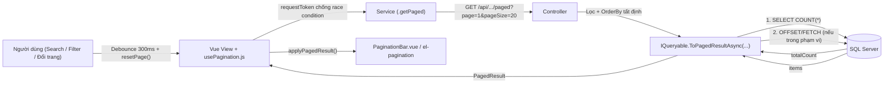

# Báo cáo Kỹ thuật & Hướng dẫn Triển khai Pagination (Hệ thống Toán Tư Duy)

Tài liệu này tổng hợp kiến trúc, danh mục thay đổi chi tiết trên Backend (ASP.NET Core 10 + Entity Framework Core + SQL Server) và Web Frontend (Vue 3 + Tailwind CSS + Element Plus), đồng thời cung cấp hướng dẫn chuẩn hóa để áp dụng kỹ thuật phân trang (Pagination) cho các module mới trong dự án **Toán Tư Duy**.

---

## Phần I. Bối cảnh & Kiến trúc Tổng thể

### 1. Vì sao cần Pagination đồng bộ?
Sau khi hệ thống được nạp bộ dữ liệu mẫu quy mô lớn (1.000+ bản ghi trên mỗi bảng bằng Bogus), việc tải toàn bộ danh sách bằng `GET /api/...` không phân trang gây ra nhiều điểm nghẽn:
- **Payload & Memory**: Trả về hàng nghìn bản ghi JSON cùng lúc (kèm nested collections như danh sách con của phụ huynh, sĩ số lớp, danh sách câu hỏi) làm phình kích thước HTTP response và tăng áp lực RAM cho cả API lẫn trình duyệt.
- **N+1 / Fan-out HTTP ở Frontend**:
  - `CourseDetailView.vue` trước đây lặp qua từng cấp độ (`courseLevels`) để gọi song song nhiều request `getByCourseLevel`.
  - `ClassDetailView.vue` trước đây gọi `parentService.getAllStudents()` ngay trong `onMounted` dù người dùng chưa mở modal thêm học viên.
  - `TeacherClassesView.vue` trước đây gọi đồng thời `classScheduleService.getByClass` và `lessonService.getByClass` cho toàn bộ lớp học cùng lúc ngay khi vào trang.
- **EF Core Cartesian Explosion / Over-fetching**: Một số truy vấn dùng `.Include(...)` thừa trước khi `.Select(...)` (ví dụ `Include(c => c.ClassStudents)` hoặc `Include(b => b.Questions)`), hoặc dùng `.Sum(x => x.Amount)` trên kiểu `int` có nguy cơ tràn `Int32` khi cộng doanh thu lớn.

Trước đợt nâng cấp này, chỉ mới có các module thông báo (`AdminNotificationsController`, `NotificationsController`, `AdminNotificationsView.vue`) và luồng chat/khóa học ở Mobile có phân trang cục bộ.

### 2. Nguyên tắc thiết kế (Design Decisions)
1. **Tương thích ngược 100% (Zero Breaking Changes)**:
   - Toàn bộ endpoint `[HttpGet]` hiện hữu (trả về mảng trực tiếp) được **giữ nguyên**, bảo đảm `Mobile_App`, các modal chọn nhanh (`CourseModal`, `ClassModal`), và `Schedule` calendar tiếp tục hoạt động bình thường.
   - Các endpoint phân trang mới được mở rộng theo quy ước hậu tố `/paged`.
2. **Đẩy lọc, tìm kiếm, sắp xếp và cắt trang xuống SQL Server (`Server-side Pagination`)**:
   - Sử dụng cặp truy vấn chuẩn `COUNT(*)` + `OFFSET ... ROWS FETCH NEXT ... ROWS ONLY` (thông qua EF Core `CountAsync` + `Skip`/`Take`).
   - Bỏ qua truy vấn lấy dữ liệu (`Skip/Take`) khi `totalCount == 0` hoặc `page` vượt ngoài phạm vi dữ liệu.
3. **Thứ tự sắp xếp tất định (Deterministic Ordering)**:
   - SQL Server yêu cầu `ORDER BY` trước `OFFSET/FETCH`. Mọi truy vấn phân trang đều kèm cột khóa duy nhất làm tie-breaker (`.ThenBy(x => x.Id)` hoặc `.ThenByDescending(x => x.Id)`) để tránh hiện tượng bản ghi trùng hoặc nhảy trang khi có nhiều dòng trùng giá trị sắp xếp (như `CreatedAt` hoặc `FullName`).
4. **Tách biệt số liệu KPI toàn bảng với lát cắt trang hiện tại**:
   - Với các màn hình có thẻ thống kê tổng hợp (`AccountSecurityView.vue`, `InvoicesView.vue`), không tính tổng bằng `.filter()` trên mảng 20 dòng của trang hiện tại; Backend trả về số liệu tổng hợp toàn hệ thống trong DTO mở rộng (`AdminAccountPagedResponse`, `AdminInvoicePagedResponse`).
5. **Phân trang Client + Lazy Enrichment có kiểm soát (nơi nghiệp vụ yêu cầu tính toán tổng hợp)**:
   - `PayrollService.GetMonthlyPayrollsPagedAsync`: Giữ nguyên transaction mức `Serializable` để tính và đồng bộ `PayrollSummary` cho toàn bộ giáo viên theo tháng/năm, sau đó lọc `keyword`/`emailStatus` và cắt trang bằng `.ToPagedResult(...)`.
   - `TeacherClassesView.vue`: Lọc và phân trang danh sách lớp được gán trước (`pageSize = 9`), chỉ gọi API lịch học/buổi học cho các lớp thuộc **trang đang hiển thị** và cache kết quả theo `classId` trong `enrichmentById`.

### 3. Sơ đồ luồng xử lý Request Pagination



---

## Phần II. Kiến trúc Code & Danh mục Chi tiết Đã Triển khai

### 1. Chuẩn DTO & Tiện ích Backend

#### a. `Backend/ToanTuDuy/DTOs/Common/PaginationDtos.cs` (namespace `ToanTuDuy.DTOs`)
- **`PaginationDefaults`**:
  - `DefaultPageSize = 20`
  - `MaxPageSize = 100`
  - `Normalize(page, pageSize, defaultPageSize = 20, maxPageSize = 100)`: Ép `page >= 1` và giới hạn `1 <= pageSize <= maxPageSize` (nếu `pageSize <= 0` sẽ rơi về `defaultPageSize`).
- **`PagedResult<T>`**:
  - `Items` (`IReadOnlyList<T>`)
  - `Page` (`int`)
  - `PageSize` (`int`)
  - `TotalCount` (`int`)
  - `TotalPages` (`int`): Bằng `0` nếu `TotalCount == 0 || PageSize <= 0`, ngược lại là `Ceiling(TotalCount / PageSize)`.
  - `HasPreviousPage` (`Page > 1`)
  - `HasNextPage` (`Page < TotalPages`)
- **`AdminAccountPagedResponse : PagedResult<AdminAccountResponse>`**:
  - Bổ sung `ActiveCount`, `BlockedCount` (tổng tài khoản hoạt động / bị khóa toàn hệ thống).
- **`AdminInvoicePagedResponse : PagedResult<AdminInvoiceResponse>`**:
  - Bổ sung `TotalAllCount`, `PaidCount`, `PendingCount`, `PaidTotalAmount` (`long`).

#### b. `Backend/ToanTuDuy/Extensions/QueryablePaginationExtensions.cs` (namespace `ToanTuDuy.Extensions`)
- **`ToPagedResultAsync<T>(this IQueryable<T> query, page, pageSize, defaultPageSize, maxPageSize, cancellationToken)`**:
  - Thực thi `CountAsync` trực tiếp trên SQL Server.
  - Nếu `totalCount == 0` hoặc `(normalizedPage - 1L) * normalizedSize >= totalCount`, trả về `Items = Array.Empty<T>()` ngay mà không tốn thêm 1 round-trip SQL.
  - Ngược lại chạy `Skip(...).Take(...).ToListAsync(...)`.
- **`ToPagedResult<T>(this IEnumerable<T> source, page, pageSize, ...)`**:
  - Dùng cho dữ liệu đã materialize sau xử lý nghiệp vụ trong bộ nhớ (ví dụ bảng lương sau khi chốt transaction).

### 2. Danh mục 12 Endpoint Backend Đã Bổ sung

| STT | Endpoint Mới | Controller & Method | Kiểu Trả về | Tham số Filter / Sort Hỗ trợ | Tối ưu Đi kèm |
| :-: | :--- | :--- | :--- | :--- | :--- |
| 1 | `GET /api/admin/accounts/paged` | `AdminAccountsController.GetAccountsPaged` | `AdminAccountPagedResponse` | `page`, `pageSize`, `keyword`, `role`, `isActive` | Đếm `ActiveCount` & `BlockedCount` trên `_context.Users.AsNoTracking()` |
| 2 | `GET /api/parents/paged` | `ParentsController.GetPaged` | `PagedResult<ParentResponseDto>` | `page`, `pageSize`, `keyword`, `isActive` | Dùng chung `BuildParentQuery`; `keyword` tìm cả tên học sinh con (`StudentProfiles`) |
| 3 | `GET /api/parents/students/paged` | `ParentsController.GetStudentsPaged` | `PagedResult<StudentResponseDto>` | `page`, `pageSize`, `keyword`, `parentAccountId` | Dùng chung `BuildStudentQuery` với `.AsNoTracking()` |
| 4 | `GET /api/teachers/paged` | `TeachersController.GetPaged` | `PagedResult<TeacherResponseDto>` | `page`, `pageSize`, `keyword`, `isActive` | Dùng chung `BuildTeacherQuery` |
| 5 | `GET /api/classes/paged` | `ClassesController.GetPaged` | `PagedResult<ClassResponse>` | `page`, `pageSize` (mặc định `12`), `keyword`, `courseId`, `courseLevelId`, `teacherId`, `status`, `capacity` (`available`/`full`/`low`), `sort` (`name_asc`, `name_desc`, `students_desc`, `date_asc`, `newest`) | Bỏ `.Include(c => c.ClassStudents)`, chuyển sang pure SQL projection `c.ClassStudents.Count(cs => cs.Status == "ACTIVE")` |
| 6 | `GET /api/classes/{id}/students/paged` | `ClassesController.GetStudentsPaged` | `PagedResult<ClassStudentResponse>` | `page`, `pageSize`, `keyword` | Dùng chung `BuildClassStudentsQuery` với `.AsNoTracking()` |
| 7 | `GET /api/admin/invoices/paged` | `InvoiceController.GetPagedForAdmin` | `AdminInvoicePagedResponse` | `page`, `pageSize`, `keyword`, `status` | 1 query `GroupBy(Status)` tính KPI toàn bảng; ép `(long)item.Amount` khi `Sum` tránh tràn `int32` |
| 8 | `GET /api/question-banks/paged` | `QuestionBanksController.GetPaged` | `PagedResult<QuestionBankResponse>` | `page`, `pageSize`, `courseId`, `keyword` | Bỏ `.Include(b => b.Questions)` thừa trước `.Select(...)` |
| 9 | `GET /api/question-banks/{bankId:int}/questions/paged` | `QuestionBanksController.GetQuestionsByBankPaged` | `PagedResult<QuestionResponse>` | `page`, `pageSize`, `difficulty`, `type`, `keyword` | Server-side tìm kiếm theo `Content` & `Answer`, check tồn tại bank bằng projection chỉ lấy `Name` |
| 10 | `GET /api/payrolls/admin/summary/paged` | `PayrollsController.GetMonthlySummaryPaged` | `PagedResult<PayslipDto>` | `month`, `year`, `page`, `pageSize`, `keyword`, `emailStatus` | Kế thừa nguyên vẹn logic upsert transactional của `GetMonthlyPayrollsAsync` rồi cắt trang bằng `.ToPagedResult()` |
| 11 | `GET /api/lessons/paged` | `LessonsController.GetPaged` | `PagedResult<LessonResponse>` | `page`, `pageSize`, `classId`, `status`, `keyword` | Dùng chung `BuildLessonQuery`, sắp xếp `LessonDate`, `StartTime`, `Id` |
| 12 | `GET /api/LeaveRequests/pending/paged` | `LeaveRequestsController.GetPendingPaged` | `PagedResult<LeaveRequestResponse>` | `page`, `pageSize` | Bỏ `.Include` thừa, chuyển sang `.AsNoTracking().Select(...)` |

> **Lưu ý về tính đồng nhất**: Mọi endpoint `[HttpGet]` gốc (không có `/paged`) vẫn được giữ nguyên tại chỗ. Riêng `AdminNotificationsController` và `NotificationsController` giữ nguyên envelope riêng (`AdminNotificationHistoryResponse`, `NotificationListResponse`) đang sử dụng ổn định cho cả Web và Mobile.

---

### 3. Thành phần Frontend Dùng chung (`Web_Frontend`)

1. **Composable `Web_Frontend/src/composables/usePagination.js`**:
   - State phản ứng: `page`, `pageSize`, `totalCount`, `totalPages`, `pageSizeOptions`, `effectiveTotalPages`, `rangeStart`, `rangeEnd`.
   - `applyPagedResult(paged)`: Đồng bộ state từ `PagedResult<T>` trả về (hỗ trợ cả `camelCase` và `PascalCase`), trả ra mảng `items`.
   - `applyClientList(allItems)`: Cắt trang trên mảng in-memory và tự kẹp `page` vào `[1, maxPage]`.
   - `resetPage()`: Đưa `page` về `1` khi đổi từ khóa tìm kiếm hoặc bộ lọc.
   - `buildParams(extra)`: Gộp `{ page, pageSize, ...extra }`.

2. **Component `Web_Frontend/src/components/common/PaginationBar.vue`**:
   - Hiển thị khoảng bản ghi (`Hiển thị 1–20 trong tổng 1000 mục`), dropdown đổi `pageSize` (`10 / 20 / 50 / 100`), nút `Trước` / `Sau`, và danh sách số trang rút gọn thông minh với dấu `...`.
   - Hỗ trợ prop `compact` cho các vùng hẹp (cột danh sách ngân hàng đề bên trái hoặc modal chọn học viên), `itemLabel`, `pageSizeOptions`, `bordered`, `showPageSize`, `disabled`.

3. **Service Layer (`Web_Frontend/src/services/*.js`)**:
   - Đã giữ nguyên các hàm `getAll()`, `getStudents()`, `getQuestions()` và bổ sung các hàm phân trang tương ứng trong:
     - `admin-account.service.js`: `getPaged`
     - `admin-invoice.service.js`: `getPaged`
     - `parent.service.js`: `getPaged`, `getStudentsPaged`
     - `teacher.service.js`: `getPaged`
     - `class.service.js`: `getPaged`, `getStudentsPaged`
     - `questionBank.service.js`: `getPaged`, `getQuestionsPaged`
     - `lesson.service.js`: `getPaged`

---

### 4. Danh sách 11 Màn hình (`Web_Frontend/src/views`) Đã Nâng cấp

| STT | View | Chế độ Phân trang | Tính năng & Tối ưu Đã Áp dụng |
| :-: | :--- | :--- | :--- |
| 1 | `views/admin/manage/AccountSecurityView.vue` | Server-side (`20/trang`) | Thêm lọc `roleFilter`, `statusFilter`, debounce search 300ms, KPI tổng từ `ActiveCount`/`BlockedCount`, `<PaginationBar />` |
| 2 | `views/admin/manage/ParentStudentView.vue` | Server-side (`20/trang`) | Debounce search 300ms (tìm cả tên phụ huynh, SĐT, email và tên học sinh con), request token chống race condition, `<PaginationBar />` |
| 3 | `views/admin/manage/TeacherManagementView.vue` | Server-side (`20/trang`) | Thêm `statusFilter` (Hoạt động/Đã khóa), debounce search 300ms, tự lùi trang nếu xóa hết dòng trang cuối, `<PaginationBar />` |
| 4 | `views/admin/finance/InvoicesView.vue` | Server-side (`20/trang`) | Lọc `statusFilter` + debounce search 300ms phía server, 4 thẻ KPI đọc từ `totalAllCount`, `paidCount`, `pendingCount`, `paidTotalAmount`, `<PaginationBar />` |
| 5 | `views/admin/finance/AdminPayrollView.vue` | Server-side (`20/trang`) | Gọi `/api/payrolls/admin/summary/paged`, thêm ô tìm kiếm giáo viên + lọc `emailStatusFilter`, dùng `<el-pagination>` của Element Plus đồng bộ UI |
| 6 | `views/admin/training/ClassesView.vue` | Server-side (`12/trang`, grid 3 cột) | Đẩy toàn bộ bộ lọc `courseId`, `status`, `capacity`, `sort` & debounced `search` xuống SQL Server, `<PaginationBar />` với `[12, 24, 48, 96]` |
| 7 | `views/admin/training/CourseDetailView.vue` | Server-side (`12/trang`) | Xóa vòng lặp gọi N request `getByCourseLevel`, thay bằng 1 request `classService.getPaged({ courseId, courseLevelId, ... })`, `<PaginationBar />` |
| 8 | `views/admin/training/ClassDetailView.vue` | Server-side trong Modal (`10/trang`) | Bỏ `loadAvailableStudents()` khỏi `onMounted`; modal thêm học viên tải theo trang via `getStudentsPaged` + debounce search 300ms + `<PaginationBar compact />` |
| 9 | `views/teacher/TeacherQuestionsView.vue` | Dual Server-side (`10` bank / `20` câu hỏi) | Phân trang độc lập cột Ngân hàng (`compact`) và cột Câu hỏi; chuyển lọc từ khóa câu hỏi xuống server; "Chọn trang này" & đánh số thứ tự liên tục theo trang |
| 10 | `views/teacher/TeacherClassesView.vue` | Client-side + Lazy Enrichment (`9/trang`) | Lọc & phân trang trước bằng `applyClientList`; chỉ fetch lịch học & buổi học cho 9 lớp thuộc trang hiện tại và lưu cache trong `enrichmentById` |
| 11 | `views/teacher/TeacherStudentsView.vue` | Server-side (`20/trang`) | Dùng `classService.getStudentsPaged`, debounce search 300ms, đánh STT theo trang; nút `Xuất danh sách (CSV)` vẫn xuất toàn bộ học sinh của lớp |

---

## Phần III. Hướng dẫn Kỹ thuật Áp dụng & Mở rộng cho Module Mới

Phần này trình bày quy chuẩn từng bước khi xây dựng màn hình danh sách mới có phân trang trong dự án.

### Bước 1: Tạo/tái sử dụng `IQueryable<TDto>` ở Backend Service

Tách query logic thành hàm `private IQueryable<TResponse> BuildXxxQuery(...)` để dùng chung giữa `GetAll` (nếu cần giữ lại) và `GetPaged`.

```csharp
private IQueryable<SampleResponse> BuildSampleQuery(string? keyword, string? status)
{
    var query = _context.Samples.AsNoTracking();

    if (!string.IsNullOrWhiteSpace(status) &&
        !status.Equals("ALL", StringComparison.OrdinalIgnoreCase))
    {
        var normalized = status.Trim().ToUpperInvariant();
        query = query.Where(x => x.Status == normalized);
    }

    if (!string.IsNullOrWhiteSpace(keyword))
    {
        var kw = keyword.Trim().ToLower();
        query = query.Where(x => x.Name.ToLower().Contains(kw));
    }

    return query
        .OrderByDescending(x => x.CreatedAt)
        .ThenByDescending(x => x.Id) // BẮT BUỘC: tie-breaker duy nhất cho SQL OFFSET/FETCH
        .Select(x => new SampleResponse
        {
            Id = x.Id,
            Name = x.Name,
            TotalChildren = x.Children.Count // EF Core tự dịch sang COUNT(*), KHÔNG dùng .Include(x => x.Children)
        });
}

public async Task<PagedResult<SampleResponse>> GetPagedAsync(
    int page,
    int pageSize,
    string? keyword = null,
    string? status = null,
    CancellationToken cancellationToken = default)
{
    return await BuildSampleQuery(keyword, status)
        .ToPagedResultAsync(page, pageSize, cancellationToken: cancellationToken);
}
```

#### Những lỗi phổ biến cần tránh ở Backend:
1. **Thiếu `OrderBy` hoặc thiếu tie-breaker duy nhất (`Id`)**: Khi nhiều bản ghi có cùng ngày tạo (`CreatedAt`), SQL Server không đảm bảo thứ tự ổn định giữa trang 1 và trang 2 -> một số dòng có thể biến mất hoặc lặp lại khi chuyển trang.
2. **Dùng `.Include(collection)` trước `.Select(...)`**: Gây JOIN thừa hoặc cảnh báo Cartesian explosion. Khi đã project sang DTO bằng `.Select(x => new Dto { ... })`, chỉ cần truy cập navigation property trực tiếp trong biểu thức `Select`.
3. **Tính tổng KPI từ `paged.Items`**: Luôn sai khi trang chỉ có 20 phần tử. Nếu UI cần các con số thống kê toàn hệ thống, hãy kế thừa `PagedResult<T>` (tương tự `AdminInvoicePagedResponse`) và thực hiện thêm 1 truy vấn `GroupBy` / `CountAsync`.
4. **Cộng tiền bằng `int` trong SQL**: Khi bảng có hàng nghìn hóa đơn, `Sum(x => x.Amount)` có thể vượt `2,147,483,647`. Luôn ép `(long)x.Amount` để EF Core sinh `SUM(CAST(... AS bigint))`.

---

### Bước 2: Khai báo Endpoint `/paged` ở Controller

```csharp
[HttpGet("paged")]
[ProducesResponseType(typeof(PagedResult<SampleResponse>), StatusCodes.Status200OK)]
public async Task<ActionResult<PagedResult<SampleResponse>>> GetPaged(
    [FromQuery] int page = 1,
    [FromQuery] int pageSize = PaginationDefaults.DefaultPageSize,
    [FromQuery] string? keyword = null,
    [FromQuery] string? status = null,
    CancellationToken cancellationToken = default)
{
    return Ok(await _sampleService.GetPagedAsync(page, pageSize, keyword, status, cancellationToken));
}
```

---

### Bước 3: Thêm hàm gọi API trong Service Frontend

```js
async getPaged({ page = 1, pageSize = 20, keyword = "", status = "" } = {}) {
  return (
    await this.api.get("/paged", {
      params: {
        page,
        pageSize,
        keyword: keyword?.trim() || undefined,
        status: status && status !== "ALL" ? status : undefined,
      },
    })
  ).data;
}
```

*Mẹo*: Truyền `undefined` cho các filter rỗng để Axios không sinh query string dư thừa (`?keyword=&status=`).

---

### Bước 4: Tích hợp vào Vue View với `usePagination` + `PaginationBar`

```vue
<template>
  <div class="overflow-hidden rounded-2xl border border-orange-100 bg-white shadow-sm">
    <!-- Bảng dữ liệu lặp trực tiếp qua items -->
    <table class="w-full text-left text-sm">
      <tbody>
        <tr v-for="(row, idx) in items" :key="row.id">
          <td>{{ (page - 1) * pageSize + idx + 1 }}</td>
          <td>{{ row.name }}</td>
        </tr>
      </tbody>
    </table>

    <PaginationBar
      v-model:page="page"
      v-model:page-size="pageSize"
      :total-count="totalCount"
      :total-pages="totalPages"
      :disabled="loading"
      item-label="bản ghi"
      @change="loadData"
    />
  </div>
</template>

<script setup>
import { onBeforeUnmount, onMounted, ref, watch } from 'vue'
import PaginationBar from '@/components/common/PaginationBar.vue'
import { usePagination } from '@/composables/usePagination'
import sampleService from '@/services/sample.service'

const { page, pageSize, totalCount, totalPages, applyPagedResult, resetPage } = usePagination({
  initialPageSize: 20,
})

const items = ref([])
const keyword = ref('')
const statusFilter = ref('ALL')
const loading = ref(false)

let searchTimer = null
let requestToken = 0

watch(keyword, () => {
  if (searchTimer) clearTimeout(searchTimer)
  searchTimer = setTimeout(() => {
    resetPage()
    loadData()
  }, 300)
})

watch(statusFilter, () => {
  resetPage()
  loadData()
})

onBeforeUnmount(() => {
  if (searchTimer) clearTimeout(searchTimer)
})

async function loadData() {
  const token = ++requestToken
  loading.value = true
  try {
    const paged = await sampleService.getPaged({
      page: page.value,
      pageSize: pageSize.value,
      keyword: keyword.value,
      status: statusFilter.value,
    })
    if (token !== requestToken) return

    const pageItems = applyPagedResult(paged)
    // Tự lùi về trang cuối hợp lệ nếu vừa xóa hết bản ghi ở trang hiện tại
    if (pageItems.length === 0 && page.value > 1 && totalPages.value > 0 && page.value > totalPages.value) {
      page.value = totalPages.value
      await loadData()
      return
    }
    items.value = pageItems
  } finally {
    if (token === requestToken) {
      loading.value = false
    }
  }
}

onMounted(loadData)
</script>
```

#### 4 quy tắc UX bắt buộc khi làm Frontend Pagination:
1. **Luôn `resetPage()` về 1 khi đổi từ khóa hoặc filter**: Tránh lỗi người dùng đang ở trang 10, gõ từ khóa chỉ có 3 kết quả -> nhận trang 10 trống trơn.
2. **Debounce ô tìm kiếm 300ms & `clearTimeout` trong `onBeforeUnmount`**: Giảm số lượng SQL query bắn lên server khi gõ nhanh và tránh memory leak.
3. **Dùng `requestToken` (monotonic counter)**: Nếu request tìm kiếm cũ phản hồi chậm hơn request mới, kết quả cũ bị hủy bỏ, không ghi đè sai lên bảng.
4. **Đánh số thứ tự (`STT`) theo công thức `(page - 1) * pageSize + index + 1`**: Không hiển thị lặp lại `#1..#20` ở mọi trang.

---

## Phần IV. Kết quả Kiểm chứng Build Thực tế

Sau lần chỉnh sửa code cuối cùng, cả Backend và Web Frontend đã được biên dịch kiểm tra trực tiếp trên máy:

1. **Backend (`ASP.NET Core 10`)**:
   - Lệnh chạy: `dotnet build Backend/ToanTuDuy/ToanTuDuy.csproj --no-restore`
   - Kết quả quan sát được: **Exit code `0`** — `0 Error(s)` (chỉ còn 125 warning có sẵn từ trước của dự án), hoàn thành trong `00:00:39.34`.
2. **Web Frontend (`Vue 3 + Vite v8.3.1`)**:
   - Lệnh chạy: `npm --prefix Web_Frontend run build` (`vite build`)
   - Kết quả quan sát được: **Exit code `0`** — `2095 modules transformed`, đóng gói thành công trong `5.92s` (`dist/index.html`, `dist/assets/index-DdIx0zL2.css`, `dist/assets/index-CJ00YB_B.js`).

> **Lưu ý kiểm thử runtime**: Kết quả trên xác minh biên dịch toàn bộ code Backend C# và bundle production Web Frontend không có lỗi cú pháp hay import. Khi triển khai lên môi trường Docker/SQL Server (`deploy.ps1` / `docker compose up --build`), nên test E2E trực tiếp trên dữ liệu Bogus 1.000 dòng tại các trang: Tài khoản, Phụ huynh & Học sinh, Giáo viên, Lớp học, Hóa đơn, Bảng lương, Ngân hàng câu hỏi và Danh sách học sinh của Giáo viên.
