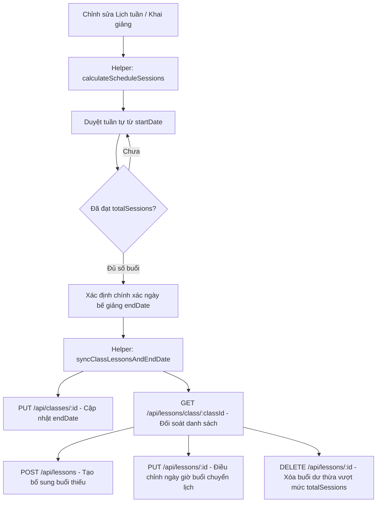

# 🎓 HỆ THỐNG TOÁN TƯ DUY — TÀI LIỆU REVIEW TOÀN DIỆN WEB FRONTEND

> **Phiên bản:** 1.0.0 (Production Ready)  
> **Framework:** Vue 3 (Composition API `<script setup>`) + Vite 8  
> **CSS & Giao diện:** Tailwind CSS v4 + Heroicons v24  
> **Kiến trúc:** Single Page Application (SPA) Đa Cổng — Admin Portal & Teacher Portal  

---

## 📌 MỤC LỤC
1. [Giới thiệu Tổng quan](#1-giới-thiệu-tổng-quan)
2. [Ngăn xếp Công nghệ (Tech Stack)](#2-ngăn-xếp-công-nghệ-tech-stack)
3. [Cấu trúc Thư mục Dự án](#3-cấu-trúc-thư-mục-dự-án)
4. [Đánh giá Chi tiết Các Module Chức năng](#4-đánh-giá-chi-tiết-các-module-chức-năng)
   - [4.1. Xác thực & Phân quyền (Auth & RBAC)](#41-xác-thực--phân-quyền-auth--rbac)
   - [4.2. Quản lý Khóa học & Cấp độ (Courses & Levels)](#42-quản-lý-khóa-học--cấp-độ-courses--levels)
   - [4.3. Quản lý Lớp học & Chi tiết Lớp (Classes & Class Details)](#43-quản-lý-lớp-học--chi-tiết-lớp-classes--class-details)
   - [4.4. Động cơ Lịch học & Thuật toán Buổi học Thông minh (Schedule & Lesson Engine)](#44-động-cơ-lịch-học--thuật-toán-buổi-học-thông-minh-schedule--lesson-engine)
   - [4.5. Quản lý Người dùng & Đối tượng (User Management)](#45-quản-lý-người-dùng--đối-tượng-user-management)
   - [4.6. Cổng Thông tin Giáo viên (Teacher Portal)](#46-cổng-thông-tin-giáo-viên-teacher-portal)
5. [Tầng Giao tiếp Dịch vụ API (API Services Layer)](#5-tầng-giao-tiếp-dịch-vụ-api-api-services-layer)
6. [Hướng dẫn Cài đặt & Vận hành (Setup & Deployment)](#6-hướng-dẫn-cài-đặt--vận-hành-setup--deployment)
7. [Đánh giá Chất lượng Mã nguồn & Khuyến nghị (Review & Recommendations)](#7-đánh-giá-chất-lượng-mã-nguồn--khuyến-nghị-review--recommendations)

---

## 1. Giới thiệu Tổng quan

Hệ thống **Web Frontend Quản trị & Giảng dạy Toán Tư Duy** là ứng dụng web hiện đại phục vụ công tác điều hành học viện đào tạo toán trí tuệ (Soroban, UCMAS, FingerMath,...). 

Ứng dụng được thiết kế phân chia thành 2 không gian làm việc chuyên biệt:
- **Cổng Quản trị viên (Admin Portal):** Quản trị danh mục khóa học, lộ trình cấp độ, lớp học, thời khóa biểu, tài khoản giáo viên, phụ huynh & học sinh.
- **Cổng Giảng viên (Teacher Portal):** Cung cấp giao diện tối ưu cho giáo viên theo dõi lịch dạy, điểm danh lớp học, giao và chấm bài tập, quản lý học sinh và gửi thông báo.

---

## 2. Ngăn xếp Công nghệ (Tech Stack)

| Hạng mục | Công nghệ sử dụng | Phiên bản | Vai trò & Mục đích |
|---|---|---|---|
| **Core Framework** | [Vue.js](https://vuejs.org/) | `^3.5.42` | Nền tảng SPA với Composition API và cú pháp `<script setup>` tối ưu hiệu năng. |
| **Build Tool** | [Vite](https://vite.dev/) | `^8.2.2` | Máy chủ phát triển HMR siêu tốc và trình đóng gói bundle tối ưu hóa. |
| **Styling** | [Tailwind CSS](https://tailwindcss.com/) | `^4.3.3` | Tiện ích CSS mới nhất với bảng màu cam - hổ phách (`orange`/`amber`) hiện đại, năng động. |
| **Routing** | [Vue Router](https://router.vuejs.org/) | `^5.3.1` | Điều hướng trang đơn, hỗ trợ middleware bảo vệ route (Navigation Guards) và phân quyền vai trò. |
| **HTTP Client** | [Axios](https://axios-http.com/) | `^1.20.0` | Xử lý request RESTful API với interceptor tự động gán Bearer Token vào Header. |
| **Icon System** | [@heroicons/vue](https://heroicons.com/) | `^2.2.0` | Thư viện vector icon sắc nét, nhẹ và đồng bộ giao diện. |

---

## 3. Cấu trúc Thư mục Dự án

```
Web_Frontend/
├── public/                     # Tài nguyên tĩnh (favicon, logo, icons)
├── src/
│   ├── assets/                 # CSS toàn cục (Tailwind directives, main.css)
│   ├── components/             # Các component tái sử dụng
│   │   ├── class/              # Component Lớp học & Buổi học
│   │   │   ├── ClassCard.vue           # Card hiển thị lớp học (Grid view)
│   │   │   ├── ClassListItem.vue       # Dòng hiển thị lớp học (List view)
│   │   │   ├── ClassModal.vue          # Modal thêm & chỉnh sửa lớp học
│   │   │   └── LessonModal.vue         # Modal thêm & chỉnh sửa từng buổi học
│   │   ├── common/             # Component tiện ích dùng chung
│   │   │   ├── EmptyState.vue          # Khung trạng thái rỗng
│   │   │   ├── LoadingSpinner.vue      # Vòng xoay trạng thái đang tải
│   │   │   ├── SearchBar.vue           # Thanh tìm kiếm với debounce
│   │   │   └── ViewToggle.vue          # Nút chuyển đổi chế độ xem Grid / List
│   │   ├── course/             # Component Khóa học & Cấp độ
│   │   │   ├── CourseCard.vue          # Thẻ khóa học hiển thị cấp độ & học phí
│   │   │   ├── CourseListItem.vue      # Dòng khóa học dạng danh sách
│   │   │   ├── CourseModal.vue         # Modal tạo mới & cập nhật khóa học
│   │   │   └── StatusBadge.vue         # Huy hiệu trạng thái tiêu chuẩn
│   │   ├── schedule/           # Component Lịch học & Thời khóa biểu
│   │   │   ├── GoogleCalendarView.vue  # Giao diện lịch học kiểu Google Calendar
│   │   │   └── ScheduleModal.vue       # Modal tạo & chỉnh sửa ca học trong tuần
│   │   ├── Header.vue          # Thanh điều hướng trên cùng (User info, chuông thông báo)
│   │   └── Sidebar.vue         # Menu thanh bên tự động đổi theo vai trò Admin / Teacher
│   ├── layouts/
│   │   └── Layout.vue          # Layout khung tổng thể (Sidebar + Header + RouterView)
│   ├── router/
│   │   └── index.js            # Khai báo tuyến đường & Navigation Guard RBAC
│   ├── services/               # Tầng giao tiếp HTTP API với backend
│   │   ├── api.service.js              # Cấu hình Axios Base Instance & Interceptor
│   │   ├── auth-storage.js             # Quản lý Token & định danh trong LocalStorage
│   │   ├── auth.service.js             # Đăng nhập, đăng xuất, lấy vai trò
│   │   ├── class.service.js            # API CRUD Lớp học (/api/classes)
│   │   ├── classSchedule.service.js    # API Lịch học theo tuần (/api/classschedules)
│   │   ├── course.service.js           # API Khóa học (/api/courses)
│   │   ├── courseLevel.service.js      # API Cấp độ khóa học (/api/courselevels)
│   │   ├── lesson.service.js           # API Buổi học chi tiết (/api/lessons)
│   │   ├── parent.service.js           # API Phụ huynh
│   │   ├── profile.service.js          # API Thông tin hồ sơ & Đổi mật khẩu
│   │   ├── scheduleSync.helper.js      # Thuật toán tính ngày kết thúc & đồng bộ buổi học
│   │   ├── student.service.js          # API Học viên
│   │   ├── teacher.service.js          # API Giáo viên
│   │   └── yeucaumuonsach.service.js   # API Yêu cầu mượn học cụ / sách
│   ├── views/                  # Các trang hiển thị chính
│   │   ├── LoginView.vue               # Trang Đăng nhập hệ thống (Admin & Teacher)
│   │   ├── PlaceholderView.vue         # Trang giữ chỗ tính năng đang hoàn thiện
│   │   ├── account/            # Quản lý tài khoản
│   │   │   ├── ProfileView.vue         # Hồ sơ cá nhân
│   │   │   └── PasswordView.vue        # Đổi mật khẩu & mã PIN
│   │   ├── admin/              # Không gian Quản trị viên
│   │   │   ├── DashboardView.vue       # Bảng điều khiển tổng quan Admin
│   │   │   ├── manage/                 # Quản lý người dùng
│   │   │   │   ├── ParentStudentView.vue   # Quản lý Phụ huynh & Học sinh
│   │   │   │   └── TeacherManagementView.vue# Quản lý Giáo viên
│   │   │   └── training/               # Quản lý Đào tạo
│   │   │       ├── CoursesView.vue         # Danh mục Khóa học
│   │   │       ├── CourseDetailView.vue    # Chi tiết Khóa học & Cấp độ
│   │   │       ├── ClassesView.vue         # Danh sách Lớp học
│   │   │       ├── ClassDetailView.vue     # Chi tiết Lớp học & Lịch học/Buổi học
│   │   │       └── ScheduleView.vue        # Thời khóa biểu toàn hệ thống
│   │   └── teacher/            # Không gian Giáo viên (Teacher Portal)
│   │       ├── TeacherDashboardView.vue    # Tổng quan công việc giáo viên
│   │       ├── TeacherScheduleView.vue     # Lịch dạy cá nhân
│   │       ├── TeacherClassesView.vue      # Lớp học đang phụ trách
│   │       ├── TeacherStudentsView.vue     # Danh sách học sinh theo lớp
│   │       ├── TeacherAttendanceView.vue   # Điểm danh học sinh từng buổi
│   │       ├── TeacherAttendanceReportView.vue # Báo cáo chuyên cần
│   │       ├── TeacherQuestionsView.vue    # Ngân hàng câu hỏi
│   │       ├── TeacherAssignmentsView.vue  # Giao bài tập về nhà
│   │       ├── TeacherGradingView.vue      # Chấm điểm & Nhận xét
│   │       ├── TeacherNoticesView.vue      # Gửi thông báo đến lớp
│   │       ├── TeacherProfileView.vue      # Hồ sơ giảng dạy
│   │       └── TeacherPasswordView.vue     # Đổi mật khẩu giáo viên
│   ├── App.vue                 # Component gốc gắn RouterView
│   └── main.js                 # Điểm khởi động ứng dụng
├── .env                        # Biến môi trường cục bộ (VITE_API_URL)
├── .env.example                # File mẫu biến môi trường
├── package.json                # Danh sách dependencies & script npm
├── vite.config.js              # Cấu hình Vite & Alias `@` -> `/src`
└── README.md                   # Tài liệu hướng dẫn & đánh giá kỹ thuật
```

---

## 4. Đánh giá Chi tiết Các Module Chức năng

### 4.1. Xác thực & Phân quyền (Auth & RBAC)
- **Cơ chế hoạt động:**
  - Trang đăng nhập duy nhất tại [`LoginView.vue`](file:///d:/ASP.NET/Hethongtoantuduy/Web_Frontend/src/views/LoginView.vue) tự động nhận diện danh tính và chuyển hướng đúng vai trò:
    - Tài khoản `Admin` ➔ Chuyển hướng về `/` (Dashboard Admin).
    - Tài khoản `Teacher` ➔ Chuyển hướng về `/teacher` (Dashboard Giáo viên).
  - Tự động lưu trữ JWT Access Token, Role và Thông tin định danh vào `localStorage` thông qua [`auth-storage.js`](file:///d:/ASP.NET/Hethongtoantuduy/Web_Frontend/src/services/auth-storage.js).
  - Trình chặn request của Axios ([`api.service.js`](file:///d:/ASP.NET/Hethongtoantuduy/Web_Frontend/src/services/api.service.js)) tự động tiêm `Authorization: Bearer <token>` vào tất cả các yêu cầu.
  - Bộ điều hướng Navigation Guard tại [`router/index.js`](file:///d:/ASP.NET/Hethongtoantuduy/Web_Frontend/src/router/index.js) kiểm soát truy cập nghiêm ngặt (`meta.requiresAuth`, `meta.adminOnly`, `meta.teacherOnly`), ngăn chặn các hành vi vượt quyền truy cập URL trái phép.

---

### 4.2. Quản lý Khóa học & Cấp độ (Courses & Levels)
- **Trang Danh mục Khóa học ([`CoursesView.vue`](file:///d:/ASP.NET/Hethongtoantuduy/Web_Frontend/src/views/admin/training/CoursesView.vue)):**
  - Hiển thị danh sách khóa học linh hoạt dưới 2 chế độ: **Lưới (Grid)** và **Danh sách (List)**.
  - Tìm kiếm toàn văn theo tên khóa, mã khóa học, nội dung mô tả; bộ lọc nâng cao theo trạng thái (`ACTIVE`, `UPCOMING`, `DRAFT`, `INACTIVE`) và khoảng học phí.
  - Tích hợp modal thêm mới khóa học trực tiếp.
- **Thẻ & Dòng khóa học ([`CourseCard.vue`](file:///d:/ASP.NET/Hethongtoantuduy/Web_Frontend/src/components/course/CourseCard.vue), [`CourseListItem.vue`](file:///d:/ASP.NET/Hethongtoantuduy/Web_Frontend/src/components/course/CourseListItem.vue)):**
  - Hiển thị ảnh bìa poster, dải màu phân biệt, độ tuổi học viên, số lượng cấp độ và mức học phí thấp nhất - cao nhất.
  - Nút **"Sửa"** nhanh cho phép mở modal chỉnh sửa trực tiếp mà không cần vào sâu trang chi tiết.
- **Trang Chi tiết Khóa học ([`CourseDetailView.vue`](file:///d:/ASP.NET/Hethongtoantuduy/Web_Frontend/src/views/admin/training/CourseDetailView.vue)):**
  - Hiển thị đầy đủ lộ trình đào tạo gồm các cấp độ con (Course Levels): Tên cấp độ, học phí, tổng số buổi học tiêu chuẩn.
  - Danh sách các lớp học trực thuộc từng cấp độ kèm bộ lọc và nút mở lớp học mới.
- **Modal Khóa học ([`CourseModal.vue`](file:///d:/ASP.NET/Hethongtoantuduy/Web_Frontend/src/components/course/CourseModal.vue)):**
  - Hỗ trợ thêm mới và chỉnh sửa đầy đủ các trường dữ liệu DTO: Mã khóa học, Tên, Độ tuổi min-max, Mô tả, Link ảnh bìa (có preview thời gian thực), Link video giới thiệu, Danh sách quyền lợi (`benefits`) động và Danh sách ảnh cơ sở vật chất động.
  - Hỗ trợ nút xóa khóa học an toàn (chặn xóa nếu khóa học đã phát sinh cấp độ).

---

### 4.3. Quản lý Lớp học & Chi tiết Lớp (Classes & Class Details)
- **Trang Danh sách Lớp học ([`ClassesView.vue`](file:///d:/ASP.NET/Hethongtoantuduy/Web_Frontend/src/views/admin/training/ClassesView.vue)):**
  - Quản lý toàn bộ các lớp học đang hoạt động trong học viện.
  - Lọc theo tình trạng sĩ số (Còn chỗ, Đã đầy $\ge 90\%$, Ít học viên $< 50\%$), lọc trạng thái và sắp xếp theo ngày khai giảng.
- **Modal Quản lý Lớp học ([`ClassModal.vue`](file:///d:/ASP.NET/Hethongtoantuduy/Web_Frontend/src/components/class/ClassModal.vue)):**
  - Lựa chọn cấp độ khóa học thông minh với danh sách gom nhóm theo Khóa học cha (`<optgroup>`), tự động hiển thị học phí và số buổi học.
  - Phân công giáo viên phụ trách từ danh sách giáo viên của hệ thống.
  - Thiết lập sĩ số tối đa, ngày khai giảng (`startDate`), ngày kết thúc (`endDate`) và trạng thái lớp.
- **Trang Chi tiết Lớp học Chuyên sâu ([`ClassDetailView.vue`](file:///d:/ASP.NET/Hethongtoantuduy/Web_Frontend/src/views/admin/training/ClassDetailView.vue)):**
  - **Banner thông tin lớp:** Hiển thị mã lớp, tên lớp, giáo viên, ngày khai giảng, ngày bế giảng chính xác, thanh thước đo % sĩ số trực quan.
  - **Khối Khóa học & Cấp độ liên kết:** Tự động truy xuất khóa học gốc để hiển thị poster, cấp độ, học phí và mục tiêu đào tạo.
  - **Hệ thống 2 Tab quản lý song song:**
    - *Tab 1: Lịch tuần cố định (`ClassSchedules`):* Hiển thị các ca học trong tuần kèm Thời khóa biểu tuần trực quan 7 cột (Thứ 2 đến Chủ nhật).
    - *Tab 2: Danh sách Buổi học cụ thể (`Lessons`):* Liệt kê chi tiết từng buổi học từ Buổi 1 đến Buổi $N$, tình trạng điểm danh, đơn xin nghỉ, buổi quan trọng và nút sửa/xóa từng buổi.

---

### 4.4. Động cơ Lịch học & Thuật toán Buổi học Thông minh (Schedule & Lesson Engine)

Đây là tính năng cốt lõi giải quyết bài toán nghiệp vụ đào tạo:



#### Chi tiết Cơ chế Hoạt động:
1. **Module Thuật toán ([`scheduleSync.helper.js`](file:///d:/ASP.NET/Hethongtoantuduy/Web_Frontend/src/services/scheduleSync.helper.js)):**
   - Hàm `calculateScheduleSessions`: Nhận vào `startDate`, danh sách ca học tuần và `totalSessions` của cấp độ khóa học (ví dụ: 24 buổi).
   - Duyệt tuần tự từ ngày khai giảng, tính toán các mốc ngày/giờ học và **dừng chính xác tại buổi thứ $N$ ($N = \text{totalSessions}$)**.
   - Trả về danh sách các slot buổi học chuẩn và ngày bế giảng chuẩn xác.
2. **Quy trình Xử lý Ngầm (Background API Sync):**
   - Tự động gọi `PUT /api/classes/{id}` để cập nhật ngày `endDate` chuẩn xác vào cơ sở dữ liệu.
   - Đối chiếu danh sách buổi học hiện tại (`/api/lessons/class/{classId}`):
     - Buổi nào còn thiếu so với `totalSessions` ➔ Gọi `POST /api/lessons` với trạng thái `SCHEDULED`.
     - Buổi nào bị dịch chuyển ngày/giờ do sửa lịch tuần ➔ Gọi `PUT /api/lessons/{id}` (bảo toàn các buổi đã `COMPLETED`).
     - Buổi học nào vượt quá `totalSessions` ➔ Gọi `DELETE /api/lessons/{id}` (đối với buổi chưa phát sinh dữ liệu điểm danh) để **đảm bảo số buổi không bao giờ vượt quá khóa học**.
3. **Modal Buổi học ([`LessonModal.vue`](file:///d:/ASP.NET/Hethongtoantuduy/Web_Frontend/src/components/class/LessonModal.vue)):**
   - Cho phép giáo viên / admin can thiệp điều chỉnh riêng lẻ một buổi học: Đổi ngày học bù, giờ học, chuyển trạng thái (`SCHEDULED`, `COMPLETED`, `CANCELLED`), hoặc tích chọn đánh dấu "Buổi học quan trọng" (thi cử, kiểm tra).

---

### 4.5. Quản lý Người dùng & Đối tượng (User Management)
- **Phụ huynh & Học sinh ([`ParentStudentView.vue`](file:///d:/ASP.NET/Hethongtoantuduy/Web_Frontend/src/views/admin/manage/ParentStudentView.vue)):** Quản lý hồ sơ gia đình, thông tin liên lạc của phụ huynh và danh sách học sinh theo từng phụ huynh.
- **Quản lý Giáo viên ([`TeacherManagementView.vue`](file:///d:/ASP.NET/Hethongtoantuduy/Web_Frontend/src/views/admin/manage/TeacherManagementView.vue)):** Quản lý tài khoản giáo viên, chuyên môn, số điện thoại, trạng thái hoạt động và phân quyền giảng dạy.

---

### 4.6. Cổng Thông tin Giáo viên (Teacher Portal)
Cổng thông tin độc lập tại tiền tố `/teacher/*`, thiết kế chuyên biệt cho tác vụ sư phạm hàng ngày:
- **Dashboard:** Thống kê nhanh số lớp đang phụ trách, lịch dạy hôm nay và việc cần làm.
- **Lịch dạy cá nhân ([`TeacherScheduleView.vue`](file:///d:/ASP.NET/Hethongtoantuduy/Web_Frontend/src/views/teacher/TeacherScheduleView.vue)):** Xem thời khóa biểu các ca dạy trong tuần.
- **Lớp học & Học sinh ([`TeacherClassesView.vue`](file:///d:/ASP.NET/Hethongtoantuduy/Web_Frontend/src/views/teacher/TeacherClassesView.vue), [`TeacherStudentsView.vue`](file:///d:/ASP.NET/Hethongtoantuduy/Web_Frontend/src/views/teacher/TeacherStudentsView.vue)):** Xem danh sách học viên từng lớp, thông tin liên hệ phụ huynh khi cần thiết.
- **Điểm danh học viên ([`TeacherAttendanceView.vue`](file:///d:/ASP.NET/Hethongtoantuduy/Web_Frontend/src/views/teacher/TeacherAttendanceView.vue)):** Giao diện điểm danh từng buổi học (Có mặt, Vắng mặt, Có phép), lưu dữ liệu trực tiếp vào hệ thống.
- **Bài tập & Chấm điểm ([`TeacherAssignmentsView.vue`](file:///d:/ASP.NET/Hethongtoantuduy/Web_Frontend/src/views/teacher/TeacherAssignmentsView.vue), [`TeacherGradingView.vue`](file:///d:/ASP.NET/Hethongtoantuduy/Web_Frontend/src/views/teacher/TeacherGradingView.vue)):** Giao bài tập về nhà và nhập nhận xét, chấm điểm cho từng học sinh.
- **Thông báo ([`TeacherNoticesView.vue`](file:///d:/ASP.NET/Hethongtoantuduy/Web_Frontend/src/views/teacher/TeacherNoticesView.vue)):** Soạn và gửi thông báo nhắc nhở đến phụ huynh và học sinh của lớp.

---

## 5. Tầng Giao tiếp Dịch vụ API (API Services Layer)

Tất cả các dịch vụ kết nối mạng được đặt tại thư mục [`src/services/`](file:///d:/ASP.NET/Hethongtoantuduy/Web_Frontend/src/services):

| Dịch vụ (Service) | Base Endpoint | Mô tả chức năng chính |
|---|---|---|
| `auth.service.js` | `/api/auth` | Đăng nhập tài khoản, giải mã quyền hạn và đăng xuất. |
| `course.service.js` | `/api/courses` | Lấy danh sách, chi tiết, thêm mới, sửa, xóa khóa học. |
| `courseLevel.service.js` | `/api/courselevels` | Lấy danh sách cấp độ theo khóa học (`/course/:id`), chi tiết cấp độ. |
| `class.service.js` | `/api/classes` | Lấy danh sách lớp, chi tiết lớp theo ID, mở lớp mới, cập nhật sĩ số/ngày kết thúc. |
| `classSchedule.service.js` | `/api/classschedules` | Quản lý ca học trong tuần của lớp (`/class/:classId`), thêm/sửa/xóa lịch. |
| `lesson.service.js` | `/api/lessons` | Quản lý từng buổi học cụ thể (`/class/:classId`), tạo, cập nhật trạng thái, xóa buổi. |
| `scheduleSync.helper.js` | *Helper nội bộ* | Động cơ tính toán thuật toán ngày kết thúc và điều phối gọi API ngầm. |
| `teacher.service.js` | `/api/teachers` | Danh sách giáo viên, hồ sơ chuyên môn, tài khoản giảng dạy. |
| `student.service.js` | `/api/students` | Quản lý học viên, thông tin lớp đang học. |
| `parent.service.js` | `/api/parents` | Quản lý phụ huynh học sinh. |
| `profile.service.js` | `/api/profile` | Thông tin người dùng hiện tại, đổi mật khẩu & mã PIN. |

---

## 6. Hướng dẫn Cài đặt & Vận hành (Setup & Deployment)

### 6.1. Yêu cầu Hệ thống
- **Node.js:** Phiên bản `>= 18.0.0` (Khuyến nghị `20.x` LTS hoặc `22.x`).
- **NPM:** Phiên bản `>= 9.0.0`.
- **Backend API:** Dịch vụ ASP.NET Core đang chạy tại cổng mặc định `http://localhost:5114`.

### 6.2. Cấu hình Môi trường
Tạo file `.env` tại thư mục gốc `Web_Frontend/`:
```env
VITE_API_URL=http://localhost:5114
```

### 6.3. Cài đặt Thư viện
```bash
npm install
```

### 6.4. Khởi chạy Môi trường Phát triển (Development)
```bash
npm run dev
```
Ứng dụng sẽ chạy tại địa chỉ: `http://localhost:5173/` (hoặc cổng hiển thị trên terminal).

### 6.5. Đóng gói Bản phát hành (Production Build)
```bash
npm run build
```
Thư mục xuất bản tĩnh được tạo tại `dist/` sẵn sàng triển khai trên Nginx, IIS, Vercel hoặc Netlify.

---

## 7. Đánh giá Chất lượng Mã nguồn & Khuyến nghị (Review & Recommendations)

### 🌟 Điểm nổi bật (Strengths)
1. **Kiến trúc rõ ràng & Đồng bộ:** Tuân thủ chuẩn mực Vue 3 SFC (`<script setup>`), phân tách tầng component, view, router và service riêng biệt.
2. **Xử lý nghiệp vụ chính xác:** Động cơ `scheduleSync.helper.js` xử lý triệt để bài toán đồng bộ giữa lịch học tuần (`ClassSchedules`), tổng số buổi học (`totalSessions`) và danh sách các buổi học thực tế (`Lessons`).
3. **Trải nghiệm người dùng (UX) cao cấp:**
   - Hỗ trợ xem linh hoạt (Grid/List, Google Calendar/Table).
   - Phản hồi thị giác thời gian thực: Loading spinners, Toast alerts, Empty states, Modal backdrop mượt mà.
   - Xem trước ảnh bìa (image preview) ngay khi nhập URL.
4. **Bảo mật phân quyền chặt chẽ:** Tách biệt rõ ràng luồng dữ liệu Admin và Teacher qua Navigation Guards.

### 💡 Khuyến nghị Nâng cấp Tương lai (Future Enhancements)
1. **Phân tách Bundle (Code Splitting / Lazy Loading):**
   - Hiện tại toàn bộ route import trực tiếp. Trong tương lai nên áp dụng `const ClassDetailView = () => import(...)` để chia nhỏ các chunk JS khi ứng dụng mở rộng.
2. **Quản lý State tập trung (Pinia):**
   - Cân nhắc tích hợp Pinia nếu cần chia sẻ trạng thái người dùng hoặc giỏ đăng ký khóa học giữa nhiều component mà không cần prop-drilling.
3. **Thông báo Thời gian thực (Real-time WebSockets):**
   - Tích hợp SignalR với Backend để tự động cập nhật trạng thái điểm danh học viên hoặc thay đổi lịch học tức thì lên màn hình của quản trị viên và giáo viên mà không cần tải lại trang.

---
*Tài liệu được khởi tạo và rà soát tự động — Hệ thống Toán Tư Duy Web Frontend.*
